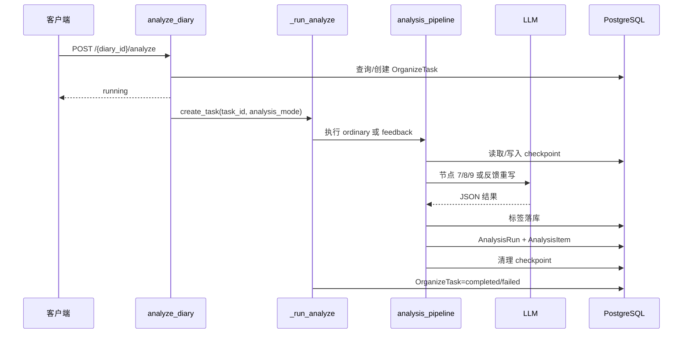

# AI 日记整理/分析业务链路日志审计

## 1. 范围

- 目标：AI 日记分析链路，包括普通分析、基于反馈的重分析、AI 节点执行、标签落库、分析结果落库和异步任务状态更新。
- 分析类型：L3 业务链级静态日志覆盖审计。
- 证据置信度：高。结论主要来自当前源代码；未执行真实 AI 调用和生产运行验证。

本报告只审计日志是否足以回答“任务走到哪里、输入是什么、调用是否成功、结果是否落库、失败后能否恢复”。不评价提示词内容、模型输出质量和数据库表设计本身。

## 2. 业务职责与入口定位

该链路负责把已经完成 AI 整理的日记，异步交给分析流水线，生成心情、事件标签、核心分析和认知分析，并保存为一轮历史分析结果。

主要入口：

1. `POST /api/diaries/{diary_id}/analyze`：创建或恢复分析任务，并启动后台协程。
2. `backend/routers/diaries.py::_run_analyze`：在独立数据库 Session 中执行普通分析或反馈重分析。
3. `backend/services/analysis_pipeline.py::run_analysis_pipeline`：执行普通分析流水线。
4. `backend/services/analysis_pipeline.py::run_feedback_reanalysis_pipeline`：执行反馈重分析流水线。

本次不覆盖 AI 整理链路 `POST /api/diaries/{diary_id}/organize`，也不覆盖对话接口。

## 3. 主流程概述

### 普通分析

1. 查询日记并校验用户、删除状态和日记状态。
2. 查询当前分析轮次和有效反馈，确定 `analysis_mode=ordinary` 或 `feedback`。
3. 检查运行中的任务；超时任务标记为失败，未超时任务直接返回。
4. 复用最近失败任务或创建新的 `OrganizeTask`。
5. 组装 `structured_diary`，启动 `_run_analyze` 后台协程。
6. 执行三个串行 LangGraph 节点：心情/标签、核心分析、认知分析。
7. 将标签写入标签表和关联表。
8. 创建 `AnalysisRun` 及分析明细，并把日记状态更新为 `analyzed`。
9. 清理 checkpoint，完成任务。

### 反馈重分析

1. 从当前有效反馈确定 `analysis_mode=feedback`。
2. `_run_analyze` 查询上一轮分析结果和反馈上下文。
3. 只执行核心分析重写和认知分析重写两个节点。
4. 合并未命中反馈的旧结果。
5. 保存新分析轮次并记录其来源轮次。
6. 清理 checkpoint，完成任务。

## 4. 逐步逻辑拆解

### 4.1 分析请求入口

- 行为：校验日记，确定分析模式，处理运行中/失败任务，创建或复用任务并启动后台协程。
- 输入：`diary_id`、当前用户、日记及其整理结果、当前分析轮次、有效反馈。
- 输出：立即返回 `OrganizeTaskResponse`。
- 副作用：更新或创建 `organize_tasks` 记录；启动 `asyncio.create_task`。
- 失败条件：日记不存在、状态不允许、没有整理结果。
- 日志现状：该方法没有正常入口、校验拒绝、任务复用、任务创建、后台启动日志。

### 4.2 后台任务包装器

- 行为：创建独立数据库 Session，根据 `analysis_mode` 调用普通或反馈流水线，最后更新任务状态。
- 输入：`task_id`、`diary_id`、`user_id`、`diary_organized_id`、结构化日记和反馈来源轮次。
- 输出：更新任务为 `completed` 或 `failed`。
- 副作用：提交任务状态；异常时保存 `error_message`。
- 失败条件：反馈任务缺少上一轮 ID、流水线异常、结果落库异常。
- 日志现状：只有一条 `error`，没有异常堆栈，也没有开始、分支、完成、状态变更和耗时日志。

### 4.3 普通分析节点

三个节点按固定顺序执行：

```text
mood_tag_extract
  -> core_analysis
  -> cognition_analysis
```

- `mood_tag_extract`：提取整体心情和事件标签。
- `core_analysis`：生成事件级和日记级核心分析、行动建议。
- `cognition_analysis`：生成认知校准、问题解答和认知完善。

当前每个节点都有开始和完成日志，包含 `diary_id`、`task_id`、事件数量或结果数量。但缺少节点耗时、模型配置、调用次数、重试次数、异常类型和恢复来源。

### 4.4 LLM 调用

- 行为：构造系统提示词和用户消息，调用 `llm.ainvoke`，解析 JSON。
- 日志现状：记录了部分或完整请求、部分或完整响应，但日志只带 `step_name`，没有 `diary_id`、`task_id`、`chain_id`、模型名、外部请求 ID、开始时间、结束时间和耗时。
- 失败条件：模型调用异常、响应不是合法 JSON。
- 日志缺口：异常直接向上传播，节点和后台任务只能看到一条泛化失败日志。

### 4.5 标签落库

- 行为：删除日记旧标签关联，按用户和名称复用或创建标签，创建事件标签和日记标签关联。
- 输出：提交数据库事务。
- 日志现状：成功只记录日记 ID 和标签数量；失败只记录异常文本。
- 日志缺口：没有记录事件数量、删除旧关联数量、创建/复用标签数量、事件标题匹配失败数量、事务开始/提交/回滚结果。

### 4.6 分析结果落库

- 行为：创建一轮 `AnalysisRun` 及其明细，设置日记状态为 `analyzed`，提交事务。
- 日志现状：成功只记录 `diary_id` 和 `task_id`；失败只记录异常文本。
- 日志缺口：没有 `analysis_run_id`、来源轮次 ID、分析明细数量、日记旧状态、新状态、事务结果和保存耗时。

### 4.7 反馈重分析

- 行为：读取上一轮结果和有效反馈，分别执行核心分析重写、认知分析重写，再合并并保存。
- 日志现状：节点内部只调用 `_update_step`，LLM 请求/响应写入 AI 日志，最终有完成日志。
- 日志缺口：没有反馈重分析开始日志、上一轮 ID、反馈数量、实际命中的分析类型、无反馈短路日志、合并结果摘要和来源轮次信息。

## 5. 完整调用链

```text
POST /api/diaries/{diary_id}/analyze
  -> analyze_diary
  -> asyncio.create_task(_run_analyze)
  -> _run_analyze
     ├─ ordinary
     │  -> ai_service.analyze_diary
     │  -> run_analysis_pipeline
     │     -> run_graph_with_checkpoint
     │        -> mood_tag_extract
     │        -> core_analysis
     │        -> cognition_analysis
     │     -> _persist_tags
     │     -> _save_analysis_result
     │     -> cleanup_checkpoint
     └─ feedback
        -> run_feedback_reanalysis_pipeline
           -> load previous AnalysisRun + effective feedback
           -> run_graph_with_checkpoint
              -> feedback_core_analysis
              -> feedback_cognition_analysis
           -> _save_analysis_result
           -> cleanup_checkpoint
  -> update OrganizeTask.status
```

## 6. 对象与字段流转

| 对象 / 字段 | 来源 | 去向 | 转换 / 状态变化 | 为什么重要 |
|---|---|---|---|---|
| `diary_id` | URL 参数 | 任务、流水线、标签和分析结果 | 全链路主业务键 | 当前日志已有，但没有统一上下文载体 |
| `task_id` | 新建或复用 `OrganizeTask.id` | LangGraph `thread_id`、任务状态、checkpoint | 失败重试时复用 | 是定位断点续跑的核心键 |
| `diary_organized_id` | `Diary.organized.id` | 分析流水线、事件查询、分析结果 | 关联结构化日记 | 当前部分完成日志有，LLM 日志没有 |
| `analysis_mode` | 当前反馈计算结果 | `_run_analyze` 分支 | `ordinary` / `feedback` | 没有入口和后台分支日志，难以判断实际路径 |
| `feedback_source_run_id` | 当前分析轮次 | 新分析轮次 | 指向上一轮结果 | 反馈重分析排查必须记录 |
| `current_step` | 任务表 | 前端状态查询 | 当前代码对分析阶段统一写为 `analysis_generating`，保存阶段写为 `saving_result` | 现有状态字段无法定位三个分析节点 |
| `AnalysisRun.id` | `_save_analysis_result` 创建 | 当前结果查询、用户反馈 | 新建一轮分析结果 | 成功日志没有记录该 ID |
| `event_tags` | `mood_tag_extract` LLM 输出 | `_persist_tags` | 按事件标题映射为事件关联 | 标题匹配失败目前无日志 |

字段流转：

```text
diary_id + diary_organized_id
  -> OrganizeTask
  -> AnalysisState
  -> LangGraph thread_id=task_id
  -> _persist_tags / _save_analysis_result
  -> AnalysisRun + AnalysisItem

当前分析轮次 + 有效反馈
  -> analysis_mode
  -> ordinary / feedback 分支
  -> feedback_source_run_id
  -> 新 AnalysisRun 的来源关系
```

## 7. 配置 / 字典 / Mapper 影响

| 类型 | Key / 资源 | 对行为的影响 | 证据 |
|---|---|---|---|
| 模型配置 | `resolve_model_setting("analysis")` | 决定分析模型、模型名和 API 地址 | `backend/services/analysis_pipeline.py:401-408`、`:462-469`、`:531-538` |
| 任务状态 | `running` / `completed` / `failed` | 决定任务复用、重试和前端状态 | `backend/models/diary.py:219-223`、`backend/routers/diaries.py:698-755` |
| 分析模式 | `ordinary` / `feedback` | 决定普通三节点或反馈两节点 | `backend/routers/diaries.py:689-696`、`:814-835` |
| LangGraph checkpoint | `thread_id=task_id` | 决定从已完成结果复用或从中断节点恢复 | `backend/services/pipeline.py:129-143` |
| 任务超时 | 15 分钟 | 运行中任务超过阈值后被标记失败 | `backend/routers/diaries.py:710-715` |

## 8. 异常处理与边界条件

| 场景 | 当前行为 | 日志问题 | 证据 | 置信度 |
|---|---|---|---|---|
| 日记不存在或状态不允许 | 直接抛出 HTTP 异常 | 没有拒绝原因日志、用户和日记上下文 | `diaries.py:666-687` | 已验证 |
| 已有未超时运行任务 | 直接返回现有任务状态 | 没有记录“重复触发/复用任务” | `diaries.py:698-723` | 已验证 |
| 运行任务超过 15 分钟 | 标记失败后继续创建或复用任务 | 没有记录旧任务 ID、创建时间和超时判定 | `diaries.py:710-715` | 已验证 |
| LLM 调用失败 | 异常传播到后台包装器 | 只记录异常文本，不记录堆栈、节点、模型和耗时 | `pipeline.py:114-126`、`diaries.py:844-851` | 已验证 |
| LLM 返回非法 JSON | `json.loads` 抛错 | 没有原始响应长度、解析位置和节点上下文 | `pipeline.py:123-126` | 已验证 |
| checkpoint 已有完整结果 | 直接复用结果 | 没有记录“复用完整 checkpoint” | `pipeline.py:137-143` | 已验证 |
| checkpoint 从中断节点恢复 | 继续执行 | 没有记录恢复节点和恢复原因 | `pipeline.py:141-143` | 已验证 |
| 标签落库失败 | 回滚并由上层吞掉，分析结果继续保存 | 记录为普通错误，缺少回滚和影响范围 | `analysis_pipeline.py:668-790`、`:1088-1093` | 已验证 |
| 分析结果保存失败 | 回滚并向上抛出 | 只有异常文本，没有事务上下文和分析轮次 ID | `analysis_pipeline.py:797-831` | 已验证 |
| checkpoint 清理失败 | 保留 checkpoint，分析结果不回滚 | 已记录 warning，但没有明确后续恢复入口信息 | `analysis_pipeline.py:1101-1106` | 已验证 |
| 反馈没有可用反馈 | 抛出 `ValueError` | 没有记录上一轮 ID和反馈数量 | `analysis_pipeline.py:1145-1147` | 已验证 |

## 9. 图示

### 9.1 主流程图

```text
[POST analyze]
      |
      v
[校验日记与整理结果]
      |
      v
[计算有效反馈]
      |
      +--> [ordinary] --> [节点7] --> [节点8] --> [节点9]
      |                                      |
      |                                      v
      |                                [标签落库]
      |                                      |
      |                                      v
      |                                [分析结果落库]
      |
      +--> [feedback] --> [核心重写] --> [认知重写]
                                             |
                                             v
                                       [分析结果落库]
                                             |
                                             v
                                      [清理 checkpoint]
```

图中当前缺失日志的关键边界：入口决策、分支选择、checkpoint 恢复、每次模型调用、事务提交和任务最终状态。

### 9.2 时序图



### 9.3 对象 / 字段流转图

```text
HTTP diary_id
  -> OrganizeTask.id = task_id
  -> LangGraph thread_id
  -> AnalysisState.task_id
  -> AnalysisRun.task_id

DiaryOrganized.id
  -> diary_organized_id
  -> DiaryEvent 查询
  -> AnalysisRun.diary_organized_id

有效反馈
  -> analysis_mode=feedback
  -> previous_run_id / feedback_source_run_id
  -> 新分析轮次的来源关系
```

### 9.4 状态机图

```text
不存在
  -> running
  -> completed

running --超过15分钟--> failed
failed --再次触发--> running
running --任意未处理异常--> failed

DiaryStatus:
organized -> analyzed
analyzed  -> analyzed（重新分析）
```

## 10. 已验证结论

1. 普通分析的三个主要 AI 节点均有开始和完成日志，已经能确认节点顺序和部分结果数量。
2. `task_id` 同时作为任务主键和 LangGraph `thread_id`，是当前最重要的断点定位键。
3. 后台分析失败日志使用 `logger.error("后台分析任务失败: %s", e)`，没有使用 `logger.exception`，因此该日志不能直接提供完整堆栈。
4. `run_graph_with_checkpoint` 对“完整结果复用”和“中断恢复”都没有日志，断点续跑行为无法从应用日志确认。
5. LLM 日志没有携带 `diary_id` 和 `task_id`，不能仅靠 AI 日志把模型请求精确关联到一次日记分析任务。
6. 分析任务入口没有记录任务创建、失败任务复用、运行任务复用、超时终止和后台协程启动。
7. `current_step` 对分析任务只写入 `analysis_generating` 和 `saving_result`，无法反映当前处于心情标签、核心分析还是认知分析节点。
8. 标签落库失败会被记录后继续保存分析结果，这是代码明确实现的“标签失败不阻断分析结果”行为；日志应明确记录该降级结果。
9. 反馈重分析有最终完成日志，但缺少开始、来源轮次、反馈数量、命中类型和中间节点日志。
10. 现有 `ai_pipeline` logger 自行添加文件 Handler，同时继续向 root logger 传播；当前配置下同一日志可能同时进入专用 AI 文件和 root Handler 管理的输出，日志归属需要统一。

## 11. 推断性结论

1. 仅凭当前应用日志，无法可靠回答一次分析失败发生在“模型调用、JSON 解析、checkpoint、标签事务还是分析结果事务”，因为这些边界没有统一的失败事件日志。
2. 当任务从 checkpoint 恢复时，现有日志很可能表现为从某个节点重新出现“开始”日志，但无法证明它是首次执行还是恢复执行。
3. 反馈重分析出现结果不符合预期时，仅凭当前日志难以复原“上一轮结果、反馈数量、实际命中的分析类型和合并结果”这四个关键输入。

以上结论是对日志可观测性的判断，不代表这些运行时场景已经在生产发生。

## 12. 待确认项

1. 问题：实际运行时 `ai_pipeline` 日志是否出现重复写入？
   - 当前证据：`pipeline.py:34-42` 添加专用 Handler，且 logger 未关闭向 root 的传播；`main.py:39-42` 为 root 添加两个 Handler。
   - 为什么未确认：需要读取实际生成的日志文件或运行一次任务。
   - 下一步建议：执行一次普通分析，按同一时间、同一步骤比对 `app_*.log` 和 `ai_*.log`。
   - 影响：重复日志会增加噪声，但不影响业务结果。

2. 问题：LLM 客户端实际返回的外部请求 ID 和重试次数是否可从 `response` 对象取得？
   - 当前证据：当前代码只读取 `response.content`，没有读取响应元数据。
   - 为什么未确认：第三方客户端和具体模型网关的运行时响应结构未在当前代码中定义。
   - 下一步建议：在一次受控调用中检查 `response` 的元数据字段，并确定可记录的请求 ID。
   - 影响：决定模型调用日志能否关联到上游服务端日志。

3. 问题：LangGraph checkpoint 记录的实际恢复节点名称是什么？
   - 当前证据：代码根据 `snapshot.values` 和 `snapshot.next` 选择复用或恢复，但没有输出 `snapshot.next`。
   - 为什么未确认：需要真实中断并再次执行，静态代码无法证明 checkpoint 内容。
   - 下一步建议：模拟一个节点失败，再次触发同一失败任务并记录恢复信息。
   - 影响：决定断点续跑日志应记录节点名还是仅记录恢复状态。

## 13. 证据索引

| 证据类型 | 路径 | 定位 | 支撑内容 |
|---|---|---|---|
| code | `backend/routers/diaries.py` | `659-797` | 分析入口、模式判断、任务创建和后台启动 |
| code | `backend/routers/diaries.py` | `800-853` | 后台执行、任务完成/失败处理 |
| code | `backend/services/analysis_pipeline.py` | `387-583` | 普通分析三个节点及现有日志 |
| code | `backend/services/analysis_pipeline.py` | `586-661` | 反馈重分析节点 |
| code | `backend/services/analysis_pipeline.py` | `668-790` | 标签处理和标签落库 |
| code | `backend/services/analysis_pipeline.py` | `797-831` | 分析结果保存和日记状态更新 |
| code | `backend/services/analysis_pipeline.py` | `1028-1116` | 普通分析流水线、checkpoint、标签和结果流程 |
| code | `backend/services/analysis_pipeline.py` | `1119-1210` | 反馈重分析流水线 |
| code | `backend/services/pipeline.py` | `84-143` | 模型创建、LLM 调用和 checkpoint 恢复逻辑 |
| code | `backend/models/diary.py` | `83-145`、`211-225` | 分析轮次、反馈和任务字段 |
| code | `backend/tests/test_analysis_prompt_rules.py` | `13-59` | 分析提示词规则测试，未覆盖日志行为 |

## 14. 建议的下一步核查

按优先级补齐日志，不建议先改日志格式：

### P0：先补链路闭环

1. 在分析入口生成并传递 `chain_id`，记录 `diary_id`、`task_id`、`analysis_mode`、`feedback_source_run_id`。
2. 在 `_run_analyze` 记录后台开始、分支、成功和失败；失败使用完整异常堆栈。
3. 在 `_invoke_llm` 记录节点开始、模型调用结束、耗时、异常、重试和 JSON 解析失败。
4. 在 checkpoint 逻辑记录首次执行、从哪个节点恢复、完整结果复用和恢复完成。

### P1：补业务结果证据

1. 将 `current_step` 从统一的 `analysis_generating` 改为三个真实节点名；反馈分析也记录两个真实节点名。
2. 记录标签落库的输入数量、删除数量、创建/复用数量、匹配失败数量和事务结果。
3. 记录 `analysis_run_id`、来源轮次 ID、分析明细数量、旧状态和新状态。
4. 记录反馈重分析的反馈数量、命中分析类型和合并结果数量。

### P2：补操作入口和日志归属

1. 记录重复触发、任务复用、超时终止、失败任务重启和状态查询异常。
2. 记录分析反馈保存/更新事件。
3. 统一 `ai_pipeline` 的 Handler 和 root Handler，明确 AI 日志是否双写，避免同一事件无法判断来源。

### 推荐的最小事件集合

```text
analysis.request.accepted
analysis.task.reused
analysis.task.created
analysis.task.started
analysis.branch.selected
analysis.node.started
analysis.llm.called
analysis.node.completed
analysis.checkpoint.reused
analysis.checkpoint.resumed
analysis.tags.persisted
analysis.result.persisted
analysis.checkpoint.cleaned
analysis.task.completed
analysis.task.failed
```

