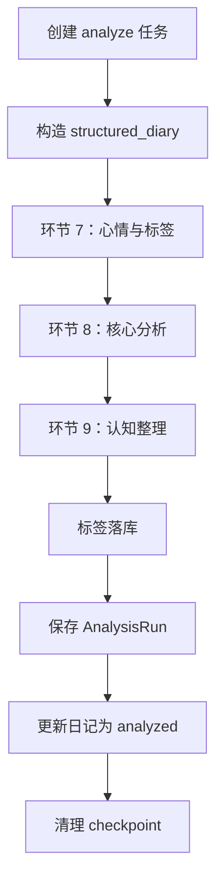
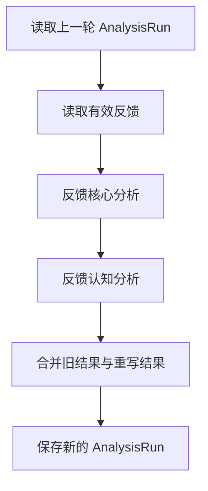

# 分析流水线方案细则

> 本文描述当前代码中的分析设计与运行机制。代码是事实来源；本文不描述尚未实现的目标功能。

## 1. 范围与职责

分析流水线处理已经完成结构化整理的日记，输出心情、标签、自我理解、行为分析、行动建议、认知校准、问题解答和认知完善。

日记完整链路分为两类流水线：

1. 整理流水线：把原始文本转换为结构化日记。实现位于 `backend/services/pipeline.py`，不属于本文的分析环节，但它是分析流水线的前置依赖。
2. 分析流水线：基于结构化日记生成分析结果。实现位于 `backend/services/analysis_pipeline.py`。

分析流水线包含两种运行模式：

| 模式 | 入口 | 作用 |
|---|---|---|
| 普通分析 | `AIService.analyze_diary` → `run_analysis_pipeline` | 生成一轮完整分析 |
| 反馈重分析 | `run_feedback_reanalysis_pipeline` | 根据低评分文字反馈重写相关分析，不重复生成无关内容 |

## 2. 核心业务流程总览

本节是分析任务的唯一业务总览。后续章节分别解释数据结构、Prompt 和代码实现，不重新定义流水线选择与任务恢复规则。

### 2.1 进入分析接口

用户调用 `POST /api/diaries/{diary_id}/analyze` 时，后端按以下顺序处理：

1. 校验日记存在且属于当前用户。
2. 日记状态必须为 `organized` 或 `analyzed`。
3. 必须存在 `diary_organized`，否则不能分析。
4. 获取当前有效的 `AnalysisRun` 和有效文字反馈。
5. 根据当前有效反馈选择流水线，并在任务创建时固定 `analysis_mode`。

### 2.2 流水线选择规则

```text
当前分析结果存在有效文字反馈？
├─ 否 → analysis_mode=ordinary → 普通分析流水线
└─ 是 → analysis_mode=feedback → 反馈重分析流水线
```

具体规则：

| 条件 | 选择 | 输入的上一轮结果 |
|---|---|---|
| 没有当前分析结果，或当前分析没有有效反馈 | 普通分析 | 无 |
| 当前分析存在有效低评分文字反馈 | 反馈重分析 | 当前 `AnalysisRun` |

普通分析生成完整的环节 7、8、9 结果；反馈重分析只重写反馈命中的分析类型，并继承其他类型的上一轮结果。

### 2.3 任务创建、复用与并发控制

每次请求都先检查同一日记是否存在 `running` 的分析任务：

```text
存在未超时 running 任务 → 返回该任务状态，不重复创建
存在超过 15 分钟的 running 任务 → 标记 failed，继续处理本次请求
不存在 running 任务 → 查找同 analysis_mode 的 failed 任务
```

对 `failed` 任务：

- 找到同一日记、同一用户、同一 `analysis_mode` 的失败任务：复用原 `task_id`，恢复执行。
- 找不到：创建新的 `OrganizeTask`，状态为 `running`。
- 复用失败任务时不重置 `current_step`，保留实际失败位置。

`task_id` 同时作为 LangGraph 的 `thread_id`，因此任务记录和 checkpoint 是一一对应的。

### 2.4 后台执行与三条流程

任务接口只负责创建或复用任务，并通过 `asyncio.create_task` 启动后台执行：

```text
analysis_mode=ordinary
    → AIService.analyze_diary
    → run_analysis_pipeline
    → 环节 7 → 环节 8 → 环节 9

analysis_mode=feedback
    → run_feedback_reanalysis_pipeline
    → 反馈核心分析 → 反馈认知分析
```

整理流水线不是分析模式之一。它先将 `saved` 日记整理为 `organized`，分析接口只接收已经完成整理的日记。

### 2.5 失败后的断点继续

节点失败时，后台任务执行以下操作：

1. 捕获异常。
2. 将 `OrganizeTask.status` 更新为 `failed`。
3. 写入 `error_message`。
4. 保留 PostgreSQL checkpoint。
5. 用户再次调用分析接口时，复用原 `task_id`。

恢复逻辑：

```text
读取 task_id 对应 checkpoint
├─ 没有 checkpoint
│  └─ 使用初始输入，从第一节点开始
├─ checkpoint.next 非空
│  └─ 使用 ainvoke(None)，从最近一次成功节点继续
└─ 有完整 values 且 next 为空
   └─ 直接复用完整结果，不再次调用模型
```

因此：

- 普通分析在环节 8 失败，重试从环节 8 继续。
- 普通分析在环节 9 失败，重试从环节 9 继续。
- 反馈重分析在反馈认知分析失败，重试从反馈认知分析继续。
- 三条流水线都使用 `run_graph_with_checkpoint`，不存在各自实现不一致的问题。

### 2.6 成功、落库与 checkpoint 清理

```text
流水线完成
→ 标签落库（普通分析）
→ 保存 AnalysisRun
→ 更新日记/任务状态
→ 清理 checkpoint
→ 返回 completed
```

业务结果保存成功后，checkpoint 清理失败只记录警告，不再把任务改成失败。这样不会因为清理故障触发重复模型调用。

### 2.7 反馈内容变化的核心边界

反馈重分析任务一旦开始，`feedback_context`、`previous_state` 和 `previous_run_id` 就被写入该任务的 checkpoint。

> 如果反馈重分析失败后，用户修改了反馈内容，再次点击分析，当前系统仍会沿用旧 checkpoint 中的反馈上下文继续执行，而不会自动切换到最新反馈。

这是当前已知限制，不是正常的“最新反馈重分析”行为。后续必须增加反馈输入版本校验：

```text
当前反馈版本 == checkpoint 版本 → 继续 checkpoint
当前反馈版本 != checkpoint 版本 → 删除旧 checkpoint，重新创建/启动任务
无法确认版本 → 禁止静默恢复，提示重新发起反馈分析
```

## 3. 运行前提与输入

### 3.1 前置状态

普通分析要求日记已经存在 `diary_organized` 和 `diary_events`，日记状态通常为 `organized`。分析完成后，日记状态更新为 `analyzed`。

反馈重分析要求存在上一轮 `AnalysisRun`，并且存在可用的低评分文字反馈。

### 3.2 `structured_diary`

分析路由从 `diary_organized` 和 `diary_events` 组装输入：

```json
{
  "introduction": "引入段",
  "events": [
    {
      "title": "事件标题",
      "body": ["事件正文段落"],
      "feeling": ["感受"],
      "reflection": ["反思与成长"]
    }
  ],
  "trivia": ["琐事"],
  "plans": ["后续计划"]
}
```

分析环节 7、8、9 的 LLM 输入主要使用 `structured_diary.events`；完整原始文本保留在流水线状态中，用于日志和后续扩展。

### 3.3 任务记录

所有异步任务使用 `organize_tasks`：

| 字段 | 当前含义 |
|---|---|
| `id` | 任务 ID，同时作为 LangGraph `thread_id` |
| `task_type` | `organize` 或 `analyze` |
| `analysis_mode` | 分析任务为 `ordinary` 或 `feedback` |
| `status` | `running`、`completed`、`failed` |
| `current_step` | 当前节点对应的业务步骤 |
| `error_message` | 最后一次失败信息 |

## 4. 普通分析流水线

### 4.1 流程



图节点定义：

```python
builder.add_node("mood_tag_extract", mood_tag_extract)
builder.add_node("core_analysis", core_analysis)
builder.add_node("cognition_analysis", cognition_analysis)
```

执行顺序固定为：

```text
START → mood_tag_extract → core_analysis → cognition_analysis → END
```

### 4.2 环节 7：心情与事件标签

实现：`mood_tag_extract`。

输入：`structured_diary`。

输出：

```json
{
  "mood": "今日整体心情",
  "event_tags": [
    {
      "title": "事件标题",
      "tags": {
        "domain": [],
        "topic": [],
        "person_object": [],
        "psychological": [],
        "knowledge": []
      }
    }
  ]
}
```

代码会对输出做容错：非列表标签转为空列表；五类标签始终保留为空列表或字符串列表。

标签类别：

| 类别 | 含义 |
|---|---|
| `domain` | 工作、生活、学习等领域 |
| `topic` | 事件主题 |
| `person_object` | 人物或对象 |
| `psychological` | 心理和情绪相关标签 |
| `knowledge` | 知识、方法或技术点 |

### 4.3 环节 8：核心分析

实现：`core_analysis`。

输出分为事件级和日记级：

```json
{
  "event_analyses": [
    {
      "title": "事件标题",
      "emotion_analyses": [],
      "behavior_decision_analyses": [],
      "self_understanding_analyses": [],
      "action_suggestions": []
    }
  ],
  "diary_analysis": {
    "emotion_analyses": [],
    "behavior_decision_analyses": [],
    "self_understanding_analyses": [],
    "action_suggestions": []
  }
}
```

四类分析职责：

| 类型 | 回答的问题 |
|---|---|
| `emotion_analyses` | 情绪是什么、由什么触发、如何理解 |
| `behavior_decision_analyses` | 做了什么、为何这样做、决策模式是什么 |
| `self_understanding_analyses` | 真正在意什么、需要什么、如何理解自己 |
| `action_suggestions` | 下一步可以采取什么具体行动 |

核心红线：

- 只使用输入中的事实和明确线索。
- 不编造事件、动机、情绪或结论。
- 不把事件复述当成分析。
- 不把认知校准写成行动建议。
- 信息不足时不得强行完成心理解释。

### 4.4 环节 9：认知整理

实现：`cognition_analysis`。

输出分为：

```json
{
  "event_cognitive_calibration_analyses": [],
  "diary_cognitive_calibration_analyses": [],
  "event_question_answers": [],
  "event_cognitive_enhancements": [],
  "diary_cognitive_enhancements": []
}
```

三类职责：

| 类型 | 职责 |
|---|---|
| `cognitive_calibration_analyses` | 判断用户对事实、因果、他人、自己或知识的理解是否存在明显偏差 |
| `question_answers` | 回答日记中提出的具体问题 |
| `cognitive_enhancements` | 补充背景、框架、方法或知识体系，帮助用户形成更完整理解 |

认知校准只回答“理解是否准确”，不输出“下一步应该怎么做”；行动建议只属于环节 8。

## 5. 反馈重分析流水线

### 5.1 目的

用户对某个分析区块给出低评分文字反馈后，系统只重写受反馈影响的分析类型，并继承未被反馈影响的内容。

### 5.2 流程



执行顺序：

```text
START → feedback_core_analysis → feedback_cognition_analysis → END
```

### 5.3 合并规则

`_merge_feedback_core` 只重写以下核心类型：

- `EMOTION`
- `BEHAVIOR_DECISION`
- `SELF_UNDERSTANDING`
- `ACTION_SUGGESTION`

`_merge_feedback_cognition` 只重写以下认知类型：

- `COGNITIVE_CALIBRATION`
- `QUESTION_ANSWER`
- `COGNITIVE_ENHANCEMENT`

没有反馈目标的分析类型保留上一轮结果。

## 6. Prompt 设计

### 6.1 普通分析 Prompt

代码位置：`backend/services/analysis_pipeline.py`。

| Prompt | 对应节点 | 主要约束 |
|---|---|---|
| `MOOD_TAG_PROMPT` | `mood_tag_extract` | 从结构化事件提取整体心情和五类事件标签 |
| `CORE_ANALYSIS_RULES` + `CORE_ANALYSIS_OUTPUT_SCHEMA` | `core_analysis` | 输出情绪、行为决策、自我理解、行动建议，区分事件级和日记级 |
| `COGNITION_ANALYSIS_RULES` + `COGNITION_ANALYSIS_OUTPUT_SCHEMA` | `cognition_analysis` | 输出认知校准、问题解答、认知完善，禁止与行动建议混淆 |

所有分析调用要求 JSON 输出；`_invoke_llm` 负责调用模型并执行 `json.loads`，节点函数负责字段容错和结构归一化。

### 6.2 反馈分析 Prompt

| Prompt | 对应节点 | 输入 |
|---|---|---|
| `FEEDBACK_CORE_ANALYSIS_PROMPT` | `feedback_core_analysis` | 结构化日记、上一轮核心分析、核心类型反馈 |
| `FEEDBACK_COGNITION_ANALYSIS_PROMPT` | `feedback_cognition_analysis` | 结构化日记、上一轮认知分析、认知类型反馈 |

反馈 Prompt 的目标不是重新分析全文，而是针对反馈目标重写对应区块。

### 6.3 模型调用配置

普通分析和反馈分析都通过 `pipeline._get_llm()` 创建 `ChatDeepSeek`：

```python
{
    "model": settings.LLM_MODEL,
    "temperature": temperature,
    "timeout": 120,
    "max_retries": 2,
    "model_kwargs": {"response_format": {"type": "json_object"}}
}
```

超时时间和重试次数是单次模型调用配置，不是整条流水线总时长配置。

## 7. 实现细节：断点续跑机制

### 7.1 Checkpoint 绑定

每个异步任务的 `task.id` 同时作为 LangGraph 的 `thread_id`：

```python
config = {"configurable": {"thread_id": task_id}}
```

任务失败后，接口复用原失败任务，不创建新任务，也不重置 `current_step`。

### 7.2 统一恢复逻辑

实现：`pipeline.run_graph_with_checkpoint`。

```python
snapshot = await graph.aget_state(config)

if snapshot.values and not snapshot.next:
    return dict(snapshot.values)
if snapshot.next:
    return dict(await graph.ainvoke(None, config=config))
return dict(await graph.ainvoke(initial_state, config=config))
```

三种状态：

| checkpoint 状态 | 行为 |
|---|---|
| 不存在 | 使用初始输入，从第一节点开始 |
| `next` 非空 | 使用 `ainvoke(None)`，从最近一次成功节点继续 |
| 有完整 `values` 且 `next` 为空 | 直接复用完整结果，避免再次调用模型 |

该方法已经接入：

- `run_pipeline`：整理流水线
- `run_analysis_pipeline`：普通分析流水线
- `run_feedback_reanalysis_pipeline`：反馈重分析流水线

### 7.3 Checkpoint 清理

只有业务结果保存成功后才清理 checkpoint。清理失败只记录警告，不把已经完成的业务任务重新标记为失败。

## 8. 实现细节：反馈 checkpoint 的输入版本边界

> **当前已知限制：反馈重分析失败后，如果用户修改了反馈内容，系统仍会沿用旧 checkpoint 中的 `feedback_context`、`previous_state` 和相关输入继续执行。**

原因：

1. 失败重试复用原 `task_id`。
2. 原 `task_id` 对应的 checkpoint 已经保存旧输入。
3. `run_graph_with_checkpoint` 发现 `snapshot.next` 非空后调用 `graph.ainvoke(None)`。
4. 本次重试传入的新 `initial_state` 不会覆盖旧 checkpoint 状态。

因此，当前“重试”语义是：继续原任务；不是基于最新反馈重新创建任务。

### 8.1 正确处理方案

后续实现必须在反馈任务恢复前比较输入版本，至少包括：

- `previous_run_id`
- 反馈记录版本或反馈内容摘要
- 反馈目标集合

处理规则：

| 输入版本 | 处理 |
|---|---|
| 与 checkpoint 一致 | 从 checkpoint 继续 |
| 与 checkpoint 不一致 | 删除旧 checkpoint，创建新任务或从第一节点重新执行 |
| 无法确认版本 | 禁止静默恢复，提示用户重新发起反馈分析 |

建议将版本摘要写入任务记录或 checkpoint 的初始状态，避免只依赖内存中的路由参数。

## 9. 任务状态与进度

### 9.1 普通分析步骤

| `current_step` | 业务含义 |
|---|---|
| `analysis_generating` | 正在执行环节 7、8 或 9 |
| `saving_result` | 正在保存分析结果 |
| `null` | 任务完成 |

### 9.2 整理步骤

整理流水线使用：

```text
text_cleaning → clean_checking → event_organizing
→ structuring → content_checking → metadata_extracting
```

节点开始时通过 `_update_step()` 更新数据库；失败后保留最后记录的步骤，重试接口返回该步骤。

## 10. 结果存储

### 10.1 分析运行记录

分析结果写入 `AnalysisRun` 及其关联分析区块。每次普通分析或反馈重分析产生一轮分析结果，当前结果通过状态标记区分。

结果按以下范围保存：

- 日记级分析：心情、日记级核心分析、日记级认知分析
- 事件级分析：事件标题、事件级核心分析、事件级认知分析
- 标签：写入标签表及日记/事件关联表

### 10.2 重新分析

普通重新分析会创建或更新一轮完整分析；反馈重分析基于上一轮结果合并生成新一轮结果。分析结果保存成功后，任务状态更新为 `completed`。

## 11. 错误处理

### 11.1 模型调用失败

`ChatDeepSeek` 单次调用超时或重试失败后，异常由后台任务捕获并写入 `organize_tasks.error_message`。checkpoint 保留，用户再次调用接口时复用原任务 ID 并恢复执行。

### 11.2 JSON 解析失败

`_invoke_llm` 对模型响应执行 JSON 解析；解析失败会使当前节点失败，并触发 checkpoint 恢复流程。

### 11.3 结果保存失败

如果节点已经完成但结果落库失败，完整 checkpoint 会保留；再次执行时直接复用完整状态，避免重复调用模型。

## 12. Prompt 局限性与改进方向

### 12.1 当前局限

1. Prompt 依赖“不要编造、不要过度推断”等负向约束，缺少足够的正反例。
2. 分析字段之间存在边界重叠，尤其是自我理解、认知校准和行动建议。
3. 事件标题匹配依赖模型输出标题与结构化事件标题一致；标题变化会影响事件级标签和分析映射。
4. 输出长度主要依赖 Prompt 约束，没有独立的长度校验和截断策略。
5. 反馈 checkpoint 暂无输入版本校验，修改反馈后可能继续旧反馈上下文。

### 12.2 改进优先级

| 优先级 | 改进项 |
|---|---|
| P0 | 增加反馈输入版本摘要，恢复前校验版本一致性 |
| P1 | 为核心分析、认知分析增加可执行的正反例 |
| P1 | 使用稳定事件 ID 代替事件标题作为跨环节匹配键 |
| P2 | 增加输出结构、数量和长度校验 |
| P2 | 将模型超时、重试次数和单任务总超时配置化 |

## 13. 代码索引

| 功能 | 文件与入口 |
|---|---|
| 整理流水线 | `backend/services/pipeline.py:run_pipeline` |
| 普通分析 | `backend/services/analysis_pipeline.py:run_analysis_pipeline` |
| 反馈重分析 | `backend/services/analysis_pipeline.py:run_feedback_reanalysis_pipeline` |
| 统一 checkpoint 恢复 | `backend/services/pipeline.py:run_graph_with_checkpoint` |
| 普通分析接口 | `backend/routers/diaries.py:analyze_diary` |
| 整理接口 | `backend/routers/diaries.py:organize_diary` |
| LLM 配置 | `backend/services/pipeline.py:_get_llm`、`backend/config.py` |
| 结果读取与组装 | `backend/services/analysis_history.py`、`backend/routers/diaries.py` |

## 附录：当前分析结果结构

```json
{
  "mood": "",
  "event_tags": [],
  "event_analyses": [],
  "diary_analysis": {
    "emotion_analyses": [],
    "behavior_decision_analyses": [],
    "self_understanding_analyses": [],
    "action_suggestions": []
  },
  "event_cognitive_calibration_analyses": [],
  "diary_cognitive_calibration_analyses": [],
  "event_question_answers": [],
  "event_cognitive_enhancements": [],
  "diary_cognitive_enhancements": []
}
```
