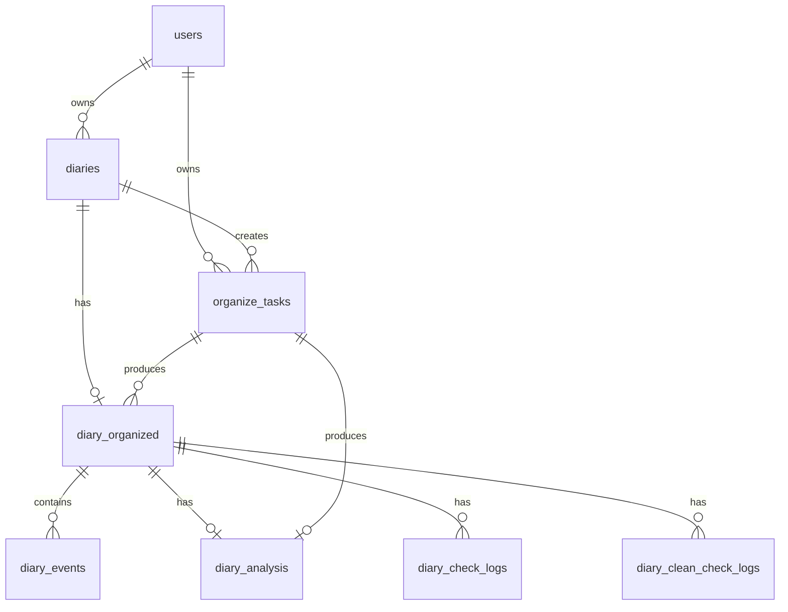
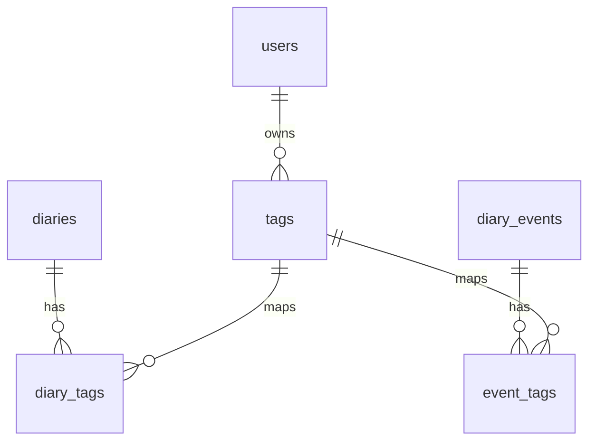
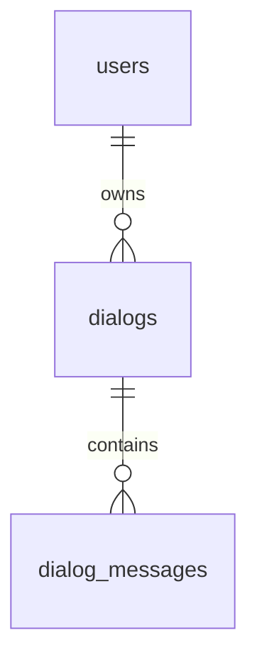
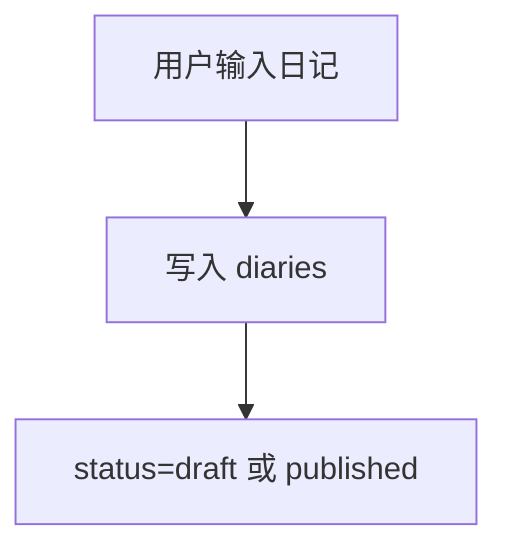
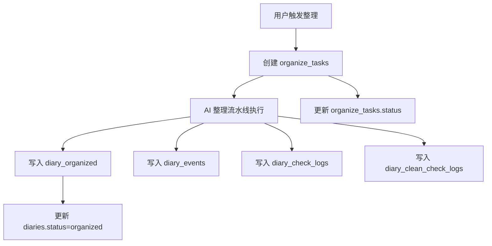
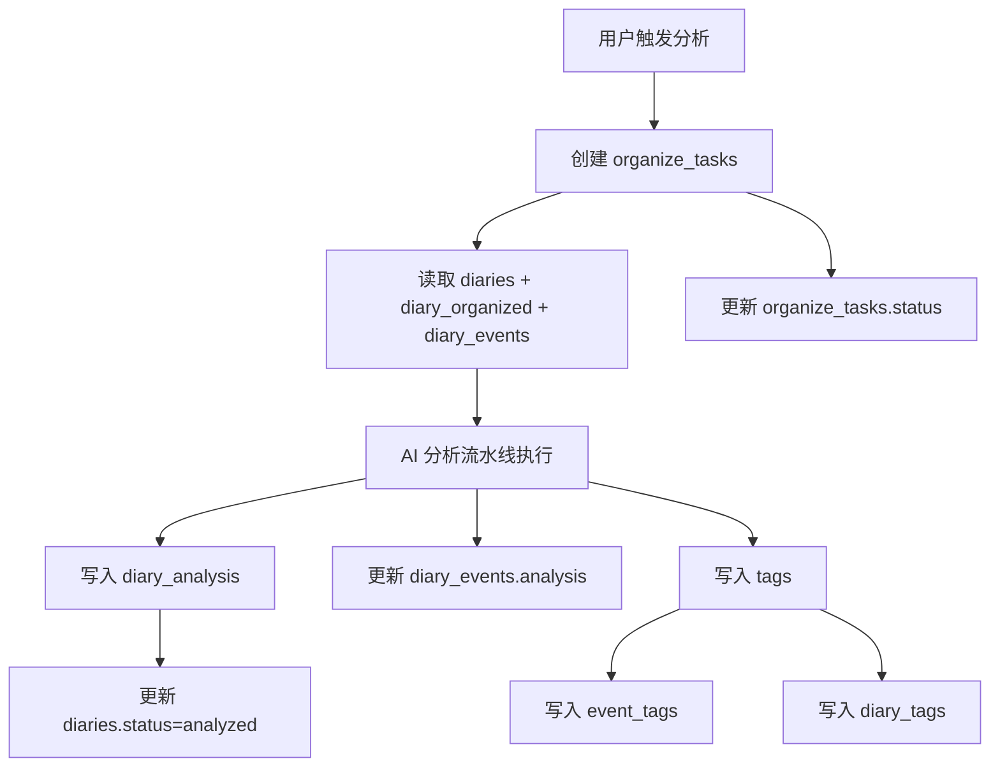
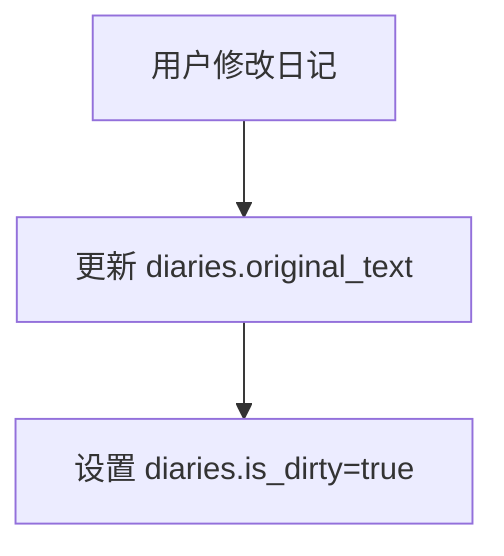
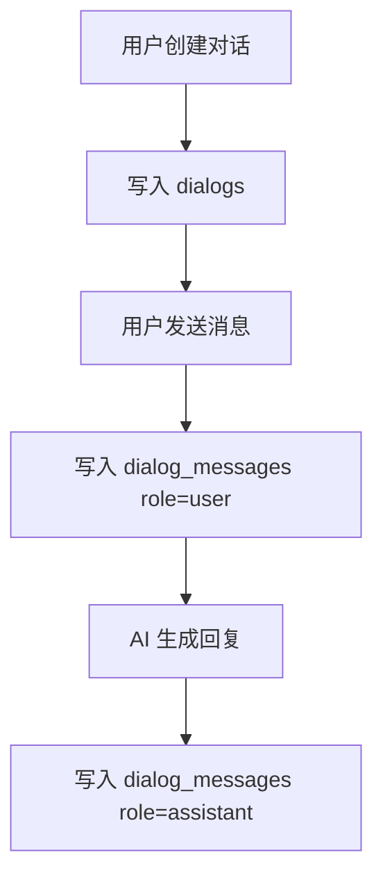

# 数据库设计文档

> 范围：当前代码已实现的数据库结构。  
> 数据库：PostgreSQL 15。  
> ORM：SQLAlchemy。  
> 建表方式：后端启动时通过 `Base.metadata.create_all` 自动创建模型中声明的表。

## 1. 数据库概览

当前系统围绕“用户记录日记，AI 整理日记，AI 分析日记，标签沉淀检索，对话围绕内容展开”这条主链路建模。

核心数据分为五类：

| 分类 | 表 | 说明 |
|---|---|---|
| 用户 | `users` | 登录账号与用户归属边界 |
| 日记主链路 | `diaries`、`organize_tasks`、`diary_organized`、`diary_events`、`diary_analysis` | 日记原文、异步任务、整理结果、结构化事件、分析结果 |
| 过程日志 | `diary_check_logs`、`diary_clean_check_logs` | AI 整理过程中的检查与清洗审核记录 |
| 标签 | `tags`、`diary_tags`、`event_tags` | 用户标签、日记标签、事件标签 |
| 对话 | `dialogs`、`dialog_messages` | 围绕日记、回顾或 AI 伙伴产生的对话 |

## 2. ER 图

### 2.1 日记主链路

### 2.2 标签关系

### 2.3 对话关系

## 3. 表结构说明

### 3.1 `users`

用途：存储系统用户。所有日记、标签和对话都通过 `user_id` 归属到用户。

| 字段 | 类型 | 为空 | 默认值 | 约束 | 说明 |
|---|---|---|---|---|---|
| `id` | UUID | 否 | `uuid.uuid4` | 主键 | 用户 ID |
| `username` | String(50) | 否 | 无 | 唯一 | 用户名 |
| `password_encrypted` | String(500) | 否 | 无 | 无 | 加密后的密码 |
| `created_at` | DateTime | 是 | `datetime.utcnow` | 无 | 创建时间 |

写入时机：用户注册或系统启动创建默认管理员账号时写入。  
读取场景：登录认证、日记查询、标签查询、对话查询。

### 3.2 `diaries`

用途：存储日记原始文本和日记状态，是日记业务的主表。

| 字段 | 类型 | 为空 | 默认值 | 约束 | 说明 |
|---|---|---|---|---|---|
| `id` | UUID | 否 | `uuid.uuid4` | 主键 | 日记 ID |
| `user_id` | UUID | 否 | 无 | 外键：`users.id` | 所属用户 |
| `original_text` | Text | 否 | 无 | 无 | 日记原文 |
| `diary_date` | Date | 否 | 无 | 无 | 日记日期 |
| `status` | Enum(`draft`, `published`, `organized`, `analyzed`) | 是 | `draft` | 无 | 日记状态 |
| `is_dirty` | Boolean | 否 | `False` | 无 | 整理或分析后，原文被再次修改的脏标记 |
| `created_at` | DateTime | 是 | `datetime.utcnow` | 无 | 创建时间 |
| `updated_at` | DateTime | 是 | `datetime.utcnow` | on update | 更新时间 |

写入时机：创建日记草稿或发布日记时写入。  
读取场景：首页列表、日历页、日记详情页、整理任务、分析任务、对话上下文。

### 3.3 `organize_tasks`

用途：记录日记整理和分析的异步任务状态。

| 字段 | 类型 | 为空 | 默认值 | 约束 | 说明 |
|---|---|---|---|---|---|
| `id` | UUID | 否 | `uuid.uuid4` | 主键 | 任务 ID |
| `diary_id` | UUID | 否 | 无 | 外键：`diaries.id` | 关联日记 |
| `user_id` | UUID | 否 | 无 | 外键：`users.id` | 所属用户 |
| `status` | String(20) | 是 | `running` | 无 | 任务状态：`running` / `completed` / `failed` |
| `task_type` | String(20) | 是 | `organize` | 无 | 任务类型：`organize` / `analyze` |
| `current_step` | String(50) | 是 | 无 | 无 | 当前执行步骤 |
| `error_message` | Text | 是 | 无 | 无 | 失败原因 |
| `created_at` | DateTime | 是 | `datetime.utcnow` | 无 | 创建时间 |
| `updated_at` | DateTime | 是 | `datetime.utcnow` | on update | 更新时间 |

写入时机：用户触发整理或分析时创建。  
读取场景：前端轮询任务进度、后端启动时恢复卡住的 `running` 任务。

### 3.4 `diary_organized`

用途：存储 AI 整理后的日记级内容。每篇日记最多一条整理结果。

| 字段 | 类型 | 为空 | 默认值 | 约束 | 说明 |
|---|---|---|---|---|---|
| `id` | UUID | 否 | `uuid.uuid4` | 主键 | 整理结果 ID |
| `task_id` | UUID | 否 | 无 | 外键：`organize_tasks.id` | 产生该整理结果的任务 |
| `diary_id` | UUID | 否 | 无 | 外键：`diaries.id`，唯一 | 关联日记 |
| `title` | String(200) | 是 | 无 | 无 | 整理后的标题 |
| `summary` | Text | 是 | 无 | 无 | 摘要 |
| `content` | Text | 是 | 无 | 无 | 整理后的完整内容 |
| `mood` | String(50) | 是 | 无 | 无 | 整理阶段提取的心情 |
| `location` | String(100) | 是 | 无 | 无 | 地点 |
| `introduction` | Text | 是 | 无 | 无 | 引入段 |
| `trivia` | Text | 是 | 无 | 无 | JSON 序列化的琐事数组 |
| `plans` | Text | 是 | 无 | 无 | JSON 序列化的计划数组 |
| `organized_at` | DateTime | 是 | `datetime.utcnow` | 无 | 整理时间 |
| `updated_at` | DateTime | 是 | `datetime.utcnow` | on update | 更新时间 |

写入时机：整理流水线完成结构化输出后写入。  
读取场景：日记详情页、分析流水线输入、事件展示、对话上下文。

### 3.5 `diary_events`

用途：存储整理后的结构化事件。一个整理结果可以包含多个事件。

| 字段 | 类型 | 为空 | 默认值 | 约束 | 说明 |
|---|---|---|---|---|---|
| `id` | UUID | 否 | `uuid.uuid4` | 主键 | 事件 ID |
| `diary_organized_id` | UUID | 否 | 无 | 外键：`diary_organized.id` | 所属整理结果 |
| `event_title` | String(200) | 是 | 无 | 无 | 事件标题 |
| `body` | Text | 否 | 无 | 无 | 事件正文 |
| `feeling` | Text | 是 | 无 | 无 | 事件感受 |
| `reflection` | Text | 是 | 无 | 无 | 事件反思 |
| `event_tags` | Text | 是 | 无 | 无 | JSON 序列化的事件级标签 |
| `analysis` | Text | 是 | 无 | 无 | JSON 序列化的事件级分析结果 |
| `sort_order` | Integer | 是 | `0` | 无 | 展示排序 |
| `created_at` | DateTime | 是 | `datetime.utcnow` | 无 | 创建时间 |

写入时机：整理流水线拆分事件后写入；分析流水线可补充 `analysis`。  
读取场景：日记详情事件列表、分析输入、标签关联、事件级 AI 分析展示。

### 3.6 `diary_analysis`

用途：存储日记级 AI 分析结果。每条整理结果最多一条当前分析结果，重新分析会覆盖旧分析结果，不保留历史版本。

| 字段 | 类型 | 为空 | 默认值 | 约束 | 说明 |
|---|---|---|---|---|---|
| `id` | UUID | 否 | `uuid.uuid4` | 主键 | 分析结果 ID |
| `task_id` | UUID | 否 | 无 | 外键：`organize_tasks.id` | 产生该分析结果的任务 |
| `diary_organized_id` | UUID | 否 | 无 | 外键：`diary_organized.id`，唯一 | 关联整理结果 |
| `mood` | String(50) | 是 | 无 | 无 | 当天整体心情 |
| `emotion_analyses` | Text | 是 | 无 | 无 | JSON 序列化的情绪分析数组 |
| `behavior_decision_analyses` | Text | 是 | 无 | 无 | JSON 序列化的行为与决策分析数组 |
| `self_understanding_analyses` | Text | 是 | 无 | 无 | JSON 序列化的自我理解分析数组 |
| `action_suggestions` | Text | 是 | 无 | 无 | JSON 序列化的行动建议数组 |
| `cognitive_calibration_analyses` | Text | 是 | 无 | 无 | JSON 序列化的认知校准分析数组 |
| `cognitive_enhancements` | Text | 是 | 无 | 无 | JSON 序列化的认知提升数组 |
| `analyzed_at` | DateTime | 是 | `datetime.utcnow` | 无 | 分析时间 |
| `updated_at` | DateTime | 是 | `datetime.utcnow` | on update | 更新时间 |

写入时机：分析流水线完成后写入；同一整理结果重新分析时，先删除旧分析结果，再写入新分析结果。  
读取场景：日记详情分析 Tab、后续自我认知和行动建议沉淀。

### 3.7 `diary_check_logs`

用途：记录整理阶段内容检查结果，属于内部过程数据。

| 字段 | 类型 | 为空 | 默认值 | 约束 | 说明 |
|---|---|---|---|---|---|
| `id` | UUID | 否 | `uuid.uuid4` | 主键 | 检查记录 ID |
| `diary_organized_id` | UUID | 否 | 无 | 外键：`diary_organized.id` | 所属整理结果 |
| `check_item` | String(100) | 是 | 无 | 无 | 检查项 |
| `status` | String(20) | 是 | 无 | 无 | 检查状态 |
| `issue` | Text | 是 | 无 | 无 | 发现的问题 |
| `before` | Text | 是 | 无 | 无 | 修正前内容 |
| `after` | Text | 是 | 无 | 无 | 修正后内容 |
| `target` | String(200) | 是 | 无 | 无 | 被修正目标 |
| `reason` | Text | 是 | 无 | 无 | 修正原因 |
| `sort_order` | Integer | 是 | `0` | 无 | 排序 |
| `created_at` | DateTime | 是 | `datetime.utcnow` | 无 | 创建时间 |

写入时机：整理流水线内容检查阶段写入。  
读取场景：内部排查 AI 整理质量。

### 3.8 `diary_clean_check_logs`

用途：记录文本清洗审核结果，属于内部过程数据。

| 字段 | 类型 | 为空 | 默认值 | 约束 | 说明 |
|---|---|---|---|---|---|
| `id` | UUID | 否 | `uuid.uuid4` | 主键 | 清洗审核记录 ID |
| `diary_organized_id` | UUID | 否 | 无 | 外键：`diary_organized.id` | 所属整理结果 |
| `issue` | Text | 是 | 无 | 无 | 发现的问题 |
| `before` | Text | 是 | 无 | 无 | 修正前内容 |
| `after` | Text | 是 | 无 | 无 | 修正后内容 |
| `reason` | Text | 是 | 无 | 无 | 修正原因 |
| `sort_order` | Integer | 是 | `0` | 无 | 排序 |
| `created_at` | DateTime | 是 | `datetime.utcnow` | 无 | 创建时间 |

写入时机：整理流水线清洗审核阶段写入。  
读取场景：内部排查文本清洗质量。

### 3.9 `tags`

用途：存储用户维度的标签。标签可关联到日记，也可关联到具体事件。

| 字段 | 类型 | 为空 | 默认值 | 约束 | 说明 |
|---|---|---|---|---|---|
| `id` | UUID | 否 | `uuid.uuid4` | 主键 | 标签 ID |
| `user_id` | UUID | 否 | 无 | 外键：`users.id`，联合唯一 | 所属用户 |
| `name` | String(50) | 否 | 无 | 联合唯一 | 标签名 |
| `type` | String(30) | 是 | 无 | 无 | 标签类型：`domain` / `topic` / `person_object` / `psychological` / `knowledge` |
| `created_at` | DateTime | 是 | `datetime.utcnow` | 无 | 创建时间 |

唯一约束：`user_id` + `name`。  
写入时机：分析流水线提取标签并 upsert 时写入。  
读取场景：标签筛选、标签列表、日记和事件标签展示。

### 3.10 `diary_tags`

用途：日记与标签的多对多关联表。

| 字段 | 类型 | 为空 | 默认值 | 约束 | 说明 |
|---|---|---|---|---|---|
| `diary_id` | UUID | 否 | 无 | 主键，外键：`diaries.id` | 日记 ID |
| `tag_id` | UUID | 否 | 无 | 主键，外键：`tags.id` | 标签 ID |

写入时机：分析流水线汇总事件标签后，为日记建立标签关联。  
读取场景：按标签查询日记、日记详情展示标签。

### 3.11 `event_tags`

用途：事件与标签的多对多关联表。

| 字段 | 类型 | 为空 | 默认值 | 约束 | 说明 |
|---|---|---|---|---|---|
| `diary_event_id` | UUID | 否 | 无 | 主键，外键：`diary_events.id` | 事件 ID |
| `tag_id` | UUID | 否 | 无 | 主键，外键：`tags.id` | 标签 ID |

写入时机：分析流水线为每个事件建立标签关联。  
读取场景：事件标签展示、按标签定位具体事件。

### 3.12 `dialogs`

用途：存储一次对话会话。对话可来源于日记详情、回顾或 AI 伙伴。

| 字段 | 类型 | 为空 | 默认值 | 约束 | 说明 |
|---|---|---|---|---|---|
| `id` | UUID | 否 | `uuid.uuid4` | 主键 | 对话 ID |
| `user_id` | UUID | 否 | 无 | 外键：`users.id` | 所属用户 |
| `source_type` | Enum(`diary_detail`, `review`, `ai_companion`) | 否 | 无 | 无 | 对话来源类型 |
| `source_id` | UUID | 是 | 无 | 无 | 来源对象 ID |
| `created_at` | DateTime | 是 | `datetime.utcnow` | 无 | 创建时间 |
| `updated_at` | DateTime | 是 | `datetime.utcnow` | on update | 更新时间 |

写入时机：用户创建对话时写入。  
读取场景：对话列表、日记详情页内嵌对话、AI 伙伴对话上下文。

### 3.13 `dialog_messages`

用途：存储对话中的每条消息。

| 字段 | 类型 | 为空 | 默认值 | 约束 | 说明 |
|---|---|---|---|---|---|
| `id` | UUID | 否 | `uuid.uuid4` | 主键 | 消息 ID |
| `dialog_id` | UUID | 否 | 无 | 外键：`dialogs.id` | 所属对话 |
| `role` | Enum(`user`, `assistant`) | 否 | 无 | 无 | 消息角色 |
| `content` | Text | 否 | 无 | 无 | 消息内容 |
| `created_at` | DateTime | 是 | `datetime.utcnow` | 无 | 创建时间 |

写入时机：用户发送消息或 AI 回复时写入。  
读取场景：对话详情、AI 回复上下文组装。

## 4. 数据生命周期

### 4.1 日记创建

日记原文保存在 `diaries.original_text`。日记日期保存在 `diaries.diary_date`。日记属于单个用户，由 `diaries.user_id` 标识。

### 4.2 日记整理

整理任务通过 `organize_tasks.task_type=organize` 标识。整理结果写入 `diary_organized`，结构化事件写入 `diary_events`，过程检查记录写入日志表。

### 4.3 日记分析

分析任务通过 `organize_tasks.task_type=analyze` 标识。日记级分析写入 `diary_analysis`，事件级分析写入 `diary_events.analysis`，标签沉淀到 `tags` 并通过关联表连接到日记和事件。

### 4.4 日记修改

`is_dirty` 表示当前原文和既有整理或分析结果可能不一致。该字段用于提醒后续重新整理或重新分析。

### 4.5 对话产生

对话通过 `dialogs.source_type` 区分来源。日记详情对话可以通过 `source_id` 指向对应日记。
