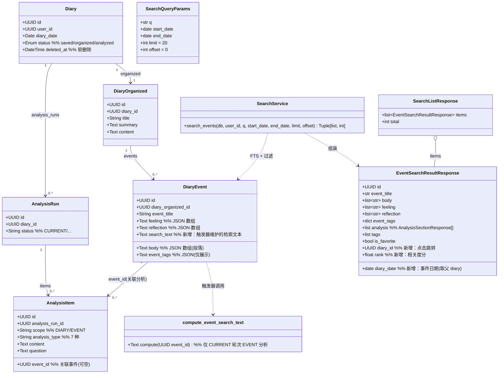
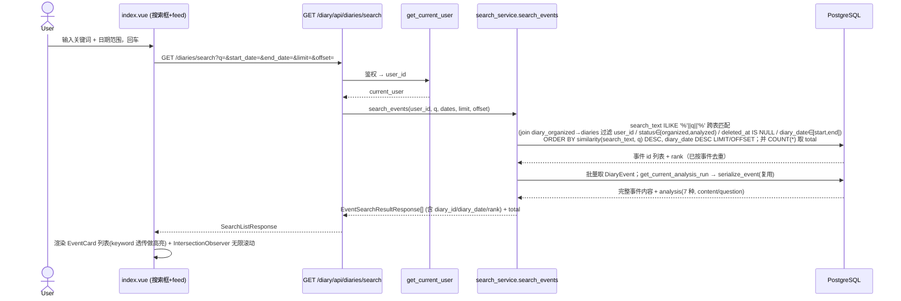
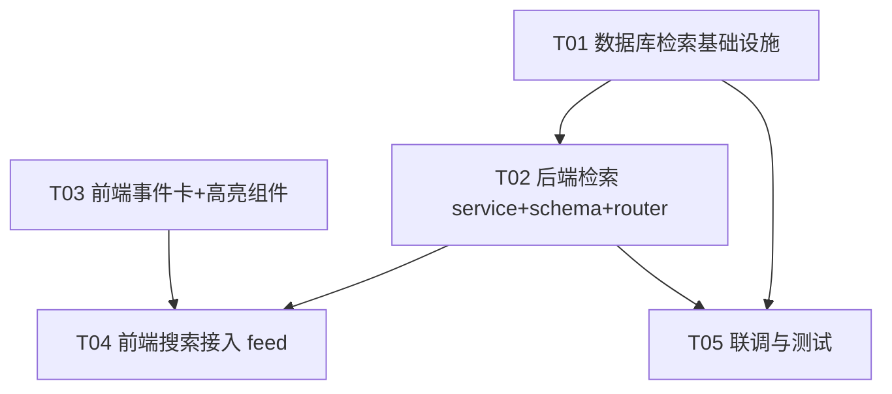

# 统一搜索功能 — 系统架构设计 + 任务分解

> 作者：Bob（架构师）｜项目：`unified_search`｜日期：2026-08
> 对齐基线：PRD《统一搜索功能需求规格》（2026-08 定稿，决策已锁死）；代码探查 `backend/routers/diaries.py`、`backend/models/diary.py`、`frontend/pages/index.vue`、`frontend/components/EventCard.vue`、`backend/services/analysis_history.py`。
> 设计原则：改造现有 `GET /diary/api/diaries/search`；检索范围仅 `DiaryEvent` 内容 + 关联 `analysis_items`（scope=EVENT，7 种类型）；按相关度排序；**仅关键词高亮、内容完整展示不截断**；标签仅展示不参与检索/排序；结果以统一事件卡落入现有 feed；复用 `index.vue` 搜索入口，不新建搜索页。

---

## Part A：系统设计

### 1. 实现方案（Implementation Approach）

#### 1.1 技术难点
- 跨两张表（`diary_events` + `analysis_items`）的"同一事件"内容聚合检索与相关度合并。
- 结果以**事件为单位去重**（同一事件可能在自身字段与关联分析中同时命中，只出一张卡）。
- 中文全文检索：PG 内置 `simple`/`english` 词典对中文几乎无效（中文无空格，整串被当成一个 lexeme，只能做整串相等匹配）。
- 事件无独立日期字段，日期来自所属 `diary.diary_date`，需跨表 join 过滤。

#### 1.2 框架与选型（后端）
- 后端已有栈：**FastAPI + SQLAlchemy(ORM) + PostgreSQL 15**。沿用，不引入新框架。
- 全文检索引擎（**已确认采用方案 B**）：**PostgreSQL `pg_trgm` 扩展 + `search_text`(Text) 列 + GIN 索引 + `ILIKE('%q%')` 子串匹配 + `similarity(search_text, q)` 排序**。不采用 `zhparser`/`tsvector` 方案。
- 跨表聚合方式：**触发器维护的"每事件检索文本"列**（见下），而非运行时 UNION。理由：
  - `analysis_items` 是另一张表且一个事件可能有多条分析，无法用纯"生成列（GENERATED ALWAYS AS）"聚合（生成列不能跨表引用）。因此采用**触发器维护的 `search_text` 列**——在 `diary_events` 上建 Text 列，由触发器在事件自身字段变更、或其关联 `analysis_items` 变更时重算（聚合该事件**CURRENT 轮次** EVENT 作用域分析内容，与卡片 `build_sections(current_run,...)` 口径一致）。
  - 这样搜索变成**单表 `ILIKE` + 一次 join 父表做隔离/状态/日期过滤**，查询简单、可走 GIN 索引、性能最优。
  - 备选（若团队不愿写触发器）：运行时 UNION（事件字段与 analysis 文本两个子查询 UNION ALL，按 event_id 取 MAX(similarity) 去重再排序分页）。架构文档给出主推方案；运行时 UNION 作为等价备选，查询更重但无需迁移触发器。

#### 1.3 中文检索方案（**已确认：方案 B，不采用 zhparser**）
- **实际采用方案 B — `pg_trgm` + `ILIKE` 子串 + `similarity` 排序**（用户已拍板）：
  - `pg_trgm` 是 PG 内置 contrib 扩展（`CREATE EXTENSION IF NOT EXISTS pg_trgm;`，标准 contrib，通常无需特殊镜像/超级用户权限），在 `diary_events` 上建 `search_text`（Text 列，触发器维护，同架构）做 `ILIKE('%q%')` 子串匹配，按 `similarity(search_text, q)` 排序。
  - 优点：对中文 100% 可用、无需特殊扩展、部署简单；缺点：相关度较弱（子串/trigram 相似度，无词权重、标题不再额外加权），但功能完整、满足 PRD 相关度排序要求。
- **未采用方案 A — `zhparser`（SCWS 内核）扩展**：因需 PG 服务端安装该扩展且通常需 `superuser`（或经 DBA 预装），部署不确定性高，故不采用。若未来环境支持，可作为相关度增强升级（将 `search_text`/ILIKE 替换为 `tsvector`/`websearch_to_tsquery`/`ts_rank_cd` 即可，应用层与前端代码不变）。
- 两种候选共用**同一套"触发器维护的每事件检索产物 + GIN 索引"架构**，仅迁移里生成的是 `search_text`（方案 B，已采用）还是 `search_vector`（方案 A，未采用），以及查询里用 `similarity` vs `ts_rank_cd` 不同。

#### 1.4 相关度排序公式（**已确认：similarity 排序**）
- 采用：`ORDER BY similarity(search_text, q) DESC, diary_date DESC`（trigram 相似度，范围 0~1，越相似越高）。
- 权重说明：方案 B 无逐字段加权（所有字段拼接进同一 `search_text`，`question` 与 `content` 按拼接顺序同等参与相似度，title 不额外加权）。这是方案 B 的固有取舍；如需标题加权，未来可升级到方案 A。
- 排序：`ORDER BY similarity DESC, diary_date DESC`；分页 `LIMIT :limit OFFSET :offset`（默认 limit=20）。
- **精确 total**：`search_events` 额外执行一次 `COUNT(*)` 查询返回总命中数（见响应 `total`），前端据此判断 `hasMore`。

#### 1.5 高亮策略（明确结论）
- **后端不返回命中位置/片段/标记**。后端只返回：完整内容字段（body/feeling/reflection 数组、analysis 各块 content/question）+ `rank` 分。
- **高亮纯前端做**：前端拿到查询关键词 `q`（作为 `keyword` prop 透传），在渲染 body/feeling/reflection/analysis 文本时把关键词包 `<mark>`，内容**完整展示、不截断**（满足 PRD P0-3）。前端高亮更灵活、避免后端截断，且无需后端额外字段。

#### 1.6 架构模式
- 沿用现有分层：Router（控制器，参数校验/鉴权/响应封装）→ Service（`search_service`，检索与排序逻辑）→ ORM Model（数据）。前端复用 `EventCard` 作为统一事件卡。

---

### 2. 文件列表（新增 / 修改，相对仓库根）

| 文件 | 类型 | 职责 |
|---|---|---|
| `backend/models/diary.py` | 修改 | `DiaryEvent` 新增 `search_text` 列（`sqlalchemy.Text`，触发器维护的检索文本）；其余模型不变。 |
| `backend/migrations/036_event_search_text.sql` | 新增 | `CREATE EXTENSION IF NOT EXISTS pg_trgm;` + `diary_events` 加 `search_text`(Text) 列 + `pg_trgm` GIN 索引；触发器函数 `compute_event_search_text(p_event_id)`（聚合事件自身字段 + **仅 CURRENT 轮次** EVENT 作用域 `analysis_items` 的 content/question）+ 两个触发器（`diary_events` 自身字段变更、`analysis_items` 变更时重算）。 |
| `backend/migrations/037_backfill_event_search_text.sql` | 新增 | 存量数据回填：对所有 `diary_events` 调用 `compute_event_search_text(id)` 重算 `search_text`。 |
| `backend/services/search_service.py` | 新增 | 核心检索：`search_events(db, user_id, q, start_date, end_date, limit, offset) -> (items, total)` → `search_text ILIKE '%q%'` 跨表匹配 + 隔离/状态/软删除/日期过滤 + `similarity(search_text, q)` 排序 + 分页去重；另发一次 `COUNT` 取精确 `total`；返回事件列表与 `rank`(similarity)；再批量 `serialize_event` 组装结果。 |
| `backend/schemas/search.py` | 新增 | `SearchQueryParams`（q/start_date/end_date/limit/offset）、`EventSearchResultResponse(DiaryEventResponse 扩展 diary_id/diary_date/rank)`、`SearchListResponse(items/total)`。 |
| `backend/routers/diaries.py` | 修改 | 改写 `search_diaries`：新增 `start_date/end_date/limit/offset` 参数；`user_id` 隔离；`status IN ('organized','analyzed')`；`Diary.deleted_at IS NULL`；日期基于 `diary.diary_date`；调用 `search_service`；返回 `SearchListResponse`；复用 `serialize_event`。 |
| `frontend/components/EventCard.vue` | 修改 | 新增可选 `keyword?: string` prop；当传入时对 `event_title/body/feeling/reflection` 各段落做关键词高亮（包 `<mark>`），内容不截断；其余渲染逻辑不变（已支持 analysis 区块）。 |
| `frontend/components/AnalysisSection.vue` | 修改 | 新增可选 `keyword?: string` prop；对分析块 `content`/`question` 文本做关键词高亮。 |
| `frontend/utils/highlight.ts` | 新增 | 纯函数 `highlight(text: string, keyword: string): string`，按词（中文逐字/大小写不敏感）拆分并包裹 `<mark>`，返回安全 HTML（需 `v-html` 或返回片段数组，注意 XSS：仅对 keyword 做转义后包裹，文本原样转义）。 |
| `frontend/pages/index.vue` | 修改 | 搜索框增加日期范围输入；`handleSearch` 调 `/diaries/search` 带 `q/start_date/end_date/limit/offset`；搜索结果区改为渲染 `EventCard`（`keyword` 透传）的 feed 列表；新增 `IntersectionObserver` 无限滚动加载更多；`searchResults` 类型改为 `SearchEventResult[]`。 |
| `frontend/composables/useSearch.ts` | 新增 | 抽取搜索状态：query/日期范围/分页 offset/hasMore/loading、调用 API、累积结果、无限滚动回调；供 `index.vue` 使用。 |
| `frontend/types/index.ts`（或现有类型文件） | 修改 | 新增 `SearchEventResult` 类型（对应 `EventSearchResultResponse`：含 `diary_id`/`diary_date`/`rank` + 事件字段）。 |
| `backend/tests/test_search_service.py` | 新增 | 单测 `compute`/排序/过滤逻辑（可用内存或测试库）。 |
| `backend/tests/test_search_api.py` | 新增 | 接口测试：鉴权、状态覆盖、软删除、日期范围、分页、相关度顺序。 |
| `backend/scripts/verify_search_backfill.py` | 新增 | 联调脚本：校验迁移后 `search_text` 非空比例与抽样命中，确认回填成功。 |

---

### 3. 数据结构与接口（Mermaid classDiagram）

**请求参数（`GET /diary/api/diaries/search`）**
- `q: str`（必填，min_length=1）
- `start_date: date | None`、`end_date: date | None`（基于 `diary.diary_date`）
- `limit: int = 20`（`1..100`）、`offset: int = 0`

**响应**：`SearchListResponse{ items: EventSearchResultResponse[], total: int }`
- `EventSearchResultResponse` = 现有 `DiaryEventResponse` 字段（EventCard 直接复用）+ `diary_id`、`diary_date`、`rank`（= `similarity` 分值）。
- 错误：`401` 未鉴权（FastAPI 依赖）、`422` 参数校验失败、`400` q 为空/日期格式非法。

---

### 4. 程序调用流程（Mermaid sequenceDiagram）

---

### 5. 待明确 / 假设（Anything UNCLEAR）
> 原 6 条待明确中，#1 中文检索方案、#2 事件日期、#4 分析轮次边界、#5 精确 total 已由用户拍板（【已确认】）；#3 迁移执行流程、#6 question/content 权重随方案 B 确定而消解（见 §10）。

- 【已确认】**事件日期** = 所属 `diary.diary_date`（事件自身无日期列）；日期范围筛选基于此。
- 【已确认】**分析纳入检索仅取 CURRENT 轮次**：触发器 `compute_event_search_text` 按 `current_run` 过滤 EVENT 作用域 `analysis_items`，与卡片 `build_sections(current_run,...)` 口径完全一致（不再含历史轮次）。
- 【已确认】**中文检索采用方案 B**：`pg_trgm` + `search_text` + `ILIKE` + `similarity`，不采用 `zhparser`/`tsvector`。
- 【已确认】**提供精确 total**：`search_events` 返回 `(items, total)`，多一次 `COUNT` 查询。
- 前端高亮方案（无变化）：默认"中文逐字/词组 + 大小写不敏感"匹配；精确中文分词高亮在前端用简单子串匹配（与后端检索分词解耦，确保不漏标）。
- 【已随方案 B 消解】**迁移执行流程/权限**：方案 B 仅需标准 contrib `pg_trgm`（`CREATE EXTENSION` 通常无需特殊镜像/超级用户），较方案 A 风险大降；存量迁移 `036/037` 的具体执行方式（CI/手动/脚本）仍建议与 DBA 确认一次。
- 【已随方案 B 消解】**question 与 content 权重**：方案 B 将两者拼接进同一 `search_text` 参与 `similarity`，天然同等权重，无需单独决策。

---

## Part B：任务分解

### 6. 依赖包列表（Required Packages）
- **后端 Python 包**：无新增。`pg_trgm` 为 PostgreSQL 内置 contrib 扩展（不采用 `zhparser`），客户端用 `ILIKE`/`similarity`，SQLAlchemy 已支持。
- **前端 npm 包**：无新增。高亮用自写 `utils/highlight.ts`。
- **基础设施**：目标 PG 需启用 `pg_trgm` 扩展（内置 contrib，方案 B 已采用；不采用 zhparser）。

### 7. 任务列表（有序、含依赖，按实现顺序）

> 规则：共 5 个任务，每个 ≥3 个相关文件；T01 为基础设施。

- **T01 — 数据库检索基础设施（迁移 + 模型 + 中文分词落地）**　优先级 P0
  - 文件：`backend/models/diary.py`、`backend/migrations/036_event_search_text.sql`、`backend/migrations/037_backfill_event_search_text.sql`
  - 内容：`DiaryEvent` 加 `search_text`(Text，触发器维护)；迁移 `CREATE EXTENSION pg_trgm` + 建列 + `pg_trgm` GIN 索引 + 触发器函数 `compute_event_search_text`（聚合事件自身字段 + **仅 CURRENT 轮次** EVENT 作用域 `analysis_items` 的 content/question）+ 两个触发器（事件字段变更、`analysis_items` 变更时重算）；037 回填存量 `search_text`。
  - 依赖：无

- **T02 — 后端检索（服务 + 响应契约 + 路由改造）**　优先级 P0
  - 文件：`backend/services/search_service.py`、`backend/schemas/search.py`、`backend/routers/diaries.py`
  - 内容：`search_service.search_events` 实现 `search_text ILIKE '%q%'` 跨表匹配/过滤/`similarity` 排序/分页/去重 + 额外 `COUNT` 取精确 `total` + 复用 `serialize_event`；`schemas/search.py` 定义 `SearchQueryParams`/`EventSearchResultResponse`/`SearchListResponse`；改写 `search_diaries` 参数与过滤（user_id 隔离、status∈(organized,analyzed)、软删除、日期基于 diary_date）、返回新 schema（含 total）。
  - 依赖：T01

- **T03 — 前端事件卡 + 关键词高亮组件**　优先级 P0
  - 文件：`frontend/components/EventCard.vue`、`frontend/components/AnalysisSection.vue`、`frontend/utils/highlight.ts`
  - 内容：`EventCard` 加 `keyword` prop 对标题/正文/感受/反思做高亮；`AnalysisSection` 加 `keyword` prop 对 content/question 高亮；`highlight.ts` 提供安全高亮工具（文本转义后包 `<mark>`，不截断）。仅依赖约定的响应结构，可与后端并行。
  - 依赖：无（仅依赖共享约定）

- **T04 — 前端搜索接入 feed（页面集成）**　优先级 P0/P1
  - 文件：`frontend/pages/index.vue`、`frontend/composables/useSearch.ts`、`frontend/types/index.ts`
  - 内容：`index.vue` 搜索框加日期范围、`handleSearch` 带参调 `/diaries/search`、结果区渲染 `EventCard`（`keyword` 透传）、新增 `IntersectionObserver` 无限滚动；`useSearch.ts` 封装搜索/分页/无限滚动状态；`types` 加 `SearchEventResult`。
  - 依赖：T02（响应结构）、T03（高亮组件）

- **T05 — 联调与测试验证**　优先级 P1
  - 文件：`backend/tests/test_search_service.py`、`backend/tests/test_search_api.py`、`backend/scripts/verify_search_backfill.py`
  - 内容：服务层单测（similarity 排序/过滤/去重）、接口测试（鉴权/状态覆盖/软删除/日期/分页/total 正确）、回填校验脚本（确认迁移后 `search_text` 非空与抽样命中）。
  - 依赖：T01、T02

### 8. 共享知识（跨文件约定）
- **字段命名**：响应事件卡复用 `DiaryEventResponse` 字段；新增 `diary_id`(UUID)、`diary_date`(date)、`rank`(float)。
- **日期格式**：请求 `start_date`/`end_date` 用 ISO `YYYY-MM-DD`（FastAPI `date` 解析）；响应 `diary_date` 同格式。
- **user_id 透传**：所有查询经 `get_current_user` 取 `current_user.id` 作过滤，**绝不**用客户端传入的 user 标识。
- **软删除/状态过滤约定**：`Diary.deleted_at IS NULL`；事件状态 `status IN ('organized','analyzed')`。
- **事件日期**：取所属 `diary.diary_date`（事件无日期列）——【已确认】。
- **前端高亮关键词字段名**：`keyword`（由 query 的 `q` 透传）；`EventCard`/`AnalysisSection` 用 `keyword` prop 高亮，内容不截断。
- **检索范围**：仅 `event` 内容（event_title/body/feeling/reflection）+ 关联 `analysis_items`（scope=EVENT，覆盖全部 7 种 `analysis_type`）；标签不检索/不排序。
- **相关度常量**：统一 `similarity(search_text, q) DESC`（方案 B 已采用）。
- **分析聚合一致性**：卡片 `analysis` 用 `build_sections(current_run, user_id, "EVENT", event.id)`（7 种），与检索索引聚合口径一致——**均仅取 CURRENT 轮次 EVENT 作用域 analysis_items**。

### 9. 任务依赖图（Mermaid graph）

### 10. 待明确事项（决策追踪）

> 共 6 条；#1 中文检索方案、#2 事件日期、#4 分析轮次边界、#5 精确 total 已由用户拍板（标【已确认】）；#3 迁移执行流程、#6 question/content 权重随方案 B 确定而消解（标【已随方案 B 消解】）。

1. 【已确认】**中文检索采用方案 B**：`pg_trgm` + `search_text`(Text 列) + GIN 索引 + `ILIKE` 子串匹配 + `similarity(search_text, q)` 排序；不采用 `zhparser`/`tsvector`。迁移 036/037 据此落地。
2. 【已确认】**事件日期取所属 `diary.diary_date`**：事件无独立日期列，日期范围筛选基于此。
3. 【已随方案 B 消解】**迁移执行流程/权限**：方案 B 仅需标准 contrib `pg_trgm`（`CREATE EXTENSION` 通常无需特殊镜像/超级用户），较方案 A 风险大降；存量迁移 `036/037` 的具体执行方式（CI/手动/脚本）仍建议与 DBA 确认。
4. 【已确认】**分析纳入检索仅取 CURRENT 轮次**：触发器 `compute_event_search_text` 按 `current_run` 过滤 EVENT 作用域 `analysis_items`，与卡片 `build_sections(current_run,...)` 口径完全一致。
5. 【已确认】**提供精确 total 计数**：`search_events` 返回 `(items, total)`，多一次 `COUNT` 查询。
6. 【已随方案 B 消解】**question 与 content 权重**：方案 B 将两者拼接进同一 `search_text` 参与 `similarity`，天然同等权重，无需单独决策。

---

## 设计要点摘要（≤300 字）

**中文全文检索选型（已确认方案 B）**：采用 PG `pg_trgm` 扩展 + `search_text`(Text 列) + GIN 索引 + `ILIKE('%q%')` 子串匹配 + `similarity(search_text, q)` 排序；不采用 `zhparser`/`tsvector`。优点：中文 100% 可用、部署简单、无需特殊扩展；取舍：相关度较弱、无逐字段加权（title 不额外加权，question/content 同等拼接）。

**跨表检索与排序**：触发器函数 `compute_event_search_text` 在 `diary_events` 上维护聚合"事件自身字段 + 仅 CURRENT 轮次 EVENT 作用域 analysis_items"的检索文本；搜索即单表 `ILIKE` + join 父表做 user_id 隔离 / status∈(organized,analyzed) / 软删除 / 日期（取 `diary.diary_date`）过滤，按 similarity 排序、按事件去重、分页。

**改造点**：改 `search_diaries` 加日期/分页参数与过滤；新增 `search_service`+`schemas/search`；`search_events` 返回 `(items, total)`（多一次 COUNT 取精确 total）；前端复用 `EventCard` 渲染事件卡并做纯前端关键词高亮（后端不返回命中标记），接入现有 feed 无限滚动。

**事件日期**：确认取所属 `diary.diary_date`（事件无独立日期列）。
