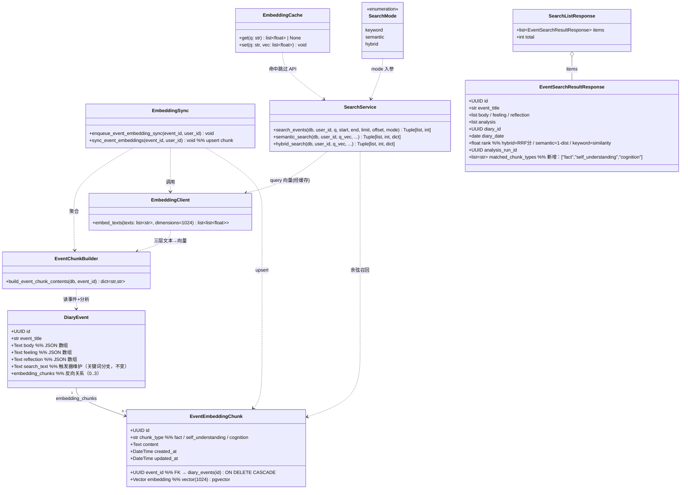
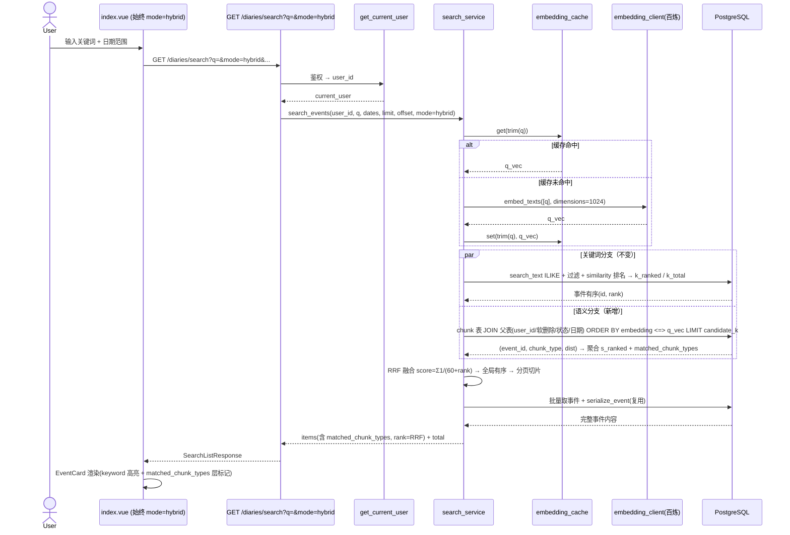
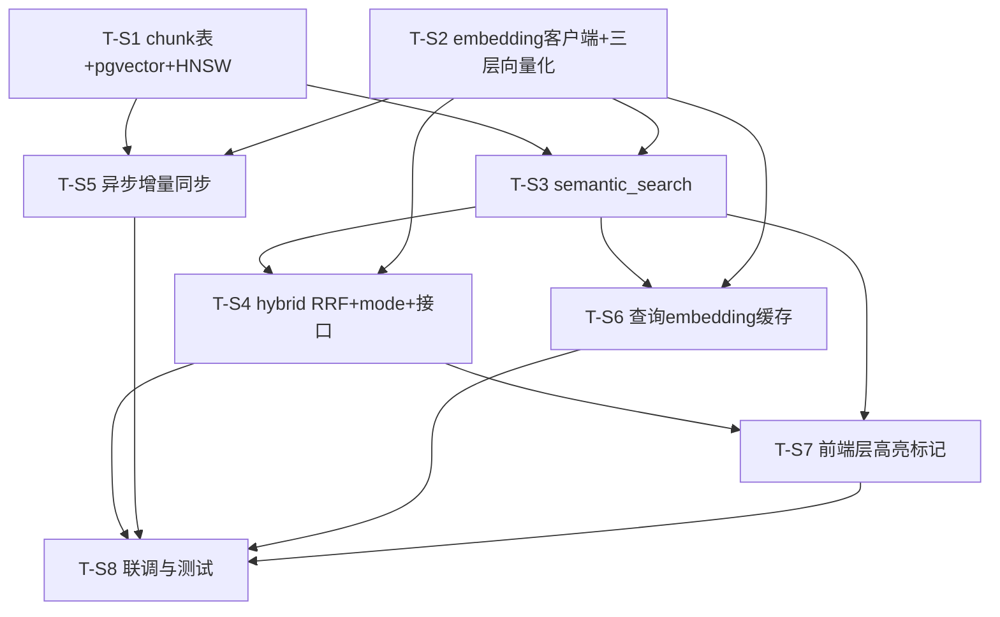

# 统一搜索语义增强 — 增量架构设计 + 任务分解

> 作者：Bob（架构师）｜项目：`diary-platform` 统一搜索语义增强（增量）｜日期：2026-08  
> 对齐基线：
>
> - 增量 PRD《统一搜索语义增强增量需求规格》（已锁死全部产品决策）
> - 现有架构 `docs/system_design.md`（pg_trgm 关键词搜索 T01–T05，已验收）
> - 代码探查：`search_service.py` / `schemas/search.py` / `routers/diaries.py` / `models/diary.py` / `migrations/036_*` `037_*` / 前端 `EventCard.vue` `useSearch.ts` `index.vue` `types/index.ts` / `config.py` `requirements.txt` / `services/ai.py` `services/model_runtime.py`
>
> 本设计为**增量设计**：在已验收的 pg_trgm 关键词检索之上叠加 embedding 语义层，形成混合共存检索。不替换关键词分支，仅扩展。

---

## 一、探查结论（设计事实依据）

| 探查项           | 结论                                                                                                                                 | 对设计的影响                                                              |
| ------------- | ---------------------------------------------------------------------------------------------------------------------------------- | ------------------------------------------------------------------- |
| 现有关键词实现       | `diary_events.search_text`（触发器 036 维护）+ GIN/pg_trgm + `similarity` 排序；`search_events` 返回 `(items, total)`                          | 语义分支与之并行；total 机制（COUNT DISTINCT event.id）复用                        |
| 异步任务基础设施      | **`asyncio.create_task`**（`routers/diaries.py` 的 `_run_organize` / `_run_analyze` 后台任务模式，独立 `SessionLocal`）                        | 增量同步复用该模式，**无需新增 Celery/线程池**                                       |
| embedding SDK | `requirements.txt` 已有 **`openai==2.46.0`**；无 dashscope SDK                                                                         | 复用 `openai` 客户端调百炼 **OpenAI 兼容 `/embeddings` 端点**，**无需新增 SDK 依赖**   |
| 现存向量依赖        | 无 `pgvector`                                                                                                                       | 需新增 `pgvector`（Python 客户端）用于 SQLAlchemy `Vector` 类型                 |
| Redis         | 无                                                                                                                                  | 查询缓存默认进程内 TTL（无新依赖）；多 worker 才需 Redis                               |
| AI Provider   | 现有 chat 走 `model_management` DB 托管 + `openai`/`langchain-openai`；fun_asr 用 dashscope                                               | embedding 建议走**独立 env 配置**（最小改动），可选接入 model_management              |
| 前端结构          | `useSearch.ts` 调 `/diaries/search`；`EventCard` 已有 `keyword` prop + `.search-keyword` 高亮样式；`index.vue` 渲染 `EventCard` 并传 `:keyword` | 仅给 `EventCard` 增 `matchedChunkTypes` prop + 层标记徽标，前端**不暴露 mode 切换** |

### 已锁死决策（来自主理人，本设计严格遵循）

1. 混合共存：关键词(pg_trgm) + embedding 语义层，RRF 融合 **k=60**。
2. 三层语义分块向量化（fact / self_understanding / cognition），每事件最多 3 块。
3. 结果单位=事件：命中任一块则事件召回，去重聚合回事件级；前端按命中层高亮。
4. 历史向量化暂缓：代码阶段不回填旧事件 embedding（旧事件仅经关键词召回）。
5. embedding 模型：阿里云百炼 **qwen text-embedding**（具体模型名与 N 见 §二，已探查定死）。
6. 向量索引：**pgvector HNSW**（vector_cosine_ops）。
7. 增量同步：请求后**异步任务**（复用 backend 现有 `asyncio.create_task`）。
8. 查询 embedding 缓存：**开启**（短时 TTL，默认进程内）。
9. 接口：`GET /diaries/search` 加 `mode∈{keyword,semantic,hybrid}`，默认 **hybrid**；前端**不暴露**切换（始终 hybrid）。

---

## 二、Embedding 模型与向量维度（探查定死 · 【已确认】）

经百炼 API 文档探查，**qwen text-embedding 系列**支持 OpenAI 兼容 `/embeddings` 调用与 `dimensions` 参数。用户已拍板模型选型（待明确 #1【已确认】）：

| 模型                                  | 支持维度                                                | 单行最大 token | 批大小  | 备注               |
| ----------------------------------- | --------------------------------------------------- | ---------- | ---- | ---------------- |
| **`qwen3.7-text-embedding`（已确认选用）** | 2560 / 2048 / 1536 / **1024(默认)** / 768 / 512 / 256 | 8192       | 20 行 | 用户指定，使用默认 1024 维 |

**锁定结论（用户已确认）：**

- **模型名 = `qwen3.7-text-embedding`**（用户指定，非 v4/v3）。
- **向量维度 `N = 1024`** → `vector(1024)`。该模型默认即 1024 维（支持 2560/2048/1536/1024/768/512/256），使用默认 `dimensions=1024`，schema 列长度稳定。
- 调用：`POST {EMBEDDING_BASE_URL}/embeddings`，body `{model:"qwen3.7-text-embedding", input:[...], dimensions:1024, encoding_format:"float"}`，使用 `openai.OpenAI`（base_url / api_key / model 由管理端 DB 托管 `EMBEDDING` 配置提供，见 §3.2 / §九 / 待明确 #2）。
- 百炼 OpenAI 兼容 base_url 形如：`https://{WorkspaceId}.cn-beijing.maas.aliyuncs.com/compatible-mode/v1`（区域/Workspace 由运维提供）。

---

## 三、实现方案（Implementation Approach）

### 3.1 技术难点

- **两层检索融合**：关键词（pg_trgm `similarity` 排名）与语义（余弦距离排名）是异构排序，需统一为事件级排名后 RRF 融合。
- **语义分支的 user_id 隔离**：chunk 表本身无 user_id，须 `chunk → diary_events → diary_organized → diaries` 三表 join 施加 `user_id` / 软删除 / 状态 / 日期过滤（与关键词分支口径一致）。
- **结果单位=事件 + 命中层标记**：语义召回以 chunk 为单位，须聚合回事件，并记录该事件命中了哪些 `chunk_type`（供前端层高亮）。
- **异步同步一致性**：新事件/新分析完成后异步写 chunk；过程失败须优雅降级（chunk 缺失 → 该事件仅由关键词召回），不影响主请求。
- **出网隐私与延迟**：每次 hybrid/semantic 搜索需调一次 embedding API；须缓存查询向量并最小化出网数据（仅送文本，不送用户标识）。

### 3.2 框架与选型（后端，沿用现有技术栈）

- 后端沿用 **FastAPI + SQLAlchemy(ORM) + PostgreSQL 15**；不引入新框架。
- 语义向量：**pgvector 扩展**（`vector(1024)` 列 + HNSW `vector_cosine_ops` 索引 + `<=>` 余弦距离算子）。
- embedding 客户端与配置：复用已有 **`openai`** Python SDK，经百炼 **OpenAI 兼容端点**（无新 SDK 依赖）；**模型配置（api_base_url / api_key / model_name）走管理端 DB 托管**——通过现有 `model_management` 模块新增 `EMBEDDING` setting_key 读取（与 chat 模型一致，管理端可配置；需小幅扩展 model_management 以支持 embedding 用途，见 §九 / 待明确 #2）。不再使用硬编码 env 变量。
- 异步同步：复用 backend 现有 **`asyncio.create_task`**（与 organize/analyze 同构）。
- 查询缓存：默认**进程内 TTL 缓存**（自写轻量封装，无新依赖）；多 worker 部署再换 Redis（待明确 #3【已确认】走进程内，不变）。
- 新增 Python 依赖仅 **`pgvector`**（SQLAlchemy `Vector` 类型）。

### 3.3 三层向量化逻辑（复用现有聚合口径）

聚合口径与现有触发器 `compute_event_search_vector` / 卡片 `build_sections(current_run, ..., "EVENT", event.id)` **完全一致**：分析取 **CURRENT 轮次 EVENT 作用域** `analysis_items`。

- **fact（事实层）** = `event_title` + `body` + `feeling` + `reflection`
- **self_understanding（自我理解分析）** = 分析的 `EMOTION` + `SELF_UNDERSTANDING` + `BEHAVIOR_DECISION` + `ACTION_SUGGESTION`（content/question；注意 `feeling`/`reflection` 已并入 fact 层，不在此层）
- **cognition（认知整理分析）** = 分析的 `COGNITIVE_CALIBRATION` + `COGNITION_ENHANCEMENT` + `QUESTION_ANSWER`（content/question，不变）

> `body/feeling/reflection` 以 JSON 数组存储，按现有口径 `json.loads` 后 `" ".join` 为纯文本（不把 JSON 括号/引号写进向量文本）。

### 3.4 语义检索 `semantic_search`

1. 查询文本 `q` 经 embedding API → `q_vec`（经缓存，见 §3.6）。
2. 在 `event_embedding_chunks` 上按余弦距离召回候选块：
   ```sql
   SELECT c.event_id, c.chunk_type, c.embedding <=> :q_vec AS dist
   FROM event_embedding_chunks c
   JOIN diary_events e        ON e.id = c.event_id
   JOIN diary_organized dorg  ON dorg.id = e.diary_organized_id
   JOIN diaries d            ON d.id = dorg.diary_id
   WHERE d.user_id = :user_id
     AND d.deleted_at IS NULL
     AND d.status IN ('organized','analyzed')
     [AND d.diary_date >= :start AND d.diary_date <= :end]
   ORDER BY dist ASC
   LIMIT :candidate_k;   -- 候选上界，如 300（覆盖分页 + 缓冲）
   ```
3. 按 `event_id` 聚合：事件语义排名 = 其命中块中**最小 dist**（1 基 rank）；`matched_chunk_types[event_id]` = 该事件进入候选的块类型集合。
4. `total` = 命中去重后的事件数（语义分支自身）。
5. 若用户无 chunk 数据（全为历史未向量化事件），语义分支返回空 —— 混合模式静默降级为关键词召回（符合决策 #4）。

### 3.5 混合 `hybrid_search`（RRF 融合，k=60）

- 关键词分支：复用现有 `similarity` 排名，得 `k_ranked`（事件有序）+ `k_total`。
- 语义分支：得 `s_ranked`（按 dist 升序）+ `matched_chunk_types` + `s_total`。
- RRF 融合：`score(eid) = Σ 1/(60 + rank)`（rank 为各分支内 1 基名次；某分支未命中则该分支不贡献）。
- 融合后按 `score` 降序得全局有序事件列表 → `total = len(fused)`（= 两分支并集去重事件数，复用 `COUNT DISTINCT` 语义）→ 按 `offset/limit` 切片分页。
- 切片内事件：`rank` 字段 = RRF score（浮点，用于排序）；`matched_chunk_types` 来自语义分支（纯关键词命中的事件该字段为空 `[]`）。
- 模式分流：
  - `keyword`：仅关键词分支（现有行为，total=k_total）。
  - `semantic`：仅语义分支（total=s_total，`rank`=1−dist）。
  - `hybrid`：双分支 RRF 融合（默认）。

### 3.6 查询 embedding 缓存

- 位置：`services/embedding_cache.py`，**进程内 TTL 缓存**（轻量 LRU+TTL 字典，无新依赖）。
- 策略：以规范化（trim）后的 `q` 为键 → 缓存 `q_vec`。hybrid/semantic 搜索先查缓存，命中则跳过 API 调用。
- 键与用户无关（文本向量与用户无关），天然隐私安全；TTL 短时（默认 600s）；上限保护内存（如最多 2000 条）。
- 多 worker 场景改 Redis 共享缓存（待明确 #3）。

### 3.7 异步增量同步（请求后异步任务）

- 触发与实现：复用 backend 现有 `asyncio.create_task` 后台任务模式（与 `_run_organize`/`_run_analyze` 同构），在**主请求提交后** fire-and-forget 启动，不阻塞响应。
- 入口（`services/embedding_sync.py`）：
  - `enqueue_event_embedding_sync(event_id, user_id)` → `asyncio.create_task(sync_event_embeddings(...))`
  - `sync_event_embeddings(event_id, user_id)`：开独立 `SessionLocal()` → `build_event_chunk_contents` → `embedding_client.embed_texts([3 层文本])`（空层跳过）→ **upsert** `event_embedding_chunks`（`ON CONFLICT (event_id, chunk_type) DO UPDATE`）→ commit → close。
- 调用点（均在写入提交后）：
  - `_run_organize` 提交后：对本日记所有新建/更新事件 enqueue（fact 层 + 若有分析的层）。
  - `_run_analyze` 提交后：对本日记所有事件 enqueue（self_understanding / cognition 层随分析变化重算）。
  - `update_diary_event`：若 `changed_fields` 含 `body/feeling/reflection` → enqueue 该事件（fact 层重算，因 feeling/reflection 已并入 fact）。
  - `update_organized`：对变更事件 enqueue。
- **定时对账任务（【已确认】用户选定时对账，比默认更强）**：在 best-effort enqueue 之上，新增 `scripts/reconcile_event_embeddings.py` —— 周期性扫描「chunk 行缺失 / 不足 3 层（fact/self_understanding/cognition 不全）或疑似过期」的事件，调用 `sync_event_embeddings` 补算，覆盖 enqueue 因进程重启等未完成的遗漏。由运维以 cron（或同等调度）按固定间隔（如每日）触发；**不引入 Celery 等新框架**，复用现有脚本执行机制。
- 健壮性：失败静默（chunk 缺失 → 该事件仅由关键词召回）；提供 `scripts/backfill_event_embeddings.py`（全量重算，换模型用）与 `scripts/reconcile_event_embeddings.py`（增量对账，日常用）两类补偿脚本。

### 3.8 架构模式

沿用现有分层：Router（参数/鉴权/响应）→ Service（`search_service` 扩展 + 新增 `embedding_sync`/`embedding_client`/`event_chunk_builder`/`embedding_cache`）→ ORM Model（新增 `EventEmbeddingChunk`）。前端 `EventCard` 增 `matchedChunkTypes` prop 复用现有高亮样式。

---

## 四、文件列表（新增 / 修改，相对仓库根）

| 文件                                                  | 类型 | 职责                                                                                                                                                                                                                                                            |
| --------------------------------------------------- | -- | ------------------------------------------------------------------------------------------------------------------------------------------------------------------------------------------------------------------------------------------------------------- |
| `backend/migrations/038_event_embedding_chunks.sql` | 新增 | `CREATE EXTENSION IF NOT EXISTS vector`；建 `event_embedding_chunks` 表（event_id/chunk_type/content/embedding vector(1024)）；(event_id,chunk_type) 唯一索引、event_id 索引、HNSW `vector_cosine_ops` 索引。与 036/037 并行不冲突（不回填历史）。                                           |
| `backend/models/diary.py`                           | 修改 | 新增 `EventEmbeddingChunk` 模型（`Vector(1024)` 列、`chunk_type` 枚举约束、唯一约束、与 `DiaryEvent` 的 `embedding_chunks` 关系）；`DiaryEvent` 加 `embedding_chunks` 反向关系（可选，便于调试）。                                                                                                  |
| `backend/requirements.txt`                          | 修改 | 新增 `pgvector`（Python 客户端）；`openai` 已存在无需加。                                                                                                                                                                                                                    |
| `backend/services/model_management.py`              | 修改 | 扩展 `SETTING_REQUIREMENTS` 新增 `embedding` 用途（协议 `openai`、类型/通道映射），使其与 chat 模型一致经 DB 托管；供 `embedding_client` 经由 `resolve_model_setting("embedding")` 读取 `api_base_url`/`api_key`/`model_name`（默认推荐 `qwen3.7-text-embedding`）。`config.py` 不再需要 embedding env 变量。 |
| `backend/services/embedding_client.py`              | 新增 | 百炼 OpenAI 兼容 embeddings 封装：`embed_texts(texts, dimensions=1024) -> list[list[float]]`；配置（base_url/key/model）经 `resolve_model_setting("embedding")` 取得；批量（≤20 行）、错误日志、空文本跳过。                                                                                   |
| `backend/services/event_chunk_builder.py`           | 新增 | `build_event_chunk_contents(db, event_id) -> dict[ChunkType,str]`：按 §3.3 三层聚合（fact/self_understanding/cognition），复用 CURRENT 轮次 EVENT 作用域分析口径。                                                                                                                 |
| `backend/services/embedding_cache.py`               | 新增 | 进程内 TTL 缓存 `get(q)/set(q, vec)`（可选 Redis 后端开关）；键=trim(q)。                                                                                                                                                                                                     |
| `backend/services/embedding_sync.py`                | 新增 | `sync_event_embeddings` / `enqueue_event_embedding_sync`（upsert chunk，asyncio.create_task 派发）；backfill 复用同一函数。                                                                                                                                                |
| `backend/services/search_service.py`                | 修改 | `search_events` 增加 `mode` 参数与分发；新增 `semantic_search`（§3.4）与 `hybrid_search`（§3.5 RRF）；查询向量经缓存获取；`matched_chunk_types` 随结果返回。                                                                                                                                  |
| `backend/schemas/search.py`                         | 修改 | `EventSearchResultResponse` 增 `matched_chunk_types: list[str] = []`；定义 `SearchMode` 字面量类型（`keyword/semantic/hybrid`）。                                                                                                                                         |
| `backend/routers/diaries.py`                        | 修改 | `search_diaries` 增 `mode` Query 参数（默认 `hybrid`，校验集合）；透传 `mode`；在 `_run_organize`/`_run_analyze` 提交后、`update_diary_event`/`update_organized` 变更后调用 `enqueue_event_embedding_sync`。                                                                             |
| `backend/scripts/backfill_event_embeddings.py`      | 新增 | 运维/换模型用：遍历事件调用 `sync_event_embeddings` 重算 chunk（全量补偿手段）。                                                                                                                                                                                                      |
| `backend/scripts/reconcile_event_embeddings.py`     | 新增 | 定时对账（【已确认】）：扫描 chunk 缺失/不完整（不足 3 层）或过期事件并补算；由 cron 周期性触发（不引入新框架）。                                                                                                                                                                                             |
| `frontend/types/index.ts`                           | 修改 | `SearchEventResult` 增 `matched_chunk_types?: string[]`。                                                                                                                                                                                                       |
| `frontend/composables/useSearch.ts`                 | 修改 | 请求参数增 `mode: 'hybrid'`（始终 hybrid，无 UI 切换）；其余不变。                                                                                                                                                                                                               |
| `frontend/components/EventCard.vue`                 | 修改 | 增 `matchedChunkTypes?: string[]` prop；标题区渲染命中层徽标（事实/自我理解/认知），复用高亮样式；`chunk_type→label` 映射。                                                                                                                                                                    |
| `frontend/pages/index.vue`                          | 修改 | `EventCard` 传 `:matched-chunk-types="item.matched_chunk_types"`。                                                                                                                                                                                              |
| `backend/tests/test_search_service.py`              | 修改 | 扩展：RRF 融合顺序、语义排名与隔离、matched_chunk_types、total 语义。                                                                                                                                                                                                             |
| `backend/tests/test_search_api.py`                  | 修改 | mode 参数校验、hybrid/semantic 返回结构、matched_chunk_types、空态降级。                                                                                                                                                                                                      |

---

## 五、数据结构与接口（Mermaid classDiagram）

> 另存为 `docs/class-diagram-semantic.mermaid`（不覆盖基线 `class-diagram.mermaid`）。



**请求参数（`GET /diaries/search`，在现有参数上扩展）**

- `q: str`（必填，min_length=1，不变）
- `mode: str = "hybrid"`（新增，`∈ {keyword, semantic, hybrid}`，默认 hybrid）
- `start_date` / `end_date` / `limit` / `offset`（不变）

**响应**：`SearchListResponse{ items: EventSearchResultResponse[], total: int }`

- `EventSearchResultResponse` = 现有字段 + `matched_chunk_types: string[]`（语义/hybrid 下标记该事件命中层；纯关键词命中为空 `[]`）。
- 错误：`401` 未鉴权、`422` 参数校验失败（含非法 `mode`）、`400` q 为空。

---

## 六、程序调用流程（Mermaid sequenceDiagram）

> 另存为 `docs/sequence-diagram-semantic.mermaid`（不覆盖基线 `sequence-diagram.mermaid`）。

### (a) hybrid 搜索流程



### (b) 增量同步流程

```mermaid
sequenceDiagram
    participant Req as 主请求(POST organize/analyze 或 PUT 事件)
    participant API as routers/diaries.py
    participant Loop as asyncio 事件循环
    participant Sync as embedding_sync.sync_event_embeddings
    participant Builder as event_chunk_builder
    participant EC as embedding_client(百炼)
    participant DB as PostgreSQL

    Req->>API: organize/analyze 完成 或 事件字段变更
    API->>DB: 提交事务(已写入事件/分析)
    API->>Loop: enqueue_event_embedding_sync(event_id, user_id) → asyncio.create_task
    API-->>Req: 立即返回(不阻塞)
    Loop->>Sync: 后台执行 sync_event_embeddings
    Sync->>DB: 取事件 + CURRENT 轮次 EVENT 分析
    Sync->>Builder: build_event_chunk_contents(event_id)
    Builder-->>Sync: {fact, self_understanding, cognition} 文本
    Sync->>EC: embed_texts([3 层文本], dimensions=1024)  %% 空层跳过
    EC-->>Sync: 3 个向量
    Sync->>DB: upsert event_embedding_chunks (ON CONFLICT(event_id,chunk_type) DO UPDATE)
    DB-->>Sync: 写入完成
    Note over Sync: 失败静默；chunk 缺失→该事件仅由关键词召回
```

---

## 七、任务分解（有序、含依赖，按实现顺序）

> 主理人要求拆为 T-S1…T-S8（覆盖实现顺序与依赖）。每任务 ≥3 文件；T-S1 为基础设施。

- **T-S1 — 数据层：chunk 表 + pgvector 扩展 + HNSW 索引**　优先级 P0
  - 文件：`backend/migrations/038_event_embedding_chunks.sql`、`backend/models/diary.py`、`backend/requirements.txt`
  - 内容：迁移 `CREATE EXTENSION vector` + 建 `event_embedding_chunks`（event_id/chunk_type/content/embedding vector(1024)）+ 唯一索引 + event_id 索引 + HNSW `vector_cosine_ops`；`models/diary.py` 新增 `EventEmbeddingChunk` 模型与 `DiaryEvent.embedding_chunks` 关系；`requirements.txt` 加 `pgvector`。与 036/037 并行不冲突、不回填历史。
  - 依赖：无
- **T-S2 — embedding 客户端封装 + 三层向量化函数**　优先级 P0
  - 文件：`backend/services/embedding_client.py`、`backend/services/event_chunk_builder.py`、`backend/services/model_management.py`
  - 内容：`embedding_client.embed_texts`（百炼 OpenAI 兼容端点，配置经 `resolve_model_setting("embedding")` 取得，批量、错误日志、空文本跳过）；`event_chunk_builder.build_event_chunk_contents`（fact / self_understanding / cognition 三层聚合，复用 CURRENT 轮次 EVENT 作用域分析口径）；`model_management` 扩展 `embedding` setting_key（默认 `qwen3.7-text-embedding`）。【已确认】配置走 DB 托管，非 env。
  - 依赖：无（读现有 `DiaryEvent`/`AnalysisItem`/`AnalysisRun` 模型，可与 T-S1 并行）
- **T-S3 — semantic_search 语义召回分支**　优先级 P0
  - 文件：`backend/services/search_service.py`、`backend/schemas/search.py`
  - 内容：`search_service.semantic_search`（查询向量经缓存；chunk 表 JOIN 父表做 user_id/软删除/状态/日期隔离；`<=>` 余弦召回候选；按事件聚合最小 dist 排名 + `matched_chunk_types` + 语义 total）；`schemas/search.py` 扩 `EventSearchResultResponse.matched_chunk_types`、定义 `SearchMode`。
  - 依赖：T-S1（chunk 表/模型）、T-S2（embedding_client 计算查询向量）
- **T-S4 — hybrid RRF 融合 + mode 参数 + 接口改造**　优先级 P0
  - 文件：`backend/services/search_service.py`、`backend/routers/diaries.py`、`backend/schemas/search.py`
  - 内容：`search_events` 增加 `mode` 分发：keyword（现有）/semantic（T-S3）/hybrid（关键词+语义 RRF 融合 k=60，事件级去重、分页复用 total）；`search_diaries` 增 `mode` Query 参数（默认 hybrid，校验集合）并透传；响应携带 `matched_chunk_types` 与 mode 相关 `rank`。
  - 依赖：T-S3（双分支就绪）、T-S2、T-S1
- **T-S5 — 异步增量同步（写入 chunk 表）**　优先级 P0/P1
  - 文件：`backend/services/embedding_sync.py`、`backend/routers/diaries.py`、`backend/scripts/backfill_event_embeddings.py`
  - 内容：`embedding_sync.sync_event_embeddings`（开独立 Session、build 三层、embed、upsert chunk）+ `enqueue_event_embedding_sync`（asyncio.create_task 派发，复用现有后台任务模式）；在 `_run_organize`/`_run_analyze` 提交后、`update_diary_event`/`update_organized` 变更后调用；`backfill_event_embeddings.py` 运维补算脚本。
  - 依赖：T-S1（chunk 表/模型）、T-S2（builder + client）
- **T-S6 — 查询 embedding 缓存**　优先级 P1
  - 文件：`backend/services/embedding_cache.py`、`backend/services/search_service.py`
  - 内容：`embedding_cache` 进程内 TTL 缓存（键=trim(q)，默认 600s，上限保护）；`search_service` 在 semantic/hybrid 路径先查缓存、命中跳过 API 调用。
  - 依赖：T-S2（embedding_client）、T-S3（语义路径）
- **T-S7 — 前端高亮层标记（matched_chunk_types）**　优先级 P1/P2
  - 文件：`frontend/types/index.ts`、`frontend/composables/useSearch.ts`、`frontend/components/EventCard.vue`、`frontend/pages/index.vue`
  - 内容：`types` 增 `matched_chunk_types?`；`useSearch` 发 `mode:'hybrid'`（无 UI 切换）；`EventCard` 增 `matchedChunkTypes` prop 与命中层徽标（事实/自我理解/认知，复用高亮样式）；`index.vue` 传 `:matched-chunk-types`。关键词高亮（`keyword`）不变。
  - 依赖：T-S3、T-S4（后端返回 `matched_chunk_types`）
- **T-S8 — 联调与测试验证**　优先级 P1
  - 文件：`backend/tests/test_search_service.py`、`backend/tests/test_search_api.py`、`backend/scripts/backfill_event_embeddings.py`（校验）
  - 内容：服务层单测（RRF 融合顺序/语义排名/隔离/matched_chunk_types/total 语义）；接口测试（mode 校验、hybrid/semantic 返回结构、空态降级、隐私最小化）；脚本校验 chunk 写入与抽样命中。
  - 依赖：T-S1、T-S2、T-S3、T-S4、T-S5、T-S6、T-S7

### 任务依赖图（Mermaid graph）



---

## 八、依赖包列表（Required Packages）

```
- pgvector==0.3.x        # 后端新增：SQLAlchemy Vector(1024) 类型 + pgvector 客户端
- openai==2.46.0         # 已存在，复用：调百炼 OpenAI 兼容 /embeddings 端点（无需新增 SDK）
- （可选）redis==5.x      # 仅当多 worker 部署需共享查询缓存时新增（待明确 #3）；默认进程内缓存不加
- （可选）cachetools==5.x # 若不想自写 TTL 缓存可改用；默认自写轻量封装（无新依赖）
```

基础设施：目标 PG 需启用 **`vector`** 扩展（pgvector，随服务端安装；与现有 `pg_trgm` 并存）；HNSW 索引需 pgvector ≥ 0.5（见待明确 #5）。

---

## 九、共享知识（跨文件约定）

- **chunk_type 枚举值（全局一致）**：`'fact'` / `'self_understanding'` / `'cognition'`。出现在 `event_embedding_chunks.chunk_type`、builder 返回 dict 键、`matched_chunk_types`、前端 `chunk_type→label` 映射，必须完全一致。
- **三层分块映射（全局一致）**：`fact` = `event_title` + `body` + `feeling` + `reflection`；`self_understanding` = 分析的 `EMOTION` + `SELF_UNDERSTANDING` + `BEHAVIOR_DECISION` + `ACTION_SUGGESTION`（content/question，`feeling`/`reflection` 已并入 fact 层、不在此层）；`cognition` = 分析的 `COGNITIVE_CALIBRATION` + `COGNITION_ENHANCEMENT` + `QUESTION_ANSWER`（content/question）。聚合口径与卡片 `build_sections` 的 CURRENT 轮次 EVENT 作用域一致；`event_chunk_builder`、语义检索与前端层高亮均须遵循此映射。
- **向量维度约定**：`N = 1024` → `vector(1024)`；embedding 调用统一 `dimensions=1024`、`encoding_format="float"`。模型名 = `qwen3.7-text-embedding`（用户指定，使用默认 1024 维），由管理端 DB 托管 `EMBEDDING` 配置设定，不写死在代码。
- **embedding API 调用约定（出网隐私最小化）**：仅发送 `content`（分块文本或查询文本），**绝不**发送 `user_id` / 用户名 / 任何用户标识；`api_base_url` / `api_key` / `model_name` 来自 `model_management` 的 DB 托管 `EMBEDDING` setting_key（解密 channel key），与管理端 chat 模型配置一致、可运行时切换；不写死在代码、不通过硬编码 env。
- **user_id 隔离 / 软删除 / 状态过滤（语义分支落实）**：语义召回必须 `JOIN diary_events→diary_organized→diaries`，施加 `diaries.user_id = current_user.id`、`diaries.deleted_at IS NULL`、`diaries.status IN ('organized','analyzed')`、日期基于 `diary.diary_date` —— 与关键词分支口径**完全一致**（主理人/用户_id 一律取 `get_current_user`，不用客户端传入）。
- **`matched_chunk_types` 字段名**：后端响应 JSON 键 `matched_chunk_types`（snake_case）；前端 prop 经 JSON 反序列化为 `matchedChunkTypes`（camelCase）。前端层标签映射：`fact→事实`、`self_understanding→自我理解`、`cognition→认知`。
- **RRF 常量**：`k = 60`（锁死）；`score = Σ 1/(60 + rank)`，rank 为各分支内 1 基名次。
- **语义相似度换算**：余弦距离 `dist = embedding <=> q_vec`；展示相似度 `similarity = 1 - dist`；语义分支事件排名按 `dist` 升序（rank=1 为最近）。
- **查询 embedding 缓存键**：规范化（`.strip()`）后的 `q`；与用户无关；TTL 默认 600s。
- **历史事件过渡态**：未向量化历史事件无 chunk 行，混合模式仅由关键词召回（预期，非缺陷）；语义分支对其静默不命中。
- **模式默认值**：`mode` 默认 `hybrid`；前端**不暴露**切换控件，始终以 hybrid 请求。

---

## 十、待明确事项（交回主理人/用户拍板）

> 下述为设计期待明确事项；**#1–#4 已由用户拍板（标注【已确认】）**，**#5/#6 按推荐默认落实**。

1. **【已确认】Embedding 模型名最终选型**：用户指定 **`qwen3.7-text-embedding`**（非 v4/v3）。该模型支持 2560 / 2048 / 1536 / **1024(默认)** / 768 / 512 / 256，使用默认 `dimensions=1024`，故 `N=1024` 锁定、`vector(1024)` schema 稳定。结论已写入 §二、§九及 `model_management` 默认配置。
2. **【已确认】API Key / base_url 配置位置**：走管理端 DB 托管——接入现有 `model_management` 模块的 DB 托管 `EMBEDDING` setting_key（与 chat 模型一致，管理端可配置、可运行时切换），**非纯 env 变量**。需小幅扩展 `model_management` 读取 EMBEDDING 配置（已在 §3.2 / §九 / 文件列表 T-S2 注明）；`config.py` 不再需要 embedding env 变量。
3. **【已确认】查询 embedding 缓存介质**：用户选推荐——**进程内 TTL 缓存**（无新依赖，单 worker/单副本足够）。多 worker 场景如需共享缓存再评估 Redis；当前设计不变。
4. **【已确认】异步同步的失败补偿强度**：用户选**定时对账**（比默认更强）。在 T-S5 的 `enqueue` best-effort 基础上，新增 `scripts/reconcile_event_embeddings.py` 定时扫描缺失/不完整 chunk 并补算（§3.7 / T-S5 已补充），由 cron 周期性触发、不引入新框架。
5. **【已确认·按推荐默认】HNSW 索引在空表上的构建**：按推荐默认采用 pgvector ≥ 0.5（空表直接建 HNSW），迁移 038 一次建好；若运维确认环境 pgvector < 0.5，再拆为「建表 → backfill → 建 HNSW」两步。
6. **【已确认·按推荐默认】迁移执行机制**：沿用 036/037 既有机制（手动/脚本执行），038 同此；`CREATE EXTENSION` 权限与执行入口与 DBA 对齐（同 036/037）。

---

## 设计要点摘要（≤300 字）

在已验收 pg_trgm 关键词检索之上叠加 embedding 语义层（混合共存，RRF k=60）。数据层新增 `event_embedding_chunks` 表（event_id+chunk_type+content+embedding **vector(1024)**），启用 pgvector 扩展与 **HNSW（vector_cosine_ops）** 索引，与现有 `search_text` 触发器并行不冲突。三层向量化（fact=标题+正文；self_understanding=感受+反思+4 类分析；cognition=3 类认知分析）复用 CURRENT 轮次 EVENT 作用域分析口径，经百炼 OpenAI 兼容端点生成（复用已有 `openai` SDK，无新依赖）。`semantic_search` 在 chunk 表 JOIN 父表做 user_id/软删除/状态/日期隔离并按余弦距离召回；`hybrid_search` 关键词+语义双排名 RRF 融合、事件级去重分页，响应带 `matched_chunk_types` 供前端层高亮。增量同步复用 backend 现有 `asyncio.create_task` 后台任务异步写 chunk；查询向量进程内 TTL 缓存。前端不暴露 mode 切换、始终 hybrid。

**最大风险**：① 云端 embedding 出网——每次 hybrid/semantic 搜索仍出网调百炼 API（即便有缓存，长尾 query 仍出网），带来隐私合规（事件内容含感受/反思/分析出网，已要求仅送文本不送用户标识）、额外延迟（约百毫秒级，端到端高于纯关键词）、外部可用性/限流耦合；缓解=查询缓存+best-effort 异步+语义失败降级关键词。② 模型锁定——换 embedding 模型需全量重算 chunk（维度绑定），已锁定 `N=1024` 缓解同系列切换（`qwen3.7-text-embedding` 默认 1024 维），但跨模型/跨系列仍要重算。
