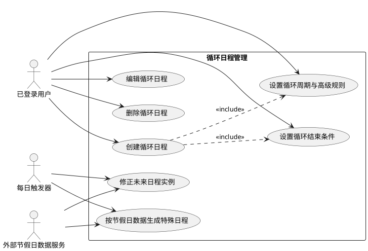
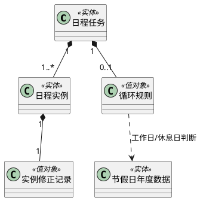

# 修订记录

| 时间 | 修订人 | 修订说明 |
|---|---|---|
| 20260724 | 用户与 Codex | 初始化循环日程扩展需求定义草案 |

# 1. 业务背景

当前日程管理支持单次、每天、每周和每月基础循环，但无法表达工作日、休息日、按间隔周期重复和按年度重复等真实生活安排。用户需要手动创建大量日程，法定节假日和调休场景也容易出现错误。

# 2. 系统目标

- 支持自然周期、工作日和休息日规则，减少重复创建日程的操作成本。
- 根据中国法定节假日和调休数据生成准确的未来日程实例。
- 在保留用户手动修改结果的前提下，维护未来未修改日程实例的一致性。

# 3. 系统边界

系统负责创建、展示、执行、编辑和删除单次及循环日程，支持每天、每周、每月、每年、工作日和休息日规则，支持高级周期参数、循环结束条件和未来日程实例修正。

系统使用外部节假日数据服务获取中国法定节假日和调休信息。系统不负责提醒通知、共享日历、外部日历同步、跨日日程、多日日程和多用户协作。

# 4. 用例设计

## 4.1 用例模型

## 4.2 参与者说明

| 参与者 | 与系统的关系 |
|---|---|
| 已登录用户 | 创建、配置、查看、编辑、完成和删除日程 |
| 每日触发器 | 按日发起节假日数据获取和未来日程维护 |
| 外部节假日数据服务 | 提供指定年份的中国法定节假日、放假日和调休上班日信息 |

## 4.3 用例说明

| 用例名 | 业务目标 | 用例优先级 |
|---|---|---|
| 创建循环日程 | 作为已登录用户，我希望创建按规则重复的日程，以便减少重复录入 | P0 |
| 设置循环周期与高级规则 | 作为已登录用户，我希望设置周期类型和高级参数，以便表达复杂的重复安排 | P0 |
| 设置循环结束条件 | 作为已登录用户，我希望设置循环结束方式，以便控制日程持续范围 | P1 |
| 按节假日数据生成特殊日程 | 作为已登录用户，我希望系统根据中国节假日和调休安排生成工作日与休息日日程，以便日程符合实际工作安排 | P0 |
| 修正未来日程实例 | 作为已登录用户，我希望未来日程根据有效规则保持准确，以便不需要手动维护重复日程 | P0 |
| 编辑循环日程 | 作为已登录用户，我希望修改循环日程或单次实例，以便应对临时变化 | P1 |
| 删除循环日程 | 作为已登录用户，我希望删除单次实例或后续循环安排，以便移除不再需要的日程 | P1 |

# 5. 用例描述

## 5.1 创建循环日程

| 项 | 内容 |
|---|---|
| 用例优先级 | P0 |
| 参与者 | 已登录用户 |
| 前置条件 | 用户已登录；开始日期为今天或未来日期 |
| 后置条件 | 系统保存循环规则，并生成未来日程实例 |

### 5.1.1 基本事件流

1. 用户输入日程名称、开始日期、全天或开始结束时间（D-1）。
2. 用户选择循环类型并设置规则（D-2）（B-1）。
3. 系统展示自然语言循环摘要（D-3）。
4. 用户确认保存。
5. 系统按照循环规则生成未来日程实例（B-2），用例结束。

### 5.1.2 备选事件流

A-1 开始日期早于今天：系统拒绝保存并提示用户选择今天或未来日期。

A-2 定时日程时间无效：系统提示开始时间和结束时间必须完整填写，且结束时间晚于开始时间。

A-3 节假日数据不可用：工作日和休息日规则按照已确认的默认兜底规则生成实例。

### 5.1.3 补充约束-数据需求

D-1 日程基本信息

| 数据 | 要求 |
|---|---|
| 日程名称 | 必填；不能为空 |
| 开始日期 | 必填；只能是今天或未来日期 |
| 全天标记 | 必填；全天日程不填写具体时间 |
| 开始时间、结束时间 | 定时日程必填；结束时间晚于开始时间；不支持跨日 |

D-2 循环规则

| 数据 | 要求 |
|---|---|
| 基础类型 | 不重复、每天、工作日、每周、每月、每年、休息日 |
| 高级周期 | 支持每 N 天、每 N 周、每 N 月、每 N 年；N 默认 1，最小值为 1 |
| 每月规则 | 支持按创建日的日期，或按每月第 N 个星期几 |
| 结束条件 | 默认永久；可选择截止日期或重复次数 |

D-3 循环摘要

| 数据 | 要求 |
|---|---|
| 摘要文本 | 保存前展示；必须明确周期、星期或日期、高级参数和结束条件 |

### 5.1.4 补充约束-业务规则

B-1 基础循环规则

- 每周按创建日的星期几重复；例如周一创建的每周日程在后续每周一发生。
- 每月按创建日的日期重复；31 号在没有 31 号的月份安排到当月最后一天。
- 每年按创建日的月日重复；2 月 29 日在非闰年安排到 2 月最后一天。
- 连续休息日每天生成一条日程实例。

B-2 实例生成范围

循环日程只生成未来 180 天内的实例；已发生实例保留原日期和执行状态。

## 5.2 按节假日数据生成特殊日程

| 项 | 内容 |
|---|---|
| 用例优先级 | P0 |
| 参与者 | 每日触发器、外部节假日数据服务 |
| 前置条件 | 系统需要生成或维护未来 180 天内的工作日或休息日日程 |
| 后置条件 | 符合规则的未来日期生成对应实例；不符合规则的日期不生成实例 |

### 5.2.1 基本事件流

1. 每日触发器发起指定年份的节假日数据获取（I-1）。
2. 系统接收该年份的节假日、放假日和调休上班日信息（D-4）。
3. 系统按照数据判断工作日和休息日（B-3）。
4. 系统生成未来 180 天内符合规则的实例。

### 5.2.2 备选事件流

A-4 年份已有非空数据：系统继续使用已保存的该年份数据，不重复获取。

A-5 获取结果为空或没有数据：系统保留空结果状态，后续每日继续尝试获取；获取不到数据时，工作日按周一至周五、休息日按周六周日处理。

### 5.2.3 补充约束-业务规则

B-3 工作日与休息日判断

- 工作日完全按节假日数据判断，包含周末调休上班日，并排除工作日放假日。
- 休息日包含外部数据标记的法定放假日，以及未调休为工作日的周六和周日。
- 休息日规则在连续休息期间每天生成一条实例。
- 年度数据首次获取成功后视为最终数据，不再自动检查该年份的后续变化。

### 5.2.4 补充约束-外部接口

I-1 获取年度节假日数据

- 服务提供者：外部节假日数据服务
- 参数：年份
- 返回值：该年份的法定节假日、放假日期和调休上班日期

## 5.3 修正未来日程实例

| 项 | 内容 |
|---|---|
| 用例优先级 | P0 |
| 参与者 | 每日触发器、外部节假日数据服务 |
| 前置条件 | 系统已存在工作日或休息日循环日程；未来实例尚未全部完成 |
| 后置条件 | 未来未被手动修改的实例与有效循环规则一致；历史实例和手动修改实例不被覆盖 |

### 5.3.1 基本事件流

1. 系统按日维护未来日程实例。
2. 系统识别未来未完成且未被手动修改的实例（D-5）。
3. 系统按照有效循环规则补充缺少的实例并移除不再符合规则的实例（B-4）。
4. 系统保留历史实例、已完成实例和用户手动修改过的单次实例。

### 5.3.2 补充约束-数据需求

D-4 节假日数据

| 数据 | 要求 |
|---|---|
| 年份 | 必须；用于识别数据所属年度 |
| 法定节假日日期 | 用于生成休息日实例 |
| 调休上班日期 | 用于生成工作日实例并覆盖周末休息判断 |

D-5 实例维护状态

| 数据 | 要求 |
|---|---|
| 是否历史实例 | 历史实例不得被自动修正 |
| 是否已完成 | 已完成实例不得被自动修正 |
| 是否手动修改 | 手动修改实例不得被自动修正 |

### 5.3.3 补充约束-业务规则

B-4 自动修正规则

- 自动修正只作用于未来、未完成且未被用户手动修改的实例。
- 自动修正不得改变历史实例、已完成实例或用户手动修改过的单次实例。
- 年度节假日数据成功获取后不再重复获取，因此不基于该年份后续外部变化再次修正实例。

## 5.4 编辑循环日程

用户可编辑循环日程的名称、全天属性和时间；对循环日程必须选择“仅此日程”或“此日程及以后”。仅此日程只影响当前实例，此日程及以后从当前实例日期开始形成新的后续安排；历史实例不被覆盖。

## 5.5 删除循环日程

用户可删除当前实例，或删除当前实例及其后续安排。删除操作必须在确认弹窗中明确展示删除范围；历史实例不因删除后续安排而被改写。

## 5.6 设置循环结束条件

用户可为循环日程选择永久、截止日期或重复次数。默认选择永久；截止日期和重复次数不得同时作为结束条件。

# 6. 领域模型

## 6.1 领域对象说明

| 领域对象 | 对象类型 | 业务含义 |
|---|---|---|
| 日程任务 | 实体 | 用户创建的单次或循环安排，定义名称、时间和循环规则 |
| 日程实例 | 实体 | 日程任务在具体日期发生的一次执行安排，记录计划内容和执行状态 |
| 循环规则 | 值对象 | 描述周期类型、间隔、日期条件和结束条件的规则集合 |
| 节假日年度数据 | 实体 | 某一年度的法定节假日、放假日和调休上班日信息 |
| 实例修正记录 | 值对象 | 描述实例是否历史、已完成或被用户手动修改的业务状态 |

## 6.2 领域模型图

# 7. 非功能需求及验收口径

| 类型 | 需求 | 验收口径 |
|---|---|---|
| 可靠性 | 外部节假日数据为空或不可用时，日程仍可按默认周末规则继续生成 | 工作日按周一至周五、休息日按周六周日生成；系统不因外部数据为空而阻止普通日程创建 |
| 数据一致性 | 自动修正不得覆盖历史、已完成或手动修改实例 | 构造上述三类实例后执行维护，实例内容保持不变 |
| 可用性 | 高级循环选项不干扰基础创建流程 | 默认只展示基础循环选项；用户展开高级设置后才看到 N、每月第 N 个星期几和结束条件 |
| 可理解性 | 保存前必须展示自然语言循环摘要 | 用户确认保存前能看到周期、日期条件和结束条件的完整文字说明 |
| 可维护性 | 年度节假日数据按年份独立管理 | 某年份已有非空数据时不重复获取；空结果年份可在后续每日任务中继续重试 |

