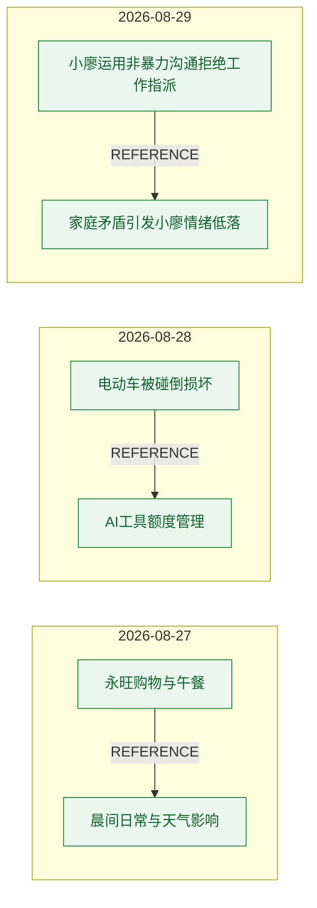
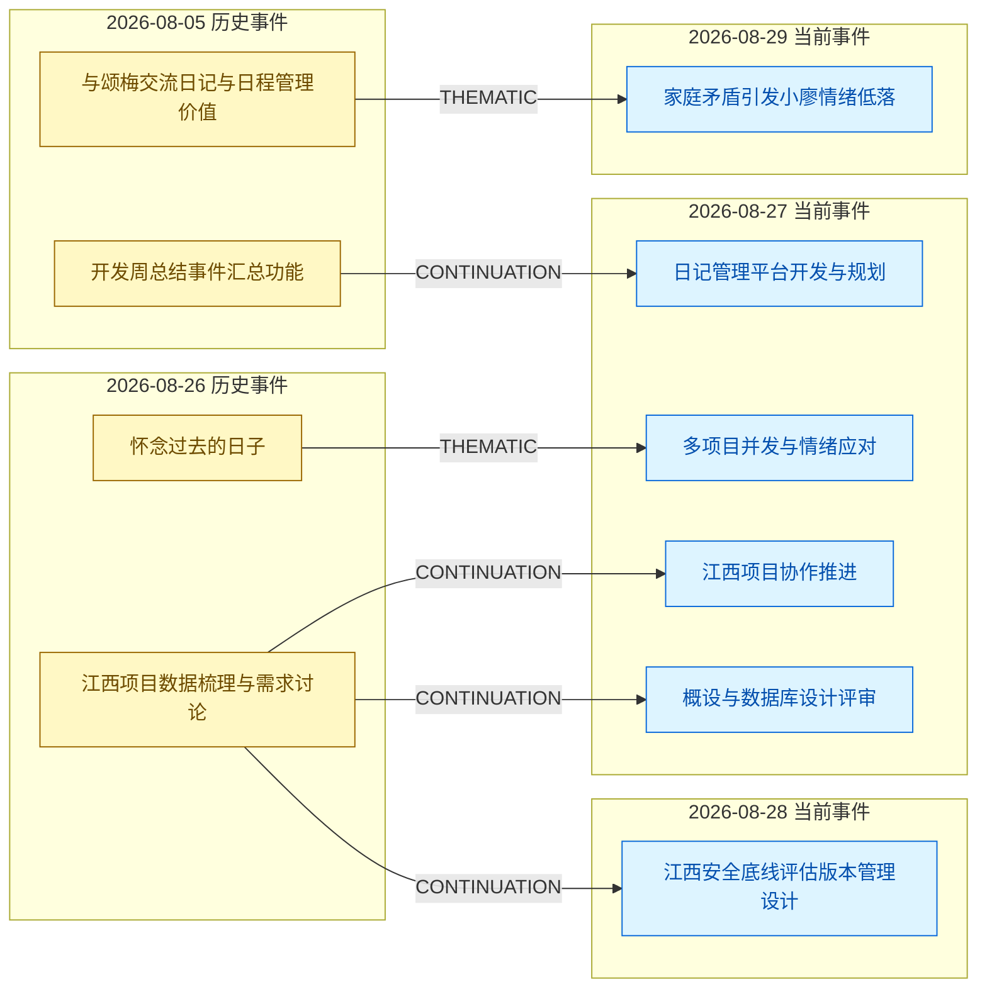
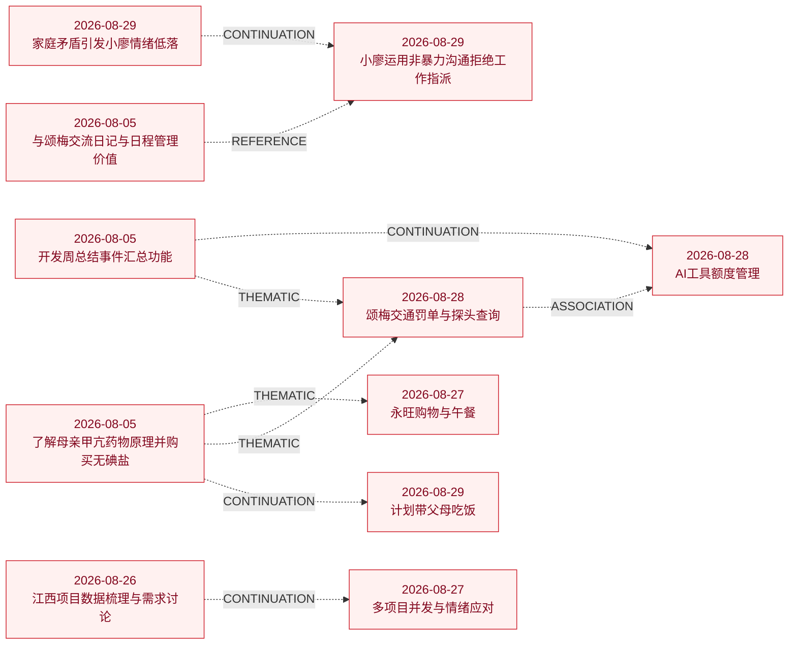

# 事件图谱分析流程真实数据验证

> 文档状态：验证完成  
> 验证日期：2026-09-01  
> 验证对象：日记内事件关系识别、历史事件召回和关系识别  
> 设计基线：[事件图谱分析流程实现设计-评审稿](事件图谱分析流程实现设计-评审稿.md)

## 1. 验证目的与边界

本次使用数据库中的真实日记和历史事件，验证以下设计：

1. 同一篇日记内多个事件之间的关系识别。
2. 基于完整正文和自然段向量召回历史事件。
3. 当前事件与历史事件之间的关系识别。
4. 模型输出结构、逐字证据校验和失败重试。

本次没有验证 `existing_relations`、直接前驱选择、祖先捷径边抑制、大日记输入预算、正式关系发布及事务回滚。原因是当前数据库没有事件关系表和已确认历史边，相关实现也尚未完成。

## 2. 执行摘要与设计决策

当前设计的主链路可以召回并识别真实关系，但关系提示词和校验失败恢复策略必须修改后才能进入实现。

| 验证项 | 结果 | 设计决策 |
|---|---|---|
| 日记内关系识别 | 模型输出 5 条；1 条原样成立、2 条需修正、2 条不成立 | 收紧关系核心事实、类型和方向判定 |
| 历史事件召回 | 162 个候选包含全部 6 条有效历史关系 | 最低相似度暂定为 `0.55` |
| 历史关系识别 | 模型输出 13 条；5 条原样成立、1 条需修正、7 条不成立 | 收紧关系直接性和对象一致性约束 |
| 输出结构与证据 | 23 个节点首次通过 20 个，通过率 `87.0%` | 校验失败后按相同输入自动原样重试 1 次 |
| 最终有效图谱 | 18 条模型关系中，6 条原样成立、3 条修正、9 条不成立 | 以复核后的 9 条关系作为首批回归基线 |

召回门槛 `0.55` 将历史候选从 162 个减少到 26 个，减少 `84.0%`，同时保留全部 6 条有效历史关系。`0.60` 只保留其中 3 条，不能采用。

## 3. 验证方案

### 3.1 数据与模型

| 项目 | 数值 |
|---|---:|
| 真实日记 | 3 篇（2026-08-27～2026-08-29） |
| 当前有效事件 | 20 个 |
| 已沉淀历史事件池 | 20 个 |
| 日记内关系节点 | 3 次 |
| 历史关系节点 | 20 次 |
| Embedding 模型 | `qwen3.7-text-embedding`，1024 维 |
| 关系模型 | 前 5 次使用 `qwen3.7-max-2026-05-17`，剩余节点及重试使用 `qwen3.7-max-2026-05-20` |
| 召回方式 | 无硬门槛；每个当前分块 Top-5，按历史事件合并后最多 15 个 |
| 历史图上下文 | 空数组 |

`qwen3.7-max-2026-05-17` 在验证中免费额度耗尽，后续按用户指定切换至 `qwen3.7-max-2026-05-20`。已完成的 5 次结果未重跑，所以本次是混合模型的流程验证，不是两个模型的横向评测。

### 3.2 执行流程

```text
读取真实日记和历史事件
  → 生成完整正文和自然段向量
  → 识别日记内事件关系
  → 为每个当前事件召回历史候选
  → 识别当前事件与历史事件关系
  → 校验 JSON 结构和逐字证据
  → 对模型关系执行事实复核
  → 形成有效图谱和回归样本
```

大模型调用使用的非密钥参数、完整提示词和原始返回均记录到 `backend/logs/ai_2026-09-01.log`。

### 3.3 事实复核标准

本文的“事实复核”是测试阶段对模型输出的评估，不是系统中的人工审批流程。复核时逐条对照真实日记正文，并检查：

1. 两个事件是否存在直接关系。
2. 关系是否作用于事件的核心事实，而不是附属动作。
3. 人物、项目、任务、目标和处理对象是否一致。
4. 关系类型是否符合定义。
5. `source_event → target_event` 方向是否正确。

复核结果分为“原样成立”“修正后成立”和“不成立”。其中“修正后成立”表示关系存在，但类型或方向错误。

## 4. 日记内事件关系验证

### 4.1 模型输出与复核

3 篇日记最终都通过结构和证据校验，共输出 5 条关系。

| 模型输出类型 | 数量 |
|---|---:|
| `CAUSAL` | 2 |
| `CONTINUATION` | 1 |
| `ASSOCIATION` | 1 |
| `REFERENCE` | 1 |

| 复核结果 | 数量 |
|---|---:|
| 原样成立 | 1 |
| 修正后成立 | 2 |
| 不成立 | 2 |

### 4.2 最终有效关系

1. 永旺购物与午餐 → 晨间日常与天气影响 / `REFERENCE`。
2. 电动车被碰倒损坏 → AI 工具额度管理 / `REFERENCE`。
3. 小廖运用非暴力沟通拒绝工作指派 → 家庭矛盾引发小廖情绪低落 / `REFERENCE`。

第二条中，AI 额度耗尽只导致用户下楼，没有导致车辆被碰和损坏。第三条中，情绪崩溃是用户在工作沟通事件中给予正面反馈的理由，没有引发工作沟通练习。因此，模型输出的两条 `CAUSAL` 都应改为反向 `REFERENCE`。

另外两条关系不成立：交通罚单查询和 AI 工具额度管理只是都使用 AI，不构成 `ASSOCIATION`；家庭情绪支持和工作中拒绝任务是不同具体事项，不构成 `CONTINUATION`。

完整模型理由和逐条复核见[附录 A](#附录-a模型输出逐条审计)。

## 5. 历史事件召回验证

### 5.1 召回结果

20 个当前事件合并得到 162 个历史候选，每个当前事件平均 `8.1` 个，实际范围为 5～14 个。

| 相似度门槛 | 保留候选 | 保留模型关系 | 保留有效历史关系 |
|---:|---:|---:|---:|
| 无 | 162 | 13/13 | 6/6 |
| 0.45 | 103 | 12/13 | 6/6 |
| 0.50 | 66 | 10/13 | 6/6 |
| 0.55 | 26 | 8/13 | 6/6 |
| 0.60 | 11 | 4/13 | 3/6 |

### 5.2 门槛结论

`GRAPH_RELATION_RECALL_MIN_SIMILARITY` 暂定为 `0.55`，并绑定当前 embedding 模型签名。

相似度只能用于控制候选数量，不能作为建边证据：“晨间日常与天气影响”的最高候选相似度为 `0.621`，双方没有直接关系；一条最终判定不成立的历史关系相似度达到 `0.742`。

## 6. 历史事件关系验证

### 6.1 模型输出与复核

历史关系模型输出 13 条关系。

| 复核结果 | 数量 |
|---|---:|
| 原样成立 | 5 |
| 修正后成立 | 1 |
| 不成立 | 7 |

### 6.2 最终有效关系

1. 开发周总结事件汇总功能 → 日记管理平台开发与规划 / `CONTINUATION`。
2. 怀念过去的日子 → 多项目并发与情绪应对 / `THEMATIC`。
3. 江西项目数据梳理与需求讨论 → 江西项目协作推进 / `CONTINUATION`。
4. 江西项目数据梳理与需求讨论 → 概设与数据库设计评审 / `CONTINUATION`。
5. 江西项目数据梳理与需求讨论 → 江西安全底线评估版本管理设计 / `CONTINUATION`。
6. 与颂梅交流日记与日程管理价值 → 家庭矛盾引发小廖情绪低落 / `THEMATIC`。

第六条模型输出为 `REFERENCE`。当前事件没有唯一引用某一次历史事件，但对早期建立的日记和日程管理价值形成了新的对比和反思，因此修正为 `THEMATIC`。

### 6.3 主要误判模式

| 误判模式 | 典型表现 | 违反的事实边界 |
|---|---|---|
| 抽象通用行为后建边 | “都使用 AI”“都先了解原理再决策” | 缺少可追溯的具体主题或结论 |
| 忽略经历者和目标 | 把母亲甲亢饮食与用户购买公司早餐关联 | 人物和具体目标不同 |
| 同平台不同功能强行延续 | 把周总结功能与事件图谱需求视为直接延续 | 具体任务不同，且存在更直接前驱 |
| 同人物和态度强行引用 | 把“希望她越来越好”与后续工作沟通关联 | 无法唯一映射到历史事件 |
| 宽泛照料行为强行延续 | 把甲亢饮食管理与带父母外出吃饭关联 | 不是同一具体事项 |

完整模型理由和逐条复核见[附录 A](#附录-a模型输出逐条审计)。

## 7. 输出结构与证据稳定性

23 个关系识别节点中，首次有 3 个模型返回未通过程序校验：

1. 一条日记内关系的 `source_evidence=[]`。
2. 一条历史关系对原文做了轻微改写，不是连续原文。
3. 另一条历史关系改写了原文中的工具名和表达。

三个节点按相同提示词和输入原样重试后全部通过。逐字证据校验有必要，但首次失败后立即终止会放大模型输出波动。

```text
首次输出校验失败
  → 相同提示词和输入自动原样重试 1 次
  → 第二次仍失败时使节点失败
```

重试不得把错误输出发送给模型进行修复。

## 8. 最终有效图谱

箭头表示 `source_event → target_event`。有效图谱共 9 条边，其中日记内关系 3 条、跨日记关系 6 条。

### 8.1 日记内关系



### 8.2 跨日记关系



## 9. 设计修改清单

### 9.1 提示词规则

| 关系类型 | 必须增加的约束 | 对应误判 |
|---|---|---|
| `CAUSAL` | 原因必须直接引发目标事件的核心结果 | AI 额度只导致下楼，不导致车辆损坏；情绪崩溃没有引发工作沟通 |
| `CONTINUATION` | 必须证明同一具体目标、任务、对象或处理流程持续推进 | 同平台不同功能、宽泛照料行为、相同人物均被误判为延续 |
| `ASSOCIATION` | 正文必须明确出现想起、记起或联想到的语义 | 两个事件只是都使用 AI |
| `THEMATIC` | 必须存在可追溯的具体主题，以及后事件的新结论或应用 | 模型抽象出“使用 AI”“了解原理后决策”等通用模式 |
| `REFERENCE` | 引用必须能唯一映射到被引用事件，并检查引用方指向被引用方 | 宽泛态度被误判为引用；两条因果关系方向错误 |

各类型需要增加以下硬约束：

- **`CAUSAL`**：原因必须直接引发目标事件的核心结果；不得把发现、注意、进入现场等附属动作扩大为核心结果的原因；提到先前情绪不等于该情绪引发后续工作。
- **`CONTINUATION`**：必须指出同一个具体目标、问题、任务、对象或处理流程；同人物、同平台、同类工具和宽泛行为不能证明延续。
- **`ASSOCIATION`**：想起方正文必须明确表达想到、记起、联想到或因此重新考虑；共享人物、工具或主题时返回无关系。
- **`THEMATIC`**：后事件必须形成、修正或应用一个能追溯到前事件的具体结论；不得先抽象通用行为模式再建边。
- **`REFERENCE`**：引用必须唯一映射到被引用事件；输出前检查“引用方 → 被引用方”；附属动作的理由不得扩大为 `CAUSAL`。

### 9.2 实现和回归验证

1. 将程序校验失败改为最多自动原样重试 1 次。
2. 将 `GRAPH_RELATION_RECALL_MIN_SIMILARITY` 暂定为 `0.55`，并绑定当前 embedding 模型签名。
3. 用附录 A 的 18 条关系建立第一批回归样本。
4. 提示词修改后重跑同一批日记，目标为类型和方向准确率至少 `85%`、9 条有效关系全部保留、9 条不成立关系全部不输出。
5. 关系表和历史边实现后，补测 `existing_relations`、直接前驱和祖先捷径边抑制。

## 10. 未验证项与验证产物

### 10.1 未验证项

| 未验证项 | 前置条件 |
|---|---|
| `existing_relations` 输入 | 数据库存在已确认历史边 |
| 直接前驱和祖先捷径边抑制 | 历史图谱形成至少三层连续关系 |
| 大日记输入预算和拆批 | 准备超过当前 4～9 个事件规模的真实样本 |
| 正式发布、幂等和事务回滚 | 关系表和统一发布节点完成实现 |

### 10.2 验证产物

- 验证脚本：`backend/scripts/validate_event_relation_design_live.py`
- 最终原始结果：`.scratch/event-relation-validation-20260901.json`
- 首轮失败快照：`.scratch/event-relation-validation-20260901-attempt1.json`
- 完整模型参数和返回日志：`backend/logs/ai_2026-09-01.log`

日志包含真实日记正文、完整提示词和模型原始返回，不应提交到公开仓库或发送给无权人员。

## 附录 A：模型输出逐条审计

### A.1 日记内关系

1. **模型关系**：永旺购物与午餐 → 晨间日常与天气影响 / `REFERENCE` / `HIGH`
   - **AI 原始理由**：E7将E1中因起床晚导致没吃早饭的经历作为去超市购买储备食物的理由。
   - **复核结论**：原样成立。
   - **复核理由**：购物事件明确把当天起晚、没吃早饭作为购买储备食物的理由，方向符合“引用方 → 被引用方”。

2. **模型关系**：AI 工具额度管理 → 电动车被碰倒损坏 / `CAUSAL` / `HIGH`
   - **AI 原始理由**：E5中Coder和CoderX额度用完，导致E6中用户下去给电动车充电，从而发现电动车被碰倒损坏。
   - **复核结论**：修正为“电动车被碰倒损坏 → AI 工具额度管理 / `REFERENCE`”。
   - **修正理由**：AI 额度耗尽只导致用户下楼，没有导致车辆被碰和损坏。电动车事件把额度耗尽作为下楼充电并发现损坏的理由，因此应用 `REFERENCE` 且方向反转。

3. **模型关系**：颂梅交通罚单与探头查询 → AI 工具额度管理 / `ASSOCIATION` / `HIGH`
   - **AI 原始理由**：E4中用户使用AI工具（元宝）查询探头信息，E5中用户提到'都AI时代了'并继续使用AI工具（CoderX），在认知上形成对AI工具使用的延续联想。
   - **复核结论**：不成立。
   - **不成立原因**：正文没有“想起、记起、联想到”等唤起语义，只是两个事件都使用 AI。

4. **模型关系**：家庭矛盾引发小廖情绪低落 → 小廖运用非暴力沟通拒绝工作指派 / `CAUSAL` / `HIGH`
   - **AI 原始理由**：E1记录小廖因被忽视而情绪低落甚至不想活着，E2明确提到小廖'刚刚情绪崩溃过'，随后进行了非暴力沟通练习，E1的情绪崩溃直接引发了E2中提到的情绪状态。
   - **复核结论**：修正为“小廖运用非暴力沟通拒绝工作指派 → 家庭矛盾引发小廖情绪低落 / `REFERENCE`”。
   - **修正理由**：情绪崩溃没有引发工作沟通练习；它只是用户在该事件中给予正面反馈的理由，因此是反向 `REFERENCE`。

5. **模型关系**：家庭矛盾引发小廖情绪低落 → 小廖运用非暴力沟通拒绝工作指派 / `CONTINUATION` / `MEDIUM`
   - **AI 原始理由**：E1中用户让小廖情绪缓和并给予关注，E2中小廖在情绪崩溃后主动尝试非暴力沟通处理工作问题，用户给予正面反馈鼓励，是情绪支持过程的延续。
   - **复核结论**：不成立。
   - **不成立原因**：家庭情绪支持和工作中拒绝任务是两个不同的具体事项，没有同一目标或处理流程的事实推进。

### A.2 历史关系

1. **模型关系**：开发周总结事件汇总功能 → 日记管理平台开发与规划 / `CONTINUATION` / `HIGH`
   - **AI 原始理由**：C中测试并修复日记管理平台的“事项管理”功能，并进一步规划“事件管理”与“事件图谱”，直接承接了H5中开发“每周事项整理”、“事项分类”及“周总结事件汇总”功能的计划与实际开发工作。
   - **复核结论**：原样成立。
   - **复核理由**：双方都指向日记管理平台的事项整理和事项管理功能，具体对象一致且后事件实际进入测试和修复阶段。

2. **模型关系**：江西项目数据梳理与需求讨论 → 多项目并发与情绪应对 / `CONTINUATION` / `HIGH`
   - **AI 原始理由**：H1中作者计划进行江西项目的数据梳理与数据库设计，C中作者在次日实际执行该任务，让AI帮忙整理数据并设计数据库表，但AI胡说八道未能有效完成，属于同一任务在事实层的继续推进与尝试。
   - **复核结论**：不成立。
   - **不成立原因**：当前事件的证据没有指明正在整理的是江西项目数据，无法确认双方实际对象一致。

3. **模型关系**：怀念过去的日子 → 多项目并发与情绪应对 / `THEMATIC` / `MEDIUM`
   - **AI 原始理由**：H2提出AI参与工作导致失去创造性乐趣的主题，C在实际遭遇AI胡说八道引发烦躁后，产生了新的心态调整与推导（将责任归于公司时间，与自己无关），形成主题上的新呼应与推导。
   - **复核结论**：原样成立。
   - **复核理由**：双方共享“AI 对工作体验的影响”这一具体主题，后事件形成了新的应对结论。

4. **模型关系**：江西项目数据梳理与需求讨论 → 江西项目协作推进 / `CONTINUATION` / `HIGH`
   - **AI 原始理由**：当前事件C继续推进历史事件H1中江西项目的数据梳理与数据库设计工作，并且都在处理数据问题并向童姐提问，事实链条直接且唯一。
   - **复核结论**：原样成立。
   - **复核理由**：项目、数据问题、数据库设计和协作人均一致，是同一任务的直接推进。

5. **模型关系**：江西项目数据梳理与需求讨论 → 概设与数据库设计评审 / `CONTINUATION` / `HIGH`
   - **AI 原始理由**：H1中用户梳理江西项目数据并讨论需求，计划第二天开始做接口；C中用户提到前一段时间搞的概设和数据库设计被童姐、杜秀清评审并提了问题需要修改，是同一数据库设计任务的后续推进。
   - **复核结论**：原样成立。
   - **复核理由**：童姐、数据库设计和前期工作共同确定了同一江西项目任务，当前事件进入评审修改阶段。

6. **模型关系**：了解母亲甲亢药物原理并购买无碘盐 → 永旺购物与午餐 / `THEMATIC` / `MEDIUM`
   - **AI 原始理由**：H1中用户通过AI了解桥本甲亢相关药理和饮食原理（如无碘盐、不吃海鲜），C中用户再次向AI咨询桥本适合的食品（粗粮、坚果、无糖牛肉干），体现了对桥本饮食管理的持续关注和新的推导应用。
   - **复核结论**：不成立。
   - **不成立原因**：历史事件的经历者是母亲，当前事件是用户给自己购买公司早餐，正文也没有说“桥本”指向母亲。经历者和具体目标不一致。

7. **模型关系**：江西项目数据梳理与需求讨论 → 江西安全底线评估版本管理设计 / `CONTINUATION` / `HIGH`
   - **AI 原始理由**：H1中完成了江西项目的数据梳理和数据库设计方向讨论，并计划第二天开始做接口；C中明确承接该工作，继续做江西安全底线评估，完成了数据库设计并推进到版本管理设计阶段。
   - **复核结论**：原样成立。
   - **复核理由**：双方都明确江西安全底线评估、数据梳理和数据库设计，后事件进入版本管理设计阶段。

8. **模型关系**：开发周总结事件汇总功能 → 颂梅交通罚单与探头查询 / `THEMATIC` / `MEDIUM`
   - **AI 原始理由**：H1中用户强调使用AI工具（如Coder、豆包）来科学地解决问题，并认为这是认知提升的出发点。C中用户使用AI工具（元宝）查询探头信息，并感叹'都AI时代了'，体现了对AI工具价值的认同和实际应用，形成了主题上的呼应和新推导。
   - **复核结论**：不成立。
   - **不成立原因**：“使用 AI 解决问题”是模型自行抽象的宽泛行为模式，当前事件没有形成可追溯到历史事件的具体新结论。

9. **模型关系**：了解母亲甲亢药物原理并购买无碘盐 → 颂梅交通罚单与探头查询 / `THEMATIC` / `MEDIUM`
   - **AI 原始理由**：H4中用户通过了解药物原理来辅助决策（如买无碘盐），强调'知其然，知其所以然'的知识价值。C中用户通过AI查询探头抓拍规则（如是否抓带人），并据此决定带两个头盔出门，同样体现了通过了解原理来辅助生活决策的主题呼应。
   - **复核结论**：不成立。
   - **不成立原因**：“了解原理后做决策”是通用方法，不是两个具体事件之间的直接主题关系。

10. **模型关系**：开发周总结事件汇总功能 → AI 工具额度管理 / `CONTINUATION` / `MEDIUM`
    - **AI 原始理由**：H1中用户与Coder沟通周总结事件汇总功能并设计事件分类方案，C中用户继续与Coder沟通事件之间的网络关系建立问题并整理出需求规格文档，属于同一日记管理平台事项管理功能的持续推进。
    - **复核结论**：不成立。
    - **不成立原因**：周总结、事项分类和事件图谱是同一平台下的不同具体功能。当前事件明确承接前一天的事项管理测试，8 月 5 日的事件不是直接前驱。

11. **模型关系**：与颂梅交流日记与日程管理价值 → 家庭矛盾引发小廖情绪低落 / `REFERENCE` / `HIGH`
    - **AI 原始理由**：C 中提到自己不再记录日记、不更新行动事项，把过去建立的'时间表、行动清单'作为对比对象，说明当前状态偏离了 H1 中倡导并实践的日记与日程管理习惯。
    - **复核结论**：修正为“与颂梅交流日记与日程管理价值 → 家庭矛盾引发小廖情绪低落 / `THEMATIC`”。
    - **修正理由**：当前事件没有唯一引用某一次历史事件，因此 `REFERENCE` 不成立；但历史事件明确建立日记与日程管理价值，后事件对习惯被出差打破、不愿继续记录形成新的对比和反思，符合 `THEMATIC`。

12. **模型关系**：与颂梅交流日记与日程管理价值 → 小廖运用非暴力沟通拒绝工作指派 / `REFERENCE` / `MEDIUM`
    - **AI 原始理由**：C中用户提到小廖'刚刚情绪崩溃过'，这与H1中用户建议小廖记日记、反思沟通问题、帮助成长的背景形成呼应，用户在C中给予小廖正面反馈鼓励，体现了H1中希望小廖'越来越好'的延续态度。
    - **复核结论**：不成立。
    - **不成立原因**：当前事件没有把旧日记事件作为条件、理由或对比对象。“希望小廖越来越好”只是宽泛人物和态度相似。

13. **模型关系**：了解母亲甲亢药物原理并购买无碘盐 → 计划带父母吃饭 / `CONTINUATION` / `MEDIUM`
    - **AI 原始理由**：C 中计划带父母出去吃饭并挑选餐厅，提到'上次带他们去吃无花果鸡，觉得还行吧'，与 H3 中为母亲甲亢购买无碘盐、关心父母饮食健康的事项在照顾父母这一具体任务上形成延续。H3 中用户主动了解母亲甲亢药物原理并调整饮食（无碘盐），C 中继续为父母安排外出就餐，体现了对父母生活照料的持续推进。
    - **复核结论**：不成立。
    - **不成立原因**：甲亢饮食管理和选择外出餐厅是两个不同具体事项，“照顾父母”是宽泛行为模式，不能作为 `CONTINUATION`。

## 附录 B：不成立的模型关系图

下图保留 9 条事实复核后判定不成立的模型关系，仅用于提示词回归，不属于有效事件图谱。


