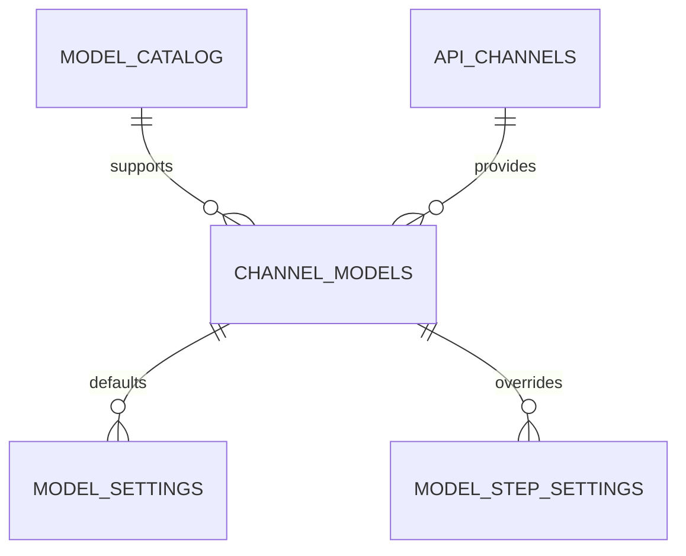

# 模型配置实现设计

核对基线：2026-10-29。对应[功能约定](功能约定.md)。完整枚举、字段、接口及校验以源码为准，本文保留关键设计和生效机制。

## 1. 数据分层

| 表 | 职责与约束 |
|---|---|
| `model_catalog` | 模型名称、类型、厂商、能力、评分、思考能力、自定义来源及启用状态 |
| `api_channels` | API 基地址、Fernet 加密密钥、思考参数模板及启用状态 |
| `channel_models` | 渠道/模型关联及启用状态，`channel_id + model_id` 唯一 |
| `model_settings` | 用途默认渠道模型、思考状态及修改人/时间，`setting_key` 唯一 |
| `model_step_settings` | 环节独立覆盖，`step_key` 唯一；模型和思考各可为空 |
| `organize_pipeline_settings` | 整理流程审核开关，保持与模型及思考配置分离 |

`model_step_settings` 不保存所属用途，避免数据库映射与实际调用步骤漂移。所属关系由 `STEP_SETTING_KEYS` 固定确定。模型协议由类型派生，实际请求名取 `model_catalog.model_name`，渠道关联中不再存协议或别名。

## 2. 代码及设计对应

| 位置 | 对应职责 |
|---|---|
| [持久化模型](../../../backend/models/model_config.py) | 五类模型配置对象及引用 |
| [管理服务](../../../backend/services/model_management.py) | 类型/能力枚举、继承视图、输入校验、引用保护、配置事务 |
| [运行时解析](../../../backend/services/model_runtime.py) | 当前可调用模型解析、解密、思考 payload |
| [管理接口](../../../backend/routers/admin_models.py) | 管理员入口、请求模型、测试调用 |
| [初始化](../../../backend/services/model_seed.py)与[清单](../../../backend/data/model_seed.csv) | 系统能力清单补齐与有限属性修复 |
| [整理流程配置](../../../backend/services/organize_settings.py) | 审核开关，逐次读取 |
| [模型页](../../../frontend/pages/admin/models.vue) / [渠道页](../../../frontend/pages/admin/channels.vue) / [设置页](../../../frontend/pages/admin/model-settings.vue) | 筛选、维护、覆盖/继承、测试和保存 |

接口在 `/diary/api/admin` 下提供模型、渠道、双向关联维护、用途/环节设置和测试。全部依赖 `require_admin`；业务字段定义直接参照请求模型，不维护第二份完整 JSON 副本。

## 3. 配置查询与事务保存

`get_model_settings_payload` 读取默认和覆盖记录，按当前用途清单输出默认值，按完整环节清单生成覆盖视图；每步含所属用途、覆盖值、有效模型和有效思考状态。前端据服务端结果展示，避免另写继承算法。

`save_model_settings`：

1. 校验提交的用途键，加载选定渠道模型并检查可调用性。
2. 语言用途要求布尔思考状态，ASR/向量用途要求为空。
3. 校验环节键、可空思考值；两个覆盖都为空则删覆盖记录。
4. `flush` 后合并数据库中的用途和环节设置。
5. 再检查全部默认及有效覆盖组合的模型能力、渠道状态和密钥。
6. 全部成功才 `commit`，失败 `rollback`。

请求可更新传入的用途与步骤，未传入的既有配置保留；不是每次必须重建所有配置行。当前 UI 通常按页面当前配置提交，仍由服务端统一验证。

旧用途已移除后，历史数据库仍可能保留旧键：查询返回按当前清单筛选，但保存的全量校验遍历已有记录。历史用途数据需单独核查与迁移，不能仅删除菜单就认为数据库已同步清理。本次未连接数据库确认或修改这些记录。

## 4. 可调用性与密钥

可调用性依次检查渠道模型、模型、渠道的启用状态及密钥存在，另校验用途要求的模型类型。API 基地址规范化去除尾部 `/`。

渠道密钥使用现有 Fernet 工具加密；序列化只返回 `has_api_key` 类状态，不返回密文或明文。非空新密钥表示替换，编辑留空保留原密钥，清空采用受引用保护的独立操作。运行时解析后才解密为内存中的请求参数。

`ensure_model_not_used`、`ensure_channel_not_used`、`ensure_channel_model_not_used` 同时检查用途默认和环节覆盖。禁用、删除模型/渠道/关联、清空渠道密钥前调用这些保护。移除某渠道关联时，处理被移除或禁用的关系，不能自动破坏使用中的默认与覆盖。

引用保护检查的是当前设置表，未枚举所有冻结任务配置；默认配置切换后，历史任务引用的原渠道仍需运行维护者保护。

## 5. 思考模式与流程开关

`validate_thinking_choice` 根据模型 `reasoning_mode` 检查最终布尔值；支持切换或强制开启时要求合法渠道模板。`validate_thinkmode` 验证开启/关闭模板结构。`resolve_thinking_payload` 返回与有效开关对应的字典，作为 OpenAI 兼容请求的扩展体。

不支持思考返回空字典；强制思考总是开启。环节为空继承用途，模型与开关互不捆绑；例如覆盖模型后仍可能继承不兼容的开关，必须一起验证有效组合。

`organize_pipeline_settings` 只影响清洗审核和内容审核是否运行，当前默认都关闭。流水线到达该步骤时调用 `get_organize_pipeline_options`，关闭时透传上游输出；思考模式由模型设置决定。旧迁移中的 `thinking_steps` 不再作为运行时来源。

## 6. 当前解析与冻结解析

### 当前解析入口

`resolve_model_setting(setting_key, step_key=None)` 检查用途合法、环节归属，加载默认和覆盖，分别合并模型与思考；再次执行状态、类型、密钥和能力校验后返回 `RuntimeModelConfig`。

配置包含调用用途、步骤、模型类型、派生协议、地址、内存密钥、模型名、渠道模型 ID、思考能力、有效开关和模板。管理端未配可调用用途时明确失败，旧 `.env` 模型名/地址/密钥不作为公共用途兜底。

### 不同调用方的实际时点

| 调用方 | 解析时点与限制 |
|---|---|
| [整理流水线](../../../backend/services/pipeline.py) | 每个 `_get_llm` 创建前读取当前步骤配置；已发请求不变，后续或重试调用重新读 |
| [对话服务](../../../backend/services/ai.py) | 当前对话调用解析 `chat`，使用有效思考模板 |
| [ASR 协议](../../../backend/services/fun_asr.py) | 请求属性按当前 `transcription` 解析；长任务期间改变渠道会影响后续请求，不能声称整个批次冻结全部 ASR 连接配置 |
| [图谱任务配置](../../../backend/services/graph_runtime.py) | `freeze_config` 在任务创建时解析模型、地址、思考 payload、提示词和预算，分析接入任务也冻结分析步骤 |
| [冻结任务恢复](../../../backend/services/graph_runtime.py) | `thaw_model` 沿用快照地址、模型名和参数；按原渠道模型读取当前密钥并检查关联/渠道仍可用 |

图谱接入后的日记分析入口由 [graph_tasks](../../../backend/services/graph_tasks.py) 创建任务。旧 [analysis_pipeline](../../../backend/services/analysis_pipeline.py) 仍定义分析规则与部分可调用函数，不能据其中 `_get_llm` 用法概称当前完整分析任务逐步骤使用最新配置。

冻结快照不存密钥明文，因此替换原渠道密钥可以影响恢复调用；修改用途选择不会自动重写旧快照。配置冻结也不意味着永久可调用，原渠道/关联被禁用、删除或密钥不可用时恢复会失败。

Skill 生成所使用模型属于执行 Skill 的环境，管理端的用途选择不能承诺控制该生成过程；服务端向量或保存工具若解析管理端配置，按对应工具的冻结/校验边界说明。具体两种实现的对应关系由日记模块维护。

## 7. 初始化与迁移

`model_seed.csv` 为当前初始化来源。初始化按模型名补齐缺失项，既有非自定义模型可以修复种子中的思考模式，管理员自建模型不被种子重建覆盖；不自动创建渠道、密钥和用途绑定。

历史迁移已将协议/别名等冗余字段移出渠道关联，并加入思考能力、模板及环节覆盖；具体 SQL 保留为数据库演进记录。新环境和旧环境升级应核对模型清单及设置兼容性，不能把旧“四用途、五分析环节”示意当成当前枚举。

## 8. 测试和可观测性

测试接口可接受未保存的渠道模型与思考选择，也可解析已保存用途/步骤。前者不自动保存；语言请求带实际思考 payload，向量请求固定最小输入及 1024 维，ASR 返回跳过真实音频测试。

现有[模型规则测试](../../../backend/tests/test_model_management.py)覆盖能力、继承归属及思考参数等约束；[前端模型类型检查](../../../frontend/tests/embedding-model-type-contract.test.ts)确认向量类型及图谱向量用途入口。测试存在不代表渠道真实连通或提供方行为已验收。

`llm_call_logs` 保存步骤、模型、token、耗时、状态和链路信息，本表不保存提示词全文或密钥。业务 AI 另有完整请求/响应日志，不得据统计表字段宣称全部日志均无正文；具体日志隐私约束及现状由日记模块与运行维护文档说明。

本次只核对和重写文档，没有发起模型测试、改变模型配置或修改服务代码。
