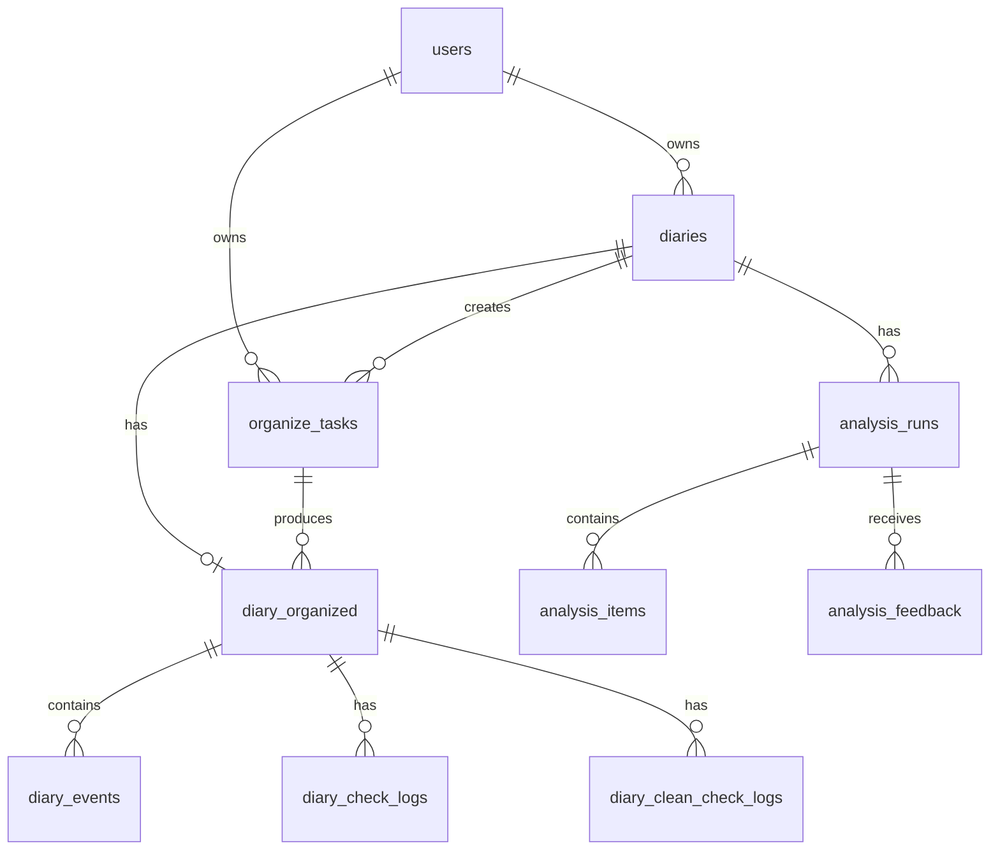
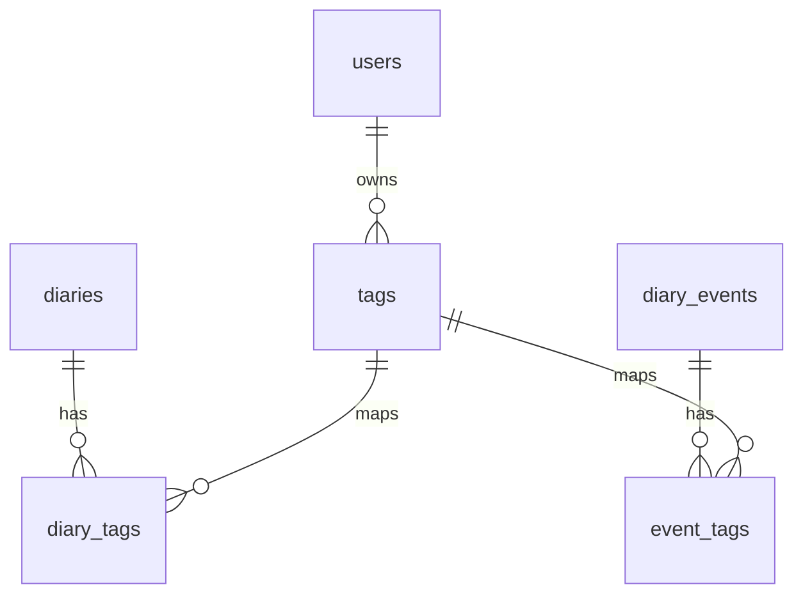
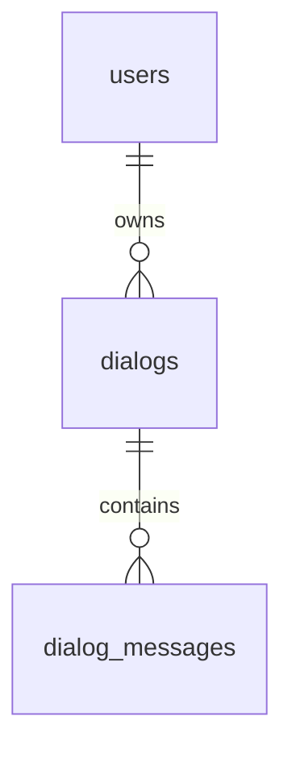
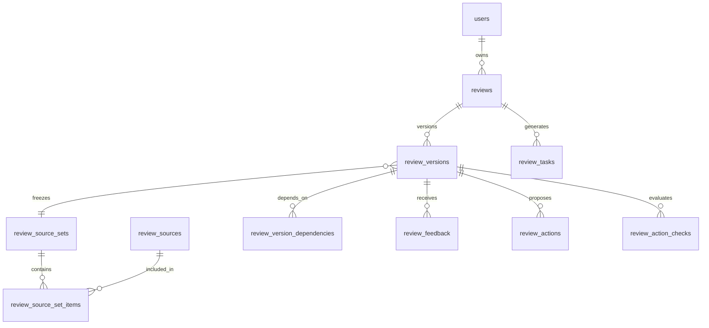
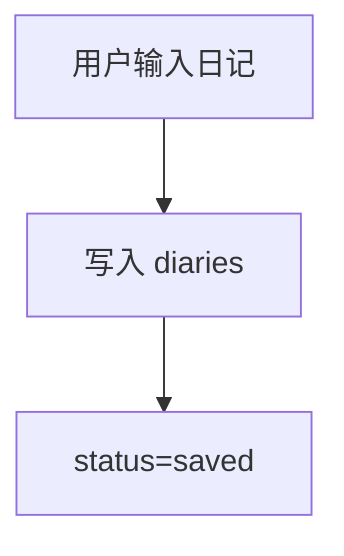
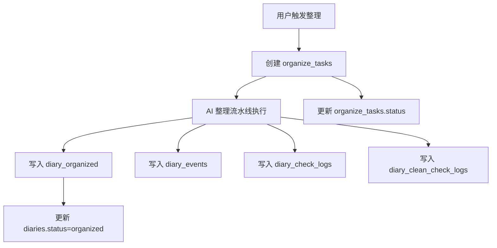
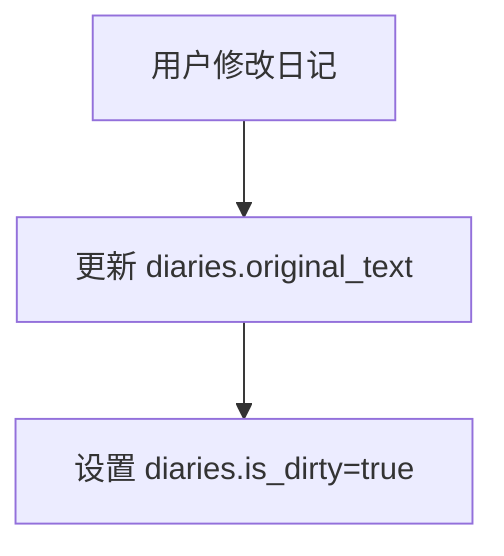
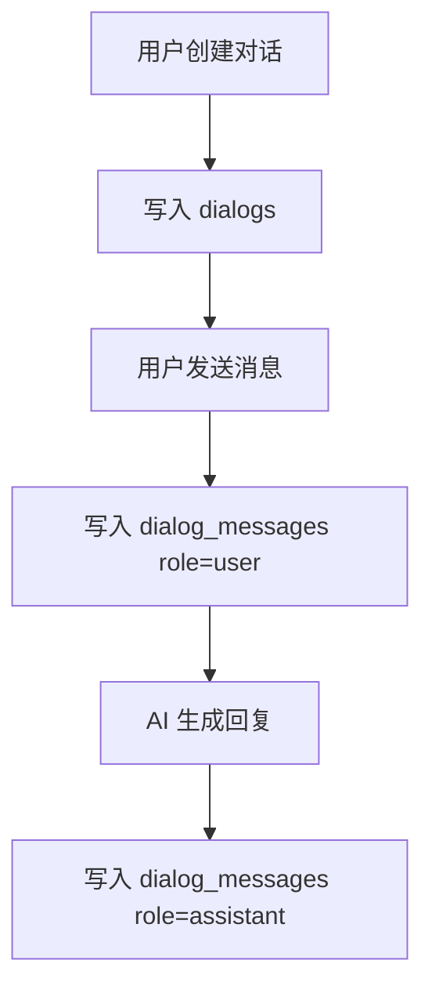
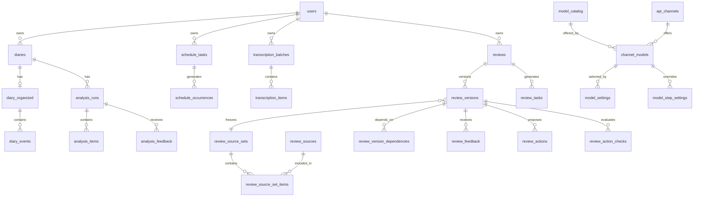

# 数据库设计

> 文档状态：现行  
> 事实基线：2026-08-01 SQLAlchemy 模型与迁移
> 本文恢复原字段级说明，并删除已由迁移确认废弃的 `diary_analysis` 单结果表。

> 范围：当前代码已实现的数据库结构。  
> 数据库：PostgreSQL 15。  
> ORM：SQLAlchemy。  
> 建表方式：后端启动时通过 `Base.metadata.create_all` 自动创建模型中声明的表。

## 1. 数据库概览

当前系统围绕“用户记录日记，AI 整理日记，AI 分析日记，标签沉淀检索，对话围绕内容展开”这条主链路建模。

核心数据按当前领域划分：

| 分类 | 表 | 说明 |
|---|---|---|
| 用户 | `users` | 登录账号与用户归属边界 |
| 日记主链路 | `diaries`、`organize_tasks`、`diary_organized`、`diary_events` | 日记原文、异步任务、整理结果和结构化事件 |
| 分析与反馈 | `analysis_runs`、`analysis_items`、`analysis_feedback` | 分析轮次、分析项和用户反馈 |
| 过程日志 | `diary_check_logs`、`diary_clean_check_logs` | AI 整理过程中的检查与清洗审核记录 |
| 标签 | `tags`、`diary_tags`、`event_tags` | 用户标签、日记标签、事件标签 |
| 对话 | `dialogs`、`dialog_messages` | 围绕日记、回顾或 AI 伙伴产生的对话 |
| 定期回顾 | `reviews`、`review_versions`、`review_tasks` | 周/月回顾、不可变版本与持久化生成任务 |
| 回顾来源 | `review_source_sets`、`review_sources`、`review_source_set_items`、`review_version_dependencies` | 冻结输入、原子事实来源、来源集合及周期依赖 |
| 回顾交互 | `review_feedback`、`review_actions`、`review_action_checks` | 分析反馈、行动及后续履行检查 |

## 2. ER 图

### 2.1 日记主链路

### 2.2 标签关系

### 2.3 对话关系

### 2.4 定期回顾关系

## 3. 表结构说明

### 3.1 `users`

用途：存储系统用户。所有日记、标签和对话都通过 `user_id` 归属到用户。

| 字段 | 类型 | 为空 | 默认值 | 约束 | 说明 |
|---|---|---|---|---|---|
| `id` | UUID | 否 | `uuid.uuid4` | 主键 | 用户 ID |
| `username` | String(50) | 否 | 无 | 唯一 | 用户名 |
| `password_encrypted` | String(500) | 否 | 无 | 无 | 加密后的密码 |
| `created_at` | DateTime | 是 | `datetime.utcnow` | 无 | 创建时间 |

写入时机：用户注册或系统启动创建默认管理员账号时写入。  
读取场景：登录认证、日记查询、标签查询、对话查询。

### 3.2 `diaries`

用途：存储日记原始文本和日记状态，是日记业务的主表。

| 字段 | 类型 | 为空 | 默认值 | 约束 | 说明 |
|---|---|---|---|---|---|
| `id` | UUID | 否 | `uuid.uuid4` | 主键 | 日记 ID |
| `user_id` | UUID | 否 | 无 | 外键：`users.id` | 所属用户 |
| `original_text` | Text | 否 | 无 | 无 | 日记原文 |
| `diary_date` | Date | 否 | 无 | 无 | 日记日期 |
| `status` | Enum(`saved`, `organized`, `analyzed`) | 是 | `saved` | 无 | 日记状态 |
| `is_dirty` | Boolean | 否 | `False` | 无 | 整理或分析后，原文被再次修改的脏标记 |
| `created_at` | DateTime | 是 | `datetime.utcnow` | 无 | 创建时间 |
| `updated_at` | DateTime | 是 | `datetime.utcnow` | on update | 更新时间 |

写入时机：创建正式日记时写入，初始状态为 `saved`。  
读取场景：首页列表、日历页、日记详情页、整理任务、分析任务、对话上下文。

### 3.3 `organize_tasks`

用途：记录日记整理和分析的异步任务状态。

| 字段 | 类型 | 为空 | 默认值 | 约束 | 说明 |
|---|---|---|---|---|---|
| `id` | UUID | 否 | `uuid.uuid4` | 主键 | 任务 ID |
| `diary_id` | UUID | 否 | 无 | 外键：`diaries.id` | 关联日记 |
| `user_id` | UUID | 否 | 无 | 外键：`users.id` | 所属用户 |
| `status` | String(20) | 是 | `running` | 无 | 任务状态：`running` / `completed` / `failed` |
| `task_type` | String(20) | 是 | `organize` | 无 | 任务类型：`organize` / `analyze` |
| `current_step` | String(50) | 是 | 无 | 无 | 当前执行步骤 |
| `error_message` | Text | 是 | 无 | 无 | 失败原因 |
| `created_at` | DateTime | 是 | `datetime.utcnow` | 无 | 创建时间 |
| `updated_at` | DateTime | 是 | `datetime.utcnow` | on update | 更新时间 |

写入时机：用户触发整理或分析时创建。  
读取场景：前端轮询任务进度、后端启动时恢复卡住的 `running` 任务。

### 3.4 `diary_organized`

用途：存储 AI 整理后的日记级内容。每篇日记最多一条整理结果。

| 字段 | 类型 | 为空 | 默认值 | 约束 | 说明 |
|---|---|---|---|---|---|
| `id` | UUID | 否 | `uuid.uuid4` | 主键 | 整理结果 ID |
| `task_id` | UUID | 否 | 无 | 外键：`organize_tasks.id` | 产生该整理结果的任务 |
| `diary_id` | UUID | 否 | 无 | 外键：`diaries.id`，唯一 | 关联日记 |
| `title` | String(200) | 是 | 无 | 无 | 日记标题；整理时为空，普通分析的元数据环节回填 |
| `summary` | Text | 是 | 无 | 无 | 日记摘要；整理时为空，普通分析的元数据环节回填 |
| `content` | Text | 是 | 无 | 无 | 整理后的完整内容 |
| `mood` | String(50) | 是 | 无 | 无 | 旧兼容字段；当前心情保存在 `analysis_runs.mood` |
| `location` | String(100) | 是 | 无 | 无 | 地点；整理时为空，普通分析的元数据环节回填 |
| `introduction` | Text | 是 | 无 | 无 | 引入段 |
| `trivia` | Text | 是 | 无 | 无 | JSON 序列化的琐事数组 |
| `plans` | Text | 是 | 无 | 无 | JSON 序列化的计划数组 |
| `organized_at` | DateTime | 是 | `datetime.utcnow` | 无 | 整理时间 |
| `updated_at` | DateTime | 是 | `datetime.utcnow` | on update | 更新时间 |

写入时机：整理流水线完成后写入结构化正文、引入段、琐事和计划；普通分析完成后回填标题、摘要和地点。  
读取场景：日记详情页、分析流水线输入、事件展示、对话上下文。

### 3.5 `diary_events`

用途：存储整理后的结构化事件。一个整理结果可以包含多个事件。

| 字段 | 类型 | 为空 | 默认值 | 约束 | 说明 |
|---|---|---|---|---|---|
| `id` | UUID | 否 | `uuid.uuid4` | 主键 | 事件 ID |
| `diary_organized_id` | UUID | 否 | 无 | 外键：`diary_organized.id` | 所属整理结果 |
| `event_title` | String(200) | 是 | 无 | 无 | 事件标题 |
| `body` | Text | 否 | 无 | 无 | 事件正文 |
| `feeling` | Text | 是 | 无 | 无 | 事件感受 |
| `reflection` | Text | 是 | 无 | 无 | 事件反思 |
| `event_tags` | Text | 是 | 无 | 无 | JSON 序列化的事件级标签 |
| `sort_order` | Integer | 是 | `0` | 无 | 展示排序 |
| `created_at` | DateTime | 是 | `datetime.utcnow` | 无 | 创建时间 |

写入时机：整理流水线拆分事件后写入；分析结果独立保存到 `analysis_runs` 和 `analysis_items`。  
读取场景：日记详情事件列表、分析输入、标签关联、事件级 AI 分析展示。

### 3.6 `diary_check_logs`

用途：记录整理阶段内容检查结果，属于内部过程数据。

| 字段 | 类型 | 为空 | 默认值 | 约束 | 说明 |
|---|---|---|---|---|---|
| `id` | UUID | 否 | `uuid.uuid4` | 主键 | 检查记录 ID |
| `diary_organized_id` | UUID | 否 | 无 | 外键：`diary_organized.id` | 所属整理结果 |
| `check_item` | String(100) | 是 | 无 | 无 | 检查项 |
| `status` | String(20) | 是 | 无 | 无 | 检查状态 |
| `issue` | Text | 是 | 无 | 无 | 发现的问题 |
| `before` | Text | 是 | 无 | 无 | 修正前内容 |
| `after` | Text | 是 | 无 | 无 | 修正后内容 |
| `target` | String(200) | 是 | 无 | 无 | 被修正目标 |
| `reason` | Text | 是 | 无 | 无 | 修正原因 |
| `sort_order` | Integer | 是 | `0` | 无 | 排序 |
| `created_at` | DateTime | 是 | `datetime.utcnow` | 无 | 创建时间 |

写入时机：整理流水线内容检查阶段写入。  
读取场景：内部排查 AI 整理质量。

### 3.7 `diary_clean_check_logs`

用途：记录文本清洗审核结果，属于内部过程数据。

| 字段 | 类型 | 为空 | 默认值 | 约束 | 说明 |
|---|---|---|---|---|---|
| `id` | UUID | 否 | `uuid.uuid4` | 主键 | 清洗审核记录 ID |
| `diary_organized_id` | UUID | 否 | 无 | 外键：`diary_organized.id` | 所属整理结果 |
| `issue` | Text | 是 | 无 | 无 | 发现的问题 |
| `before` | Text | 是 | 无 | 无 | 修正前内容 |
| `after` | Text | 是 | 无 | 无 | 修正后内容 |
| `reason` | Text | 是 | 无 | 无 | 修正原因 |
| `sort_order` | Integer | 是 | `0` | 无 | 排序 |
| `created_at` | DateTime | 是 | `datetime.utcnow` | 无 | 创建时间 |

写入时机：整理流水线清洗审核阶段写入。  
读取场景：内部排查文本清洗质量。

### 3.8 `tags`

用途：存储用户维度的标签。标签可关联到日记，也可关联到具体事件。

| 字段 | 类型 | 为空 | 默认值 | 约束 | 说明 |
|---|---|---|---|---|---|
| `id` | UUID | 否 | `uuid.uuid4` | 主键 | 标签 ID |
| `user_id` | UUID | 否 | 无 | 外键：`users.id`，联合唯一 | 所属用户 |
| `name` | String(50) | 否 | 无 | 联合唯一 | 标签名 |
| `type` | String(30) | 是 | 无 | 无 | 标签类型：`domain` / `topic` / `person_object` / `psychological` / `knowledge` |
| `created_at` | DateTime | 是 | `datetime.utcnow` | 无 | 创建时间 |

唯一约束：`user_id` + `name`。  
写入时机：分析流水线提取标签并 upsert 时写入。  
读取场景：标签筛选、标签列表、日记和事件标签展示。

### 3.9 `diary_tags`

用途：日记与标签的多对多关联表。

| 字段 | 类型 | 为空 | 默认值 | 约束 | 说明 |
|---|---|---|---|---|---|
| `diary_id` | UUID | 否 | 无 | 主键，外键：`diaries.id` | 日记 ID |
| `tag_id` | UUID | 否 | 无 | 主键，外键：`tags.id` | 标签 ID |

写入时机：分析流水线汇总事件标签后，为日记建立标签关联。  
读取场景：按标签查询日记、日记详情展示标签。

### 3.10 `event_tags`

用途：事件与标签的多对多关联表。

| 字段 | 类型 | 为空 | 默认值 | 约束 | 说明 |
|---|---|---|---|---|---|
| `diary_event_id` | UUID | 否 | 无 | 主键，外键：`diary_events.id` | 事件 ID |
| `tag_id` | UUID | 否 | 无 | 主键，外键：`tags.id` | 标签 ID |

写入时机：分析流水线为每个事件建立标签关联。  
读取场景：事件标签展示、按标签定位具体事件。

### 3.11 `dialogs`

用途：存储一次对话会话。对话可来源于日记详情、回顾或 AI 伙伴。

| 字段 | 类型 | 为空 | 默认值 | 约束 | 说明 |
|---|---|---|---|---|---|
| `id` | UUID | 否 | `uuid.uuid4` | 主键 | 对话 ID |
| `user_id` | UUID | 否 | 无 | 外键：`users.id` | 所属用户 |
| `source_type` | Enum(`diary_detail`, `review`, `ai_companion`) | 否 | 无 | 无 | 对话来源类型 |
| `source_id` | UUID | 是 | 无 | 无 | 来源对象 ID |
| `created_at` | DateTime | 是 | `datetime.utcnow` | 无 | 创建时间 |
| `updated_at` | DateTime | 是 | `datetime.utcnow` | on update | 更新时间 |

写入时机：用户创建对话时写入。  
读取场景：对话列表、日记详情页内嵌对话、AI 伙伴对话上下文。

### 3.12 `dialog_messages`

用途：存储对话中的每条消息。

| 字段 | 类型 | 为空 | 默认值 | 约束 | 说明 |
|---|---|---|---|---|---|
| `id` | UUID | 否 | `uuid.uuid4` | 主键 | 消息 ID |
| `dialog_id` | UUID | 否 | 无 | 外键：`dialogs.id` | 所属对话 |
| `role` | Enum(`user`, `assistant`) | 否 | 无 | 无 | 消息角色 |
| `content` | Text | 否 | 无 | 无 | 消息内容 |
| `created_at` | DateTime | 是 | `datetime.utcnow` | 无 | 创建时间 |

写入时机：用户发送消息或 AI 回复时写入。  
读取场景：对话详情、AI 回复上下文组装。

## 4. 数据生命周期

### 4.1 日记创建

日记原文保存在 `diaries.original_text`。日记日期保存在 `diaries.diary_date`。日记属于单个用户，由 `diaries.user_id` 标识。

### 4.2 日记整理

整理任务通过 `organize_tasks.task_type=organize` 标识。整理结果写入 `diary_organized`，结构化事件写入 `diary_events`，过程检查记录写入日志表。

### 4.3 日记分析

1. 创建或复用 `task_type=analyze` 的异步任务。
2. 串行执行元数据与标签、核心分析、认知分析。
3. 写入 `analysis_runs` 和 `analysis_items`，旧当前轮次转为历史。
4. 保存反馈时写入 `analysis_feedback`；反馈重分析产生新轮次。
5. 日记状态更新为 `analyzed`。

### 4.4 日记修改

`is_dirty` 表示当前原文和既有整理或分析结果可能不一致。该字段用于提醒后续重新整理或重新分析。

### 4.5 对话产生

对话通过 `dialogs.source_type` 区分来源。日记详情对话可以通过 `source_id` 指向对应日记。

## 5. 2026-07-31 新增模型与字段补充

以下表和字段由后续代码及迁移引入，属于当前数据库设计：

### 5.1 表清单

| 领域 | 表 | 用途 |
|---|---|---|
| 账号 | `users` | 用户凭据与账号信息 |
| 日记 | `diaries` | 日记原文、日期、状态、脏标记和软删除 |
| 日记 | `diary_organized` | 一篇日记的当前结构化整理结果 |
| 日记 | `diary_events` | 结构化事件 |
| 日记 | `diary_check_logs`、`diary_clean_check_logs` | 整理质量检查记录 |
| 日记 | `organize_tasks` | 整理和分析异步任务 |
| 分析 | `analysis_runs` | 分析历史轮次 |
| 分析 | `analysis_items` | 日记级与事件级分析块 |
| 分析 | `analysis_feedback` | 用户评分、评论和继承关系 |
| 批注 | `diary_annotations` | 正文和分析内容的文本定位 |
| 批注 | `diary_annotation_comments` | 批注评论 |
| 标签 | `tags`、`diary_tags`、`event_tags` | 用户标签及多对多关联 |
| 收藏 | `favorites` | 日记或事件收藏 |
| 对话 | `dialogs`、`dialog_messages` | 来源对话和消息历史 |
| 语音 | `transcription_batches`、`transcription_items` | 语音批次与音频项 |
| 资料 | `hot_words`、`person_relations`、`asr_vocabularies` | 用户词表和人物关系 |
| 日程 | `schedule_tasks`、`schedule_occurrences` | 日程定义与持久化实例 |
| 日程 | `schedule_holiday_years` | 节假日年度缓存 |
| 日程 | `schedule_maintenance_jobs` | 未来实例维护任务 |
| 定期回顾 | `reviews`、`review_versions`、`review_tasks` | 回顾周期、不可变版本与可恢复生成任务 |
| 回顾来源 | `review_source_sets`、`review_sources`、`review_source_set_items` | 输入快照、原子来源及来源集合关联 |
| 回顾来源 | `review_version_dependencies` | 下级周期及同级前序回顾依赖 |
| 回顾交互 | `review_feedback`、`review_actions`、`review_action_checks` | 分析反馈、候选行动及履行检查 |
| 模型 | `model_catalog`、`api_channels`、`channel_models` | 模型能力和调用渠道 |
| 模型 | `model_settings`、`model_step_settings` | 用途级与环节级模型配置 |
| 模型 | `organize_pipeline_settings` | 整理审核环节开关 |
| 可观测性 | `llm_call_logs` | 模型调用耗时与 token 统计 |
| 备份 | `backup_restore_records`、`backup_import_reports` | 备份恢复任务和导入报告 |

### 5.2 核心关系

### 5.3 关键约束

- `users.username` 全局唯一。
- 同一用户下 `tags.name`、热词文本和人物姓名保持唯一。
- 一个转写批次最多关联一篇正式日记。
- 同一用户同一日期只能有一个活动语音批次。
- 同一日程任务同一日期最多一个日程实例。
- 一条收藏必须且只能指向日记或事件之一，并按用户与目标唯一。
- `model_settings.setting_key` 和 `model_step_settings.step_key` 唯一。
- 同一用户、回顾类型和周期只能有一条 `reviews`；同一回顾的版本号唯一。
- 同一回顾只能有一个处于 `QUEUED` 或 `RUNNING` 的生成任务。
- 回顾版本引用冻结的来源集合；只有 `READY` 集合可进入版本持久化。
- API 密钥和用户密码只保存加密值。

### 5.4 状态数据

- 日记状态：`saved`、`organized`、`analyzed`。
- 整理/分析任务：`running`、`completed`、`failed`。
- 分析轮次：`CURRENT` 与历史状态。
- 日程实例主要状态：`pending`、`completed`。
- 语音批次和音频项分别维护独立状态机，设计见[语音录入系统设计](日记管理/语音录入系统设计.md)。
- 回顾任务：`QUEUED`、`RUNNING`、`SUCCEEDED`、`FAILED`、`SKIPPED_NO_DATA`。
- 回顾来源集合：`BUILDING`、`READY`、`ABANDONED`；行动：`CANDIDATE`、`CONFIRMED`、`IGNORED`。

### 5.5 建表与迁移

应用启动时执行 `Base.metadata.create_all` 创建缺失表；既有表结构演进依赖 `backend/migrations/001_*.sql` 至 `027_*.sql`。`create_all` 不会替代 ALTER/DROP 类迁移，因此部署已有数据库时必须按顺序执行尚未应用的迁移。定期回顾上线前必须执行 `027_periodic_reviews.sql`，以补齐修订号、回顾表和 LLM 日志字段。

当前仓库没有迁移版本登记表，部署方需要自行记录迁移执行状态，避免重复或漏执行。

## 6. 关键新增字段

- `diaries.deleted_at`、`deleted_by`：日记软删除。
- `diaries.content_revision`：日记原文修订号，用于判断整理结果是否仍对应当前原文。
- `diary_organized.source_content_revision`、`structured_revision`：整理输入修订号与结构化内容修订号。
- `analysis_runs.source_structured_revision`：分析所依据的结构化修订号。
- `organize_tasks.analysis_mode`：普通分析或反馈分析。
- `analysis_feedback.is_inherited`、`source_feedback_id`：反馈继承链。
- `diary_annotations.merged_into_id`：批注合并去向。
- `schedule_occurrences.manually_modified`、`execution_note`：实例保护和执行记录。
- `transcription_batches.hotword_vocabulary_id`、`hotword_fingerprint`：ASR 词表快照。
- `model_catalog.reasoning_mode`、`api_channels.thinkmode`：模型思考能力。
- `model_settings.thinking_enabled`、`model_step_settings`：用途与环节思考配置。
- `review_source_sets.input_snapshot`：冻结分析、反馈、行动、依赖、缺失周期和日程状态等生成输入。
- `review_actions.rationale`：候选行动的生成依据。
- `llm_call_logs.review_task_id`、`completion_tokens`：回顾任务关联和输出 token 统计。
