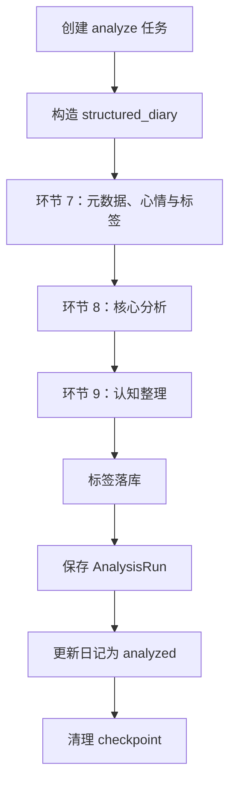
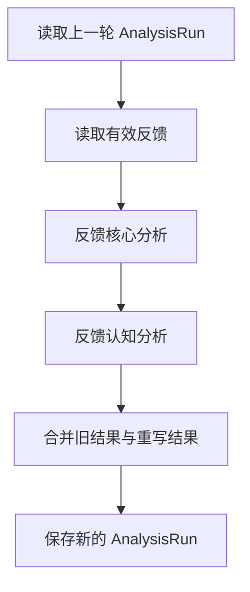

# AI 分析流水线设计

> 文档状态：现行  
> 事实基线：2026-07-31 代码  
> 本文描述当前代码中的分析设计与运行机制，不描述尚未实现的目标功能。

## 1. 范围与职责

分析流水线处理已经完成结构化整理的日记，输出心情、标签、自我理解、行为分析、行动建议、认知校准、问题解答和认知完善。

日记完整链路分为两类流水线：

1. 整理流水线：把原始文本转换为结构化日记。实现位于 `backend/services/pipeline.py`，不属于本文的分析环节，但它是分析流水线的前置依赖。
2. 分析流水线：基于结构化日记生成分析结果。实现位于 `backend/services/analysis_pipeline.py`。

分析流水线包含两种运行模式：

| 模式 | 入口 | 作用 |
|---|---|---|
| 普通分析 | `AIService.analyze_diary` → `run_analysis_pipeline` | 生成一轮完整分析 |
| 反馈重分析 | `run_feedback_reanalysis_pipeline` | 根据低评分文字反馈重写相关分析，不重复生成无关内容 |

## 2. 核心业务流程总览

本节是分析任务的唯一业务总览。后续章节分别解释数据结构、Prompt 和代码实现，不重新定义流水线选择与任务恢复规则。

### 2.1 进入分析接口

用户调用 `POST /api/diaries/{diary_id}/analyze` 时，后端按以下顺序处理：

1. 校验日记存在且属于当前用户。
2. 日记状态必须为 `organized` 或 `analyzed`。
3. 必须存在 `diary_organized`，否则不能分析。
4. 获取当前有效的 `AnalysisRun` 和有效文字反馈。
5. 根据当前有效反馈选择流水线，并在任务创建时固定 `analysis_mode`。

### 2.2 流水线选择规则

```text
当前分析结果存在有效文字反馈？
├─ 否 → analysis_mode=ordinary → 普通分析流水线
└─ 是 → analysis_mode=feedback → 反馈重分析流水线
```

具体规则：

| 条件 | 选择 | 输入的上一轮结果 |
|---|---|---|
| 没有当前分析结果，或当前分析没有有效反馈 | 普通分析 | 无 |
| 当前分析存在有效低评分文字反馈 | 反馈重分析 | 当前 `AnalysisRun` |

普通分析生成完整的环节 7、8、9 结果；反馈重分析只重写反馈命中的分析类型，并继承其他类型的上一轮结果。

### 2.3 任务创建、复用与并发控制

每次请求都先检查同一日记是否存在 `running` 的分析任务：

```text
存在未超时 running 任务 → 返回该任务状态，不重复创建
存在超过 15 分钟的 running 任务 → 标记 failed，继续处理本次请求
不存在 running 任务 → 查找同 analysis_mode 的 failed 任务
```

对 `failed` 任务：

- 找到同一日记、同一用户、同一 `analysis_mode` 的失败任务：复用原 `task_id`，恢复执行。
- 找不到：创建新的 `OrganizeTask`，状态为 `running`。
- 复用失败任务时不重置 `current_step`，保留实际失败位置。

`task_id` 同时作为 LangGraph 的 `thread_id`，因此任务记录和 checkpoint 是一一对应的。

### 2.4 后台执行与三条流程

任务接口只负责创建或复用任务，并通过 `asyncio.create_task` 启动后台执行：

```text
analysis_mode=ordinary
    → AIService.analyze_diary
    → run_analysis_pipeline
    → 环节 7 → 环节 8 → 环节 9

analysis_mode=feedback
    → run_feedback_reanalysis_pipeline
    → 反馈核心分析 → 反馈认知分析
```

整理流水线不是分析模式之一。它先将 `saved` 日记整理为 `organized`，分析接口只接收已经完成整理的日记。

### 2.5 失败后的断点继续

节点失败时，后台任务执行以下操作：

1. 捕获异常。
2. 将 `OrganizeTask.status` 更新为 `failed`。
3. 写入 `error_message`。
4. 保留 PostgreSQL checkpoint。
5. 用户再次调用分析接口时，复用原 `task_id`。

恢复逻辑：

```text
读取 task_id 对应 checkpoint
├─ 没有 checkpoint
│  └─ 使用初始输入，从第一节点开始
├─ checkpoint.next 非空
│  └─ 使用 ainvoke(None)，从最近一次成功节点继续
└─ 有完整 values 且 next 为空
   └─ 直接复用完整结果，不再次调用模型
```

因此：

- 普通分析在环节 8 失败，重试从环节 8 继续。
- 普通分析在环节 9 失败，重试从环节 9 继续。
- 反馈重分析在反馈认知分析失败，重试从反馈认知分析继续。
- 三条流水线都使用 `run_graph_with_checkpoint`，不存在各自实现不一致的问题。

### 2.6 成功、落库与 checkpoint 清理

```text
流水线完成
→ 标签落库（普通分析）
→ 保存 AnalysisRun
→ 更新日记/任务状态
→ 清理 checkpoint
→ 返回 completed
```

业务结果保存成功后，checkpoint 清理失败只记录警告，不再把任务改成失败。这样不会因为清理故障触发重复模型调用。

### 2.7 反馈内容变化的核心边界

反馈重分析任务一旦开始，`feedback_context`、`previous_state` 和 `previous_run_id` 就被写入该任务的 checkpoint。

> 如果反馈重分析失败后，用户修改了反馈内容，再次点击分析，当前系统仍会沿用旧 checkpoint 中的反馈上下文继续执行，而不会自动切换到最新反馈。

这是当前已知限制，不是正常的“最新反馈重分析”行为。后续必须增加反馈输入版本校验：

```text
当前反馈版本 == checkpoint 版本 → 继续 checkpoint
当前反馈版本 != checkpoint 版本 → 删除旧 checkpoint，重新创建/启动任务
无法确认版本 → 禁止静默恢复，提示重新发起反馈分析
```

## 3. 运行前提与输入

### 3.1 前置状态

普通分析要求日记已经存在 `diary_organized` 和 `diary_events`，日记状态通常为 `organized`。分析完成后，日记状态更新为 `analyzed`。

反馈重分析要求存在上一轮 `AnalysisRun`，并且存在可用的低评分文字反馈。

### 3.2 `structured_diary`

分析路由从 `diary_organized` 和 `diary_events` 组装输入：

```json
{
  "introduction": "引入段",
  "events": [
    {
      "title": "事件标题",
      "body": ["事件正文段落"],
      "feeling": ["感受"],
      "reflection": ["反思与成长"]
    }
  ],
  "trivia": ["琐事"],
  "plans": ["后续计划"]
}
```

分析环节 7、8、9 的 LLM 输入主要使用 `structured_diary.events`；完整原始文本保留在流水线状态中，用于日志和后续扩展。

### 3.3 任务记录

所有异步任务使用 `organize_tasks`：

| 字段 | 当前含义 |
|---|---|
| `id` | 任务 ID，同时作为 LangGraph `thread_id` |
| `task_type` | `organize` 或 `analyze` |
| `analysis_mode` | 分析任务为 `ordinary` 或 `feedback` |
| `status` | `running`、`completed`、`failed` |
| `current_step` | 当前节点对应的业务步骤 |
| `error_message` | 最后一次失败信息 |

## 4. 普通分析流水线

### 4.1 流程



图节点定义：

```python
builder.add_node("mood_tag_extract", mood_tag_extract)
builder.add_node("core_analysis", core_analysis)
builder.add_node("cognition_analysis", cognition_analysis)
```

执行顺序固定为：

```text
START → mood_tag_extract → core_analysis → cognition_analysis → END
```

### 4.2 环节 7：元数据、心情与事件标签

实现：`mood_tag_extract`。

输入：`structured_diary`。

输出：

```json
{
  "title": "日记标题",
  "summary": "摘要",
  "location": "地点，没有则空字符串",
  "mood": "今日整体心情",
  "event_tags": [
    {
      "title": "事件标题",
      "tags": {
        "domain": [],
        "topic": [],
        "person_object": [],
        "psychological": [],
        "knowledge": []
      }
    }
  ]
}
```

代码会对输出做容错：非列表标签转为空列表；五类标签始终保留为空列表或字符串列表。

标签类别：

| 类别 | 含义 |
|---|---|
| `domain` | 工作、生活、学习等领域 |
| `topic` | 事件主题 |
| `person_object` | 人物或对象 |
| `psychological` | 心理和情绪相关标签 |
| `knowledge` | 知识、方法或技术点 |

### 4.3 环节 8：核心分析

实现：`core_analysis`。

输出分为事件级和日记级：

```json
{
  "event_analyses": [
    {
      "title": "事件标题",
      "emotion_analyses": [],
      "behavior_decision_analyses": [],
      "self_understanding_analyses": [],
      "action_suggestions": []
    }
  ],
  "diary_analysis": {
    "emotion_analyses": [],
    "behavior_decision_analyses": [],
    "self_understanding_analyses": [],
    "action_suggestions": []
  }
}
```

四类分析职责：

| 类型 | 回答的问题 |
|---|---|
| `emotion_analyses` | 情绪是什么、由什么触发、如何理解 |
| `behavior_decision_analyses` | 做了什么、为何这样做、决策模式是什么 |
| `self_understanding_analyses` | 真正在意什么、需要什么、如何理解自己 |
| `action_suggestions` | 下一步可以采取什么具体行动 |

核心红线：

- 只使用输入中的事实和明确线索。
- 不编造事件、动机、情绪或结论。
- 不把事件复述当成分析。
- 不把认知校准写成行动建议。
- 信息不足时不得强行完成心理解释。

### 4.4 环节 9：认知整理

实现：`cognition_analysis`。

输出分为：

```json
{
  "event_cognitive_calibration_analyses": [],
  "diary_cognitive_calibration_analyses": [],
  "event_question_answers": [],
  "event_cognitive_enhancements": [],
  "diary_cognitive_enhancements": []
}
```

三类职责：

| 类型 | 职责 |
|---|---|
| `cognitive_calibration_analyses` | 判断用户对事实、因果、他人、自己或知识的理解是否存在明显偏差 |
| `question_answers` | 回答日记中提出的具体问题 |
| `cognitive_enhancements` | 补充背景、框架、方法或知识体系，帮助用户形成更完整理解 |

认知校准只回答“理解是否准确”，不输出“下一步应该怎么做”；行动建议只属于环节 8。

## 5. 反馈重分析流水线

### 5.1 目的

用户对某个分析区块给出低评分文字反馈后，系统只重写受反馈影响的分析类型，并继承未被反馈影响的内容。

### 5.2 流程



执行顺序：

```text
START → feedback_core_analysis → feedback_cognition_analysis → END
```

### 5.3 合并规则

`_merge_feedback_core` 只重写以下核心类型：

- `EMOTION`
- `BEHAVIOR_DECISION`
- `SELF_UNDERSTANDING`
- `ACTION_SUGGESTION`

`_merge_feedback_cognition` 只重写以下认知类型：

- `COGNITIVE_CALIBRATION`
- `QUESTION_ANSWER`
- `COGNITIVE_ENHANCEMENT`

没有反馈目标的分析类型保留上一轮结果。

## 6. Prompt 设计

### 6.1 普通分析 Prompt

代码位置：`backend/services/analysis_pipeline.py`。

| Prompt | 对应节点 | 主要约束 |
|---|---|---|
| `MOOD_TAG_PROMPT` | `mood_tag_extract` | 从结构化事件生成元数据，并提取整体心情和五类事件标签 |
| `CORE_ANALYSIS_RULES` + `CORE_ANALYSIS_OUTPUT_SCHEMA` | `core_analysis` | 输出情绪、行为决策、自我理解、行动建议，区分事件级和日记级 |
| `COGNITION_ANALYSIS_RULES` + `COGNITION_ANALYSIS_OUTPUT_SCHEMA` | `cognition_analysis` | 输出认知校准、问题解答、认知完善，禁止与行动建议混淆 |

所有分析调用要求 JSON 输出；`_invoke_llm` 负责调用模型并执行 `json.loads`，节点函数负责字段容错和结构归一化。

### 6.2 反馈分析 Prompt

| Prompt | 对应节点 | 输入 |
|---|---|---|
| `FEEDBACK_CORE_ANALYSIS_PROMPT` | `feedback_core_analysis` | 结构化日记、上一轮核心分析、核心类型反馈 |
| `FEEDBACK_COGNITION_ANALYSIS_PROMPT` | `feedback_cognition_analysis` | 结构化日记、上一轮认知分析、认知类型反馈 |

反馈 Prompt 的目标不是重新分析全文，而是针对反馈目标重写对应区块。

### 6.3 模型调用配置

普通分析和反馈分析都通过 `pipeline._get_llm(..., "analysis")` 创建 OpenAI 兼容 Chat 模型。实际 API 地址、密钥和模型名来自管理端 `model_settings.analysis` 指向的 `channel_models`：

```python
{
    "model": model_catalog.model_name,
    "base_url": api_channels.api_base_url,
    "temperature": temperature,
    "timeout": 12000,
    "max_retries": 1,
    "model_kwargs": {"response_format": {"type": "json_object"}}
}
```

超时时间和重试次数是单次模型调用配置，不是整条流水线总时长配置。

## 7. 实现细节：断点续跑机制

### 7.1 Checkpoint 绑定

每个异步任务的 `task.id` 同时作为 LangGraph 的 `thread_id`：

```python
config = {"configurable": {"thread_id": task_id}}
```

任务失败后，接口复用原失败任务，不创建新任务，也不重置 `current_step`。

### 7.2 统一恢复逻辑

实现：`pipeline.run_graph_with_checkpoint`。

```python
snapshot = await graph.aget_state(config)

if snapshot.values and not snapshot.next:
    return dict(snapshot.values)
if snapshot.next:
    return dict(await graph.ainvoke(None, config=config))
return dict(await graph.ainvoke(initial_state, config=config))
```

三种状态：

| checkpoint 状态 | 行为 |
|---|---|
| 不存在 | 使用初始输入，从第一节点开始 |
| `next` 非空 | 使用 `ainvoke(None)`，从最近一次成功节点继续 |
| 有完整 `values` 且 `next` 为空 | 直接复用完整结果，避免再次调用模型 |

该方法已经接入：

- `run_pipeline`：整理流水线
- `run_analysis_pipeline`：普通分析流水线
- `run_feedback_reanalysis_pipeline`：反馈重分析流水线

### 7.3 Checkpoint 清理

只有业务结果保存成功后才清理 checkpoint。清理失败只记录警告，不把已经完成的业务任务重新标记为失败。

## 8. 实现细节：反馈 checkpoint 的输入版本边界

> **当前已知限制：反馈重分析失败后，如果用户修改了反馈内容，系统仍会沿用旧 checkpoint 中的 `feedback_context`、`previous_state` 和相关输入继续执行。**

原因：

1. 失败重试复用原 `task_id`。
2. 原 `task_id` 对应的 checkpoint 已经保存旧输入。
3. `run_graph_with_checkpoint` 发现 `snapshot.next` 非空后调用 `graph.ainvoke(None)`。
4. 本次重试传入的新 `initial_state` 不会覆盖旧 checkpoint 状态。

因此，当前“重试”语义是：继续原任务；不是基于最新反馈重新创建任务。

### 8.1 正确处理方案

后续实现必须在反馈任务恢复前比较输入版本，至少包括：

- `previous_run_id`
- 反馈记录版本或反馈内容摘要
- 反馈目标集合

处理规则：

| 输入版本 | 处理 |
|---|---|
| 与 checkpoint 一致 | 从 checkpoint 继续 |
| 与 checkpoint 不一致 | 删除旧 checkpoint，创建新任务或从第一节点重新执行 |
| 无法确认版本 | 禁止静默恢复，提示用户重新发起反馈分析 |

建议将版本摘要写入任务记录或 checkpoint 的初始状态，避免只依赖内存中的路由参数。

## 9. 任务状态与进度

### 9.1 普通分析步骤

| `current_step` | 业务含义 |
|---|---|
| `analysis_generating` | 正在执行环节 7、8 或 9 |
| `saving_result` | 正在保存分析结果 |
| `null` | 任务完成 |

### 9.2 整理步骤

整理流水线使用：

```text
text_cleaning → clean_checking → event_organizing
→ structuring → content_checking
```

节点开始时通过 `_update_step()` 更新数据库；失败后保留最后记录的步骤，重试接口返回该步骤。

## 10. 结果存储

### 10.1 分析运行记录

分析结果写入 `AnalysisRun` 及其关联分析区块。每次普通分析或反馈重分析产生一轮分析结果，当前结果通过状态标记区分。

结果按以下范围保存：

- 日记级分析：心情、日记级核心分析、日记级认知分析
- 事件级分析：事件标题、事件级核心分析、事件级认知分析
- 标签：写入标签表及日记/事件关联表

### 10.2 重新分析

普通重新分析会创建或更新一轮完整分析；反馈重分析基于上一轮结果合并生成新一轮结果。分析结果保存成功后，任务状态更新为 `completed`。

## 11. 错误处理

### 11.1 模型调用失败

`ChatDeepSeek` 单次调用超时或重试失败后，异常由后台任务捕获并写入 `organize_tasks.error_message`。checkpoint 保留，用户再次调用接口时复用原任务 ID 并恢复执行。

### 11.2 JSON 解析失败

`_invoke_llm` 对模型响应执行 JSON 解析；解析失败会使当前节点失败，并触发 checkpoint 恢复流程。

### 11.3 结果保存失败

如果节点已经完成但结果落库失败，完整 checkpoint 会保留；再次执行时直接复用完整状态，避免重复调用模型。

## 12. Prompt 局限性与改进方向

### 12.1 当前局限

1. Prompt 依赖“不要编造、不要过度推断”等负向约束，缺少足够的正反例。
2. 分析字段之间存在边界重叠，尤其是自我理解、认知校准和行动建议。
3. 事件标题匹配依赖模型输出标题与结构化事件标题一致；标题变化会影响事件级标签和分析映射。
4. 输出长度主要依赖 Prompt 约束，没有独立的长度校验和截断策略。
5. 反馈 checkpoint 暂无输入版本校验，修改反馈后可能继续旧反馈上下文。

### 12.2 改进优先级

| 优先级 | 改进项 |
|---|---|
| P0 | 增加反馈输入版本摘要，恢复前校验版本一致性 |
| P1 | 为核心分析、认知分析增加可执行的正反例 |
| P1 | 使用稳定事件 ID 代替事件标题作为跨环节匹配键 |
| P2 | 增加输出结构、数量和长度校验 |
| P2 | 将模型超时、重试次数和单任务总超时配置化 |

## 13. 代码索引

| 功能 | 文件与入口 |
|---|---|
| 整理流水线 | `backend/services/pipeline.py:run_pipeline` |
| 普通分析 | `backend/services/analysis_pipeline.py:run_analysis_pipeline` |
| 反馈重分析 | `backend/services/analysis_pipeline.py:run_feedback_reanalysis_pipeline` |
| 统一 checkpoint 恢复 | `backend/services/pipeline.py:run_graph_with_checkpoint` |
| 普通分析接口 | `backend/routers/diaries.py:analyze_diary` |
| 整理接口 | `backend/routers/diaries.py:organize_diary` |
| LLM 配置 | `backend/services/pipeline.py:_get_llm`、`backend/config.py` |
| 结果读取与组装 | `backend/services/analysis_history.py`、`backend/routers/diaries.py` |

## 附录：当前分析结果结构

```json
{
  "mood": "",
  "event_tags": [],
  "event_analyses": [],
  "diary_analysis": {
    "emotion_analyses": [],
    "behavior_decision_analyses": [],
    "self_understanding_analyses": [],
    "action_suggestions": []
  },
  "event_cognitive_calibration_analyses": [],
  "diary_cognitive_calibration_analyses": [],
  "event_question_answers": [],
  "event_cognitive_enhancements": [],
  "diary_cognitive_enhancements": []
}
```

## 14. 原日记核心设计保留的详细分析 Prompt 与边界

> 以下内容用于保留原设计中的分析任务定义、输入输出、Prompt 和边界。执行模型为当前三个串行分析环节；旧的并行描述和旧结果存储结构不再保留。

### 环节 7：元数据 + 心情 + 标签提取

#### 环节定位

基于审核后的结构化日记，生成标题、摘要和地点，并提取当天整体心情和事件级标签。

心情用一个短词表示当天整体情绪。标签按五类提取，与事件一一对应，为后续检索、AI 对话、人物画像、心路历程和知识沉淀提供入口。

#### 输入

```json
{
  "structured_diary": {
    "introduction": "",
    "events": [
      {
        "title": "事件标题",
        "body": "事件正文",
        "feeling": "感受内容",
        "reflection": "反思与成长内容"
      }
    ],
    "trivia": [],
    "plans": []
  }
}
```

#### 输出

```json
{
  "title": "日记标题",
  "summary": "摘要",
  "location": "地点，没有则空字符串",
  "mood": "心情",
  "event_tags": [
    {
      "title": "事件标题",
      "tags": {
        "domain": [],
        "topic": [],
        "person_object": [],
        "psychological": [],
        "knowledge": []
      }
    }
  ]
}
```

#### Prompt

```text
你是日记元数据、心情与标签提取助手。请仅根据结构化日记生成标题、摘要、地点、心情和事件级标签。

## 任务目标
1. 生成日记标题 title、摘要 summary 和地点 location。
2. 提取当天整体心情 mood。
3. 为每个事件提取事件级标签 event_tags，按五类分组。
4. 所有内容只能依据 structured_diary 生成，不补充其中没有的信息。

## 输入说明
structured_diary 是整理后的结构化日记，是本环节唯一输入依据。

## 生成规则
1. 标题 title：10-20 字，概括当天最主要的 1-2 条事件主线，不写营销文案或文学化标题。
2. 摘要 summary：用 1 个自然段概括核心事件，通常 2-4 句，不加入原文没有的评价。
3. 地点 location：提取事件中明确出现的主要地点；多个地点用中文顿号连接，没有则填空字符串。
4. 心情 mood：用一个短词表示当天整体情绪或状态；没有明确线索则填空字符串。

## 心情提取规则
1. 心情用一个短词表示当天整体情绪或状态，例如"疲惫""平静""烦躁""开心""低落""充实""焦虑""放松"。
2. 必须有 structured_diary 中的明确线索支撑。
3. 没有明确线索则填空字符串。

## 标签提取规则
1. 标签不是简单分类，而是为后续检索、AI 对话、人物画像、心路历程和知识沉淀提供入口。
2. 标签类型固定为五类：domain、topic、person_object、psychological、knowledge。
3. 只输出事件级标签，不直接输出整篇日记级标签。日记级标签由所有事件级标签合并、去重后得到。
4. event_tags 必须与 structured_diary.events 一一对应，title 使用事件 title。
5. 每个事件的 tags 都按五类输出：domain、topic、person_object、psychological、knowledge。
6. 每种标签类型都输出数组；没有对应标签时输出空数组。同一事件、同一类型下可以有多个标签，但不要重复。
7. 优先提取 topic、person_object、psychological、knowledge；domain 只作为辅助粗分类，数量要少。
8. 标签必须来自 structured_diary 中的明确依据。
9. 不要生成原文没有依据的标签。
10. 不要生成空泛评价型标签，例如"成长""感悟""重要""日常"。
11. 心情词不要重复作为标签。

## 标签类型说明
- domain：领域标签，用于粗粒度筛选日记，例如"工作""生活""关系""健康""学习""娱乐"。
- topic：主题标签，用于串起长期反复出现的具体事项，例如"日记管理""AI 开发""小红书爬虫""遛狗"。
- person_object：人物 / 对象标签，用于串起具体人物、关系和重要对象，例如"林萧鹏""田总""媳妇""达达"。
- psychological：心理主题标签，用于串起情绪、需求和内在模式，例如"不确定性""控制感""遗憾""无奈""成就感"。
- knowledge：知识点标签，用于串起学习内容、方法、概念和做事方式，例如"软件工程""需求分析""原型设计""AI 辅助开发""项目管理"。

## 输出要求
请严格按以下 JSON 格式返回，不要包含 markdown 代码块标记：

{
  "title": "日记标题",
  "summary": "摘要",
  "location": "地点，没有则空字符串",
  "mood": "心情，没有则空字符串",
  "event_tags": [
    {
      "title": "事件标题",
      "tags": {
        "domain": [],
        "topic": [],
        "person_object": [],
        "psychological": [],
        "knowledge": []
      }
    }
  ]
}
```

#### 关键边界

- 只提取，不推导。
- 标签必须有文本依据。
- 心情词不重复作为标签。
- 事件级标签与事件一一对应。

### 环节 8：核心分析 + 可行动建议

#### 环节定位

基于结构化日记中的 events，进行描述性和解释性分析，输出情绪分析、行为与决策分析、关注点与需求和可行动建议。

环节 8 只输入 events，不输入 original_text。核心分析和可行动建议都同时输出事件级结果和整篇日记结果：事件级结果展示在对应事件的 Tab 中，日记级总结和日记级建议展示在分析 Tab 中。

分析只针对当天日记内容，不做人格判断、心理诊断或贴标签。较强推断必须写依据。所有分析字段都输出数组；没有明显分析线索时返回空数组，不硬凑分析。

四类内容的目标分工：

1. 情绪分析：帮助用户理解情绪怎么来的，并找到改变路径；包括当下如何化解情绪、未来如何减少坏情绪和增加好情绪。
2. 行为与决策分析：帮助用户看清当天遇到问题时的处理方式，判断这种方式是否有效、有什么结果和风险，并找到更好的处理策略。
3. 关注点与需求：帮助用户理解自己模糊、未说出口甚至尚未意识到的心理诉求，包括真正关注什么、真正想要什么、正在用什么方式满足需求，以及这种满足方式是否健康、稳定、可持续。
4. 可行动建议：基于前三类分析结果，生成低成本、具体、可执行的下一步行动；它是前三类分析的汇总落地，不脱离前三类分析另起建议。

数组含义：`emotion_analyses`、`behavior_decision_analyses`、`self_understanding_analyses`、`diary_emotion_analyses`、`diary_behavior_decision_analyses`、`diary_self_understanding_analyses` 的每一项是一条独立分析结论文本；`action_suggestions`、`diary_action_suggestions` 的每一项是一条独立建议文本。

#### 输入

```json
{
  "events": [
    {
      "title": "事件标题",
      "body": "事件正文",
      "feeling": "感受内容",
      "reflection": "反思与成长内容"
    }
  ]
}
```

#### 输出

```json
{
  "event_emotion_analyses": [
    {
      "event_index": 0,
      "title": "事件标题",
      "emotion_analyses": [
        "该事件的一条情绪分析"
      ]
    }
  ],
  "diary_emotion_analyses": [
    "整篇日记的一条当天情绪总结"
  ],
  "event_behavior_decision_analyses": [
    {
      "event_index": 0,
      "title": "事件标题",
      "behavior_decision_analyses": [
        "该事件的一条行为与决策分析"
      ]
    }
  ],
  "diary_behavior_decision_analyses": [
    "整篇日记的一条行为与决策总结"
  ],
  "event_self_understanding_analyses": [
    {
      "event_index": 0,
      "title": "事件标题",
      "self_understanding_analyses": [
        "该事件的一条关注点与需求分析"
      ]
    }
  ],
  "diary_self_understanding_analyses": [
    "整篇日记的一条关注点与需求总结"
  ],
  "event_action_suggestions": [
    {
      "event_index": 0,
      "title": "事件标题",
      "action_suggestions": [
        "下次可以尝试……"
      ]
    }
  ],
  "diary_action_suggestions": [
    "下次可以尝试……"
  ]
}
```

#### Prompt

```text
你是一个日记核心分析与建议助手。请基于 events，生成事件级分析、整篇日记总结和可行动建议。

## 任务目标
基于当天日记事件，输出三部分分析和可行动建议：
1. 情绪分析：event_emotion_analyses、diary_emotion_analyses
2. 行为与决策分析：event_behavior_decision_analyses、diary_behavior_decision_analyses
3. 关注点与需求：event_self_understanding_analyses、diary_self_understanding_analyses
4. 可行动建议：event_action_suggestions、diary_action_suggestions

## 输入说明
events 是整理后的日记事件列表，是唯一依据。
不要引用 events 之外的信息。

## 核心边界
1. 只分析当天这篇日记，不引用当天以外的信息。
2. 不做长期人格判断、心理诊断、贴标签。
3. 较强推断必须写依据，依据来自 events 中的具体事件或事实。
4. 只做描述性和解释性分析，不做评判。
5. 不把推导写成绝对事实。
6. 所有分析字段都输出数组；没有明显线索时返回空数组，不硬凑分析。
7. 没有明显可行动建议时返回空数组，不硬凑建议。
8. 每个事件级结果必须与 events 按顺序一一对应，event_index 从 0 开始，title 使用对应事件的 title，不要改写。

## 情绪分析
为每个事件生成 emotion_analyses，并基于所有事件生成 diary_emotion_analyses。二者都是数组。

核心目标：帮助用户理解情绪怎么来的，并找到改变路径；包括当下如何化解情绪、未来如何减少坏情绪和增加好情绪。

处理流程：
1. 识别事件中的主要情绪，区分好情绪、中性或轻度压力情绪、坏情绪，并判断情绪强度。
2. 找出触发情绪的具体事实，不脱离 events 推断。
3. 分析情绪背后的真实冲突，不只站在用户角度，也要看对方、对象或现实条件的客观规律。
4. 挖掘深层根因，例如期待落空、控制感丧失、边界被侵犯、不确定性、价值感受损、责任不清、想改造无法改造的对象。
5. 给出当下化解方向：好情绪分析如何更多创造，中性情绪分析如何转化为行动信号，坏情绪分析如何先降低扩大。
6. 给出未来预防方向：治标是解决这件具体事的根因，治本是通过工作方式、沟通方式、边界设置、预期管理、工具流程或心态调整，减少类似情绪再次触发。

分析内容：
- 主要情绪。
- 情绪变化路径。
- 触发情绪的具体事实。
- 情绪背后被触动的东西（重点），例如需求、边界、控制感、确定性、价值排序、自我叙事。
- 情绪背后的真实冲突，例如人的期待与现实规律、控制期待与对象天性、个人需求与对方限制之间的冲突。
- 当下如何化解情绪。
- 未来如何减少坏情绪、增加好情绪。
- 可以区分表层情绪和更深层的情绪，但必须有事件依据。

分析规则：
- 事件级分析只分析该事件，不引用其他事件。
- 日记级分析需要综合所有事件，整理成当天整体情绪总结。
- 分析不能只站在用户主观角度，也要基于 events 还原对方、对象或现实条件的客观规律，例如人的能力边界、动物天性、系统约束、流程限制。
- 对好情绪，要分析它来自什么条件，以及未来如何更多创造类似条件。
- 对中性或轻度压力情绪，要分析它如何转化为行动信号。
- 对坏情绪，要同时分析这件具体事的根因如何处理，以及未来类似触发如何通过工作方式、沟通方式、边界设置、预期管理、工具流程或心态调整来减少发生。
- 不把改变目标写成强行改造他人、动物或不可控条件；优先分析如何调整自己的处理方式、环境条件和管理机制。
- 如果某个事件没有明显情绪线索，该事件 emotion_analyses 返回空数组。
- 如果整篇日记没有明显情绪线索，diary_emotion_analyses 返回空数组。
- 不输出 events 中没有依据的深层解释。

## 行为与决策分析
为每个事件生成 behavior_decision_analyses，并基于所有事件生成 diary_behavior_decision_analyses。二者都是数组。

核心目标：帮助用户看清当天遇到问题时的处理方式，判断这种方式是否有效、有什么结果和风险，并找到更好的处理策略。

处理流程：
1. 识别用户当天做了什么，以及做了哪些选择。
2. 找出用户遇到的具体问题，并把问题处理方式作为分析核心。
3. 判断当前处理方式是否有效：哪些部分解决了问题，哪些部分没有解决问题。
4. 识别做事方式类型，例如主动推进、等待观察、反复确认、寻求帮助、回避拖延、短期压制、过度控制、无效重复。
5. 分析行为已经带来的结果，以及继续使用该方式可能带来的风险。
6. 如果同一方式重复多次仍无效，要指出问题不是力度不够，而是处理机制可能不对。
7. 给出改进方向：保留有效部分，停止无效重复，换成更符合问题机制的方法。

分析内容：
- 用户做了什么。
- 用户做了什么选择。
- 用户遇到问题时怎么处理（核心）。
- 行为已经带来的结果。
- 行为可能带来的后续风险。
- 哪些做法是有效的，哪些做法是无效重复、短期压制、回避拖延、过度控制或误判问题机制。
- 下次更合理的问题处理方式是什么。

分析规则：
- 可以指出当天体现出的行为模式线索，例如主动推进、等待观察、反复确认、寻求外部帮助、暂时回避、先处理情绪再处理事情。
- 行为模式只能写成"今天体现出……"，不能写成长期人格或固定模式。
- 如果一个处理方式重复多次仍无效，要指出核心问题不是力度不够，而是处理机制可能不对。
- 改进方向要从"更用力"转向"方法更符合问题机制"，例如提前管理、即时阻断、替代行为、沟通澄清、拆小步骤、寻求合适帮助。
- 如果事件还没有结果，可以基于当天事实适当推测后续风险。
- 事件级分析只分析该事件，不引用其他事件。
- 日记级分析需要综合所有事件，整理成当天整体行为与决策总结。
- 如果某个事件没有明显行为或决策线索，该事件 behavior_decision_analyses 返回空数组。
- 如果整篇日记没有明显行为或决策线索，diary_behavior_decision_analyses 返回空数组。

## 关注点与需求
为每个事件生成 self_understanding_analyses，并基于所有事件生成 diary_self_understanding_analyses。二者都是数组。

核心目标：帮助用户理解自己模糊、未说出口甚至尚未意识到的心理诉求，包括真正关注什么、真正想要什么、正在用什么方式满足需求，以及这种满足方式是否健康、稳定、可持续。

处理流程：
1. 识别用户表面关注的内容，例如成绩、表现、输赢、对错、对方反应。
2. 从事件、情绪、行为和反复出现的在意点里，推断用户真实关注的内容。
3. 分析用户未说出口、自己也可能尚未意识到的需求，例如陪伴、连接、被看见、被选择、归属感、认可、安全感、掌控感。
4. 判断是否存在关注点错位：表面关注某个指标，实际想要另一种心理满足。
5. 分析需求满足方式是否健康、稳定、可持续，例如是否过度依赖某个人、某个反馈或单一快乐来源。
6. 给出更健康的满足方向：不是否定需求，而是拓宽需求满足路径，让快乐、价值感和支持来源更稳定。

分析内容：
- 用户表面在关注什么。
- 用户真正关注什么。
- 用户当下真正想要什么。
- 用户正在维护什么。
- 用户怎么看待这件事。
- 这件事反映用户看重什么。
- 用户没有说出口、自己也可能尚未意识到的心理诉求。
- 用户满足需求的方式是否健康、稳定、可持续。

分析规则：
- 可以分析未说出口的期待，例如希望对方主动回应、希望事情有明确进展、希望自己的投入被看见、希望责任边界更清楚、希望获得尊重、理解、确定性、公平或掌控感。
- 可以写"你真正想要的是……"，但必须有 events 中的明确依据。
- 用户自己可能也不知道真正关注点和需求是什么，需要从事件、情绪、行为和反复出现的在意点里深入分析。
- 可以分析关注点是否错位，例如表面关注成绩、表现、对错，实际关注陪伴、连接、被看见、被选择或归属感。
- 可以分析需求满足方式的风险，例如快乐来源过于单一、过度依赖某个人的反馈、把价值感建立在外部关注上。
- 更健康的方向不是否定需求，而是拓宽需求满足路径，例如保留关系中的快乐，同时培养爱好、个人成长、稳定作息或更丰富的支持来源。
- 不要把推断写成绝对事实。较强推断要写明依据。
- 对"填补内心空虚"这类强心理解释要谨慎，除非 events 有明确依据；更稳妥的写法是指出可能在寻求情绪陪伴、被关注、被选择或归属感。
- 事件级分析只分析该事件，不引用其他事件。
- 日记级分析需要综合所有事件，整理成当天整体关注点与需求总结。
- 如果某个事件没有明显线索，该事件 self_understanding_analyses 返回空数组。
- 如果整篇日记没有明显线索，diary_self_understanding_analyses 返回空数组。
- 帮助用户理解自己，不评价用户。

## 可行动建议
为每个事件生成 action_suggestions，并基于整篇日记生成 diary_action_suggestions。

核心目标：基于前三类分析结果，生成低成本、具体、可执行的下一步行动，帮助用户下次在类似情境中做得更好。

处理流程：
1. 从情绪分析中提取情绪触发点、根因、当下化解方式和未来预防方向。
2. 从行为与决策分析中提取有效做法、无效做法、行为风险和改进方向。
3. 从关注点与需求分析中提取真实诉求、心理依赖、需求满足方式问题和更健康的满足路径。
4. 将前三类分析压缩成少量具体动作，避免重复分析。
5. 过滤掉无依据、泛泛而谈、高成本或不可执行的建议。
6. 按事件级和日记级分别输出：事件级建议针对单个事件，日记级建议针对整篇日记呈现出的共性问题。

分析依据：
- 可以基于 events 中的具体事实。
- 必须基于本次输出中的情绪分析、行为与决策分析、关注点与需求分析。
- 建议必须服务于用户下次遇到类似情况时的具体行动。

建议类型：
- 情绪建议：如何化解当下情绪、减少坏情绪触发、创造更多好情绪。
- 做事建议：如何停止无效重复、保留有效方式、换成更符合问题机制的方法。
- 需求建议：如何更健康地满足真实需求、减少单点依赖、拓宽快乐、价值感和支持来源。
- 表达方式建议。
- 降低不确定性的动作。
- 区分事实、情绪和解释。
- 边界保护。
- 推进事情的下一步小动作。
- 其他低成本、具体、可执行动作。

生成规则：
- 事件级建议只针对单个事件中能明确落地的动作。
- 日记级建议不必是事件级建议的合并，可以包含不归属于任何单个事件、但基于整篇日记整体分析得到的建议。
- 日记级建议可以来自某个关键事件、多个事件共同呈现的问题、当天整体情绪/行为/需求分析，或不适合归属到单个事件的整体调整动作。
- 可行动建议是前三类分析的汇总落地，不重新做一套脱离分析依据的建议。
- 建议要具体到动作，优先调整方法、环境、表达、预期和行动，不要求用户改变人格。
- 每条建议使用"下次可以尝试…"、"建议…"表达。
- 不限制建议数量，但只输出有依据、可执行的建议，不为凑数量生成建议。
- 不输出泛泛而谈的鸡汤。
- 不输出高成本建议，例如辞职、分手、拉黑、放弃项目、重大关系决策。
- 只有 events 明确表达相关打算时，才允许涉及高成本建议。
- 如果某个事件没有明显可行动建议，该事件 action_suggestions 返回空数组。
- 如果整篇日记没有明显可行动建议，diary_action_suggestions 返回空数组。

## 输出要求
请严格按以下 JSON 格式返回，不要包含 markdown 代码块标记：

{
  "event_emotion_analyses": [
    {
      "event_index": 0,
      "title": "事件标题",
      "emotion_analyses": [
        "一条独立情绪分析文本"
      ]
    }
  ],
  "diary_emotion_analyses": [
    "一条独立日记级情绪总结文本"
  ],
  "event_behavior_decision_analyses": [
    {
      "event_index": 0,
      "title": "事件标题",
      "behavior_decision_analyses": [
        "一条独立行为与决策分析文本"
      ]
    }
  ],
  "diary_behavior_decision_analyses": [
    "一条独立日记级行为与决策总结文本"
  ],
  "event_self_understanding_analyses": [
    {
      "event_index": 0,
      "title": "事件标题",
      "self_understanding_analyses": [
        "一条独立关注点与需求分析文本"
      ]
    }
  ],
  "diary_self_understanding_analyses": [
    "一条独立日记级关注点与需求总结文本"
  ],
  "event_action_suggestions": [
    {
      "event_index": 0,
      "title": "事件标题",
      "action_suggestions": [
        "下次可以尝试……"
      ]
    }
  ],
  "diary_action_suggestions": [
    "下次可以尝试……"
  ]
}
```

#### 关键边界

- 只做描述性和解释性分析，不做评判。
- 不引用当天以外的信息。
- 较强推断必须写依据。
- 不做人格判断、心理诊断或贴标签。
- 没有明显分析线索时返回空数组。
- 没有明显建议时返回空数组。
- 日记级建议可以不是事件级建议的汇总。

### 环节 9：认知校准 + 问题解答 + 认知完善

#### 环节定位

基于结构化日记中的 events，进行认知校准、问题解答和认知完善。

环节 9 的处理顺序固定为：

1. 先做认知校准：识别用户对世界、他人、自己、知识、方法或事件因果的理解中是否存在明显偏差，并在有依据时温和纠正。
2. 再做问题解答：找出日记中的明确问题和隐性问题，直接给出问题和回答，回答必须突出核心重点。
3. 最后做认知完善：基于日记中的零散知识、随想、判断、类比和问题解答结果，整理成更完整、可复用的认知体系。

数组含义：`event_cognitive_calibration_analyses`、`diary_cognitive_calibration_analyses` 的每一项是一条独立认知校准文本；`event_question_answers`、`diary_question_answers` 的每一项是一组问题与回答；`event_cognitive_enhancements`、`diary_cognitive_enhancements` 的每一项是一条独立认知完善文本。

#### 输入

```json
{
  "events": [
    {
      "title": "事件标题",
      "body": "事件正文",
      "feeling": "感受内容",
      "reflection": "反思与成长内容"
    }
  ]
}
```

#### 输出

```json
{
  "event_cognitive_calibration_analyses": [
    {
      "event_index": 0,
      "title": "事件标题",
      "cognitive_calibration_analyses": [
        "该事件的一条认知校准"
      ]
    }
  ],
  "diary_cognitive_calibration_analyses": [
    "整篇日记的一条认知校准"
  ],
  "event_question_answers": [
    {
      "event_index": 0,
      "title": "事件标题",
      "question_answers": [
        {
          "question": "识别出的问题",
          "answer": "回答文本，先给核心重点；无法可靠回答时直接说明无法可靠回答的部分"
        }
      ]
    }
  ],
  "diary_question_answers": [
    {
      "question": "识别出的日记级问题",
      "answer": "回答文本，先给核心重点；无法可靠回答时直接说明无法可靠回答的部分"
    }
  ],
  "event_cognitive_enhancements": [
    {
      "event_index": 0,
      "title": "事件标题",
      "cognitive_enhancements": [
        "基于该事件的一条体系化认知"
      ]
    }
  ],
  "diary_cognitive_enhancements": [
    "基于整篇日记的一条体系化认知"
  ]
}
```

#### Prompt

```text
你是一个日记认知分析助手。请基于 events，按顺序完成认知校准、问题解答和认知完善。

## 任务目标
按以下顺序输出：
1. event_cognitive_calibration_analyses：事件级认知校准。
2. diary_cognitive_calibration_analyses：整篇日记的认知校准。
3. event_question_answers：事件级问题解答。
4. diary_question_answers：日记级问题解答。
5. event_cognitive_enhancements：事件级认知完善。
6. diary_cognitive_enhancements：日记级认知完善。

## 输入说明
events 是整理后的日记事件列表，是主要依据。
不要引用 events 之外的信息。

## 认知校准规则
1. 主要校准以下内容：
   - 事实与解释是否混淆。
   - 是否存在过度概括。
   - 是否存在绝对化判断。
   - 是否无依据判断别人动机。
   - 对知识、方法、因果关系的理解是否准确。
2. 允许直接指出判断不准确，但必须说明依据。
3. 事件级认知校准只分析该事件，不引用其他事件。
4. 日记级认知校准需要综合所有事件，识别整篇日记层面的理解偏差。
5. 可以引用事件标题和 events 中的具体事实，不引用原始文本。
6. 语气根据严重程度动态选择：事实错误可以直接指出；情绪中的判断要温和校准。
7. 如果某个事件没有明显需要校准的判断，该事件 cognitive_calibration_analyses 返回空数组。
8. 如果整篇日记没有明显需要校准的判断，diary_cognitive_calibration_analyses 返回空数组。
9. 不否定用户感受。
10. 不站在道德高地。
11. 依据不足时不强行纠错。
12. 不对专业知识胡乱纠正。
13. 不把认知校准写成行动建议。

## 问题解答规则
1. 先从 events 中找出问题，再回答问题。
2. 需要识别的问题包括：
   - 日记里明确提出的问题。
   - "我不知道……"这类隐性问题。
   - "这个有什么用"这类价值问题。
   - "这个该归到哪里"这类分类问题。
   - "这个到底好不好"这类判断问题。
3. 只输出 question 和 answer 两个字段。
4. answer 必须先给核心重点，不绕；复杂问题可以在 answer 内部简要拆解。
5. 可以使用模型已有的通用知识进行解释，但不能编造具体事实、数据、来源或确定性结论。
6. 没有可靠答案时，在 answer 中直接说明哪些部分无法可靠回答，不能装作确定。
7. 如果某个事件没有问题，该事件 question_answers 返回空数组。
8. 如果整篇日记没有日记级问题，diary_question_answers 返回空数组。

## 认知完善规则
1. 认知完善必须在问题解答之后进行。
2. 认知完善的输入包括：
   - events 中的零散知识。
   - events 中的随想、判断、类比和半成品观点。
   - 本环节生成的问题解答结果。
3. 认知完善的目标是把碎片想法转化为可复用的认知体系。
4. 认知完善应尽量整理出：
   - 核心概念。
   - 关键关系。
   - 因果链。
   - 适用边界。
   - 反例或限制。
   - 可以沉淀的知识点。
5. 可以使用模型已有的通用知识补全框架，但不能编造具体事实、数据、来源或确定性结论。
6. 不要先搭框架再反推问题答案，必须先问题解答，再认知完善。
7. 如果某个事件没有需要完善的认知，该事件 cognitive_enhancements 返回空数组。
8. 如果整篇日记没有需要完善的认知，diary_cognitive_enhancements 返回空数组。
9. 不输出行动建议。

## 输出要求
请严格按以下 JSON 格式返回，不要包含 markdown 代码块标记：

{
  "event_cognitive_calibration_analyses": [
    {
      "event_index": 0,
      "title": "事件标题",
      "cognitive_calibration_analyses": [
        "一条独立认知校准文本"
      ]
    }
  ],
  "diary_cognitive_calibration_analyses": [
    "一条独立日记级认知校准文本"
  ],
  "event_question_answers": [
    {
      "event_index": 0,
      "title": "事件标题",
      "question_answers": [
        {
          "question": "",
          "answer": ""
        }
      ]
    }
  ],
  "diary_question_answers": [
    {
      "question": "",
      "answer": ""
    }
  ],
  "event_cognitive_enhancements": [
    {
      "event_index": 0,
      "title": "事件标题",
      "cognitive_enhancements": [
        "一条独立认知完善文本"
      ]
    }
  ],
  "diary_cognitive_enhancements": [
    "一条独立日记级认知完善文本"
  ]
}
```

#### 关键边界

- 不否定用户感受。
- 不站在道德高地。
- 依据不足时不强行纠错。
- 不输出可行动建议。
- 不输入、不引用原始文本。
- 没有明显需要校准的判断时返回空数组。
- 没有问题时返回空数组。
- 没有需要完善的认知时返回空数组。
- 问题解答必须突出核心。
- 必须先问题解答，再认知完善。

### 标签落库策略

分析完成后，程序将事件级标签落库到 tags + diary_tags 表：

- 将事件级标签去重后 upsert 到 tags 表（按 user_id + name 去重）。
- 在 diary_tags 中创建日记与标签的关联。
- 重新分析时，先删除该日记在 diary_tags 中的所有旧关联，再重建。
- 不删除 tags 表中的标签记录（即使某标签不再被任何日记引用）。

### 当前目标形态

**整理流水线产出：**

- 每篇日记包含标题、摘要、地点、引入段、事件、琐事、后续计划。
- 每个事件包含标题、正文、感受、反思与成长。

**分析流水线产出：**

- 心情（当天整体情绪状态）。
- 事件级标签（5 类：领域 / 主题 / 人物对象 / 心理主题 / 知识点），展示在事件卡片内。
- 日记级标签由事件级标签合并去重得到，汇总展示在日记顶部。
- 日记分析六部分：情绪分析、行为与决策分析、关注点与需求、认知校准、可行动建议、问题解答与认知完善。

**展示规则：**

- 事件级标签展示在事件卡片内，不同类型用不同颜色区分。
- 日记级标签汇总展示在日记顶部。
- 日记级分析在日记详情页以独立 Tab（分析 Tab）展示，均为只读。
- 事件级分析由后端组装到 `organized.events[].analysis`，前端在事件卡片展开后展示。
- 对外接口中，日记级和事件级分析使用同一套字段名，通过 `organized.analysis` 和 `organized.events[].analysis` 所在层级区分。
- 不再使用旧的 `tag_names` 设计。


## 15. 原设计分析 Prompt 总览


分析阶段分三个环节执行：

**环节 7：元数据 + 心情 + 标签提取**

输入：结构化日记
输出：标题（title）、摘要（summary）、地点（location）、心情（mood）、事件级标签（event_tags，按 5 类分组：domain / topic / person_object / psychological / knowledge）

提示词要点：

- 心情用一个短词表示当天整体情绪，必须有明确线索支撑
- 标签按五类提取，事件级标签与事件一一对应
- 标签必须有明确文本依据，不生成空泛评价型标签
- 心情词不重复作为标签

**环节 8：核心分析 + 可行动建议**

输入：结构化日记中的 events
输出：事件级 + 日记级三类核心分析，以及可行动建议：

- 情绪分析（event_emotion_analyses、diary_emotion_analyses）
- 行为与决策分析（event_behavior_decision_analyses、diary_behavior_decision_analyses）
- 关注点与需求（event_self_understanding_analyses、diary_self_understanding_analyses）
- 可行动建议（event_action_suggestions、diary_action_suggestions）

提示词要点：

- 只分析当天日记，不引用长期历史
- 不做人格判断、心理诊断或贴标签
- 较强推断必须写依据
- 没有明显分析线索时返回空数组
- 没有明显建议时返回空数组
- 事件级分析展示在对应事件卡片内，日记级总结展示在分析 Tab
- 日记级建议可以包含不归属于任何单个事件、但基于整篇日记整体分析得到的建议

**环节 9：认知校准 + 问题解答 + 认知完善**

输入：结构化日记中的 events
输出：事件级 + 日记级认知校准、问题解答和认知完善：

- 认知校准（event_cognitive_calibration_analyses、diary_cognitive_calibration_analyses）
- 问题解答与认知完善（event_question_answers、diary_question_answers、event_cognitive_enhancements、diary_cognitive_enhancements）

提示词要点：

- 认知校准识别明显偏差并温和纠正
- 区分事实、情绪、解释和判断
- 先找出日记中的问题，直接输出问题和回答；回答突出核心重点，再做认知完善
- 认知完善基于日记中的零散知识、随想、判断、类比和问题解答结果
- 输出事件级和日记级两层结果
- 没有明显需要校准的判断时返回空数组
- 没有问题时返回空数组
- 没有需要完善的认知时返回空数组
- 依据不足时不强行纠错

## 16. 当前分析 State 数据结构

```python
class AnalysisState(TypedDict, total=False):
    original_text: str
    structured_diary: dict
    task_id: str
    diary_id: str
    diary_organized_id: str
    user_id: str
    person_relations: list[dict]
    title: str
    summary: str
    location: str
    mood: str
    event_tags: list
    event_analyses: list
    diary_analysis: dict
    event_cognitive_calibration_analyses: list
    diary_cognitive_calibration_analyses: list
    event_question_answers: list
    event_cognitive_enhancements: list
    diary_cognitive_enhancements: list
    current_step: str
```

反馈重分析使用独立的 `FeedbackAnalysisState`，额外保存上一轮 ID、上一轮状态、反馈上下文以及分阶段合并结果。

## 17. Temperature 配置

| 环节 | Temperature |
|---|---:|
| 元数据、心情与标签 | 0.3 |
| 核心分析 | 0.5 |
| 认知分析 | 0.5 |
| 反馈核心分析 | 0.2 |
| 反馈认知分析 | 0.2 |

## 18. 断点续跑

- 普通分析和反馈重分析均使用 `AsyncPostgresSaver`。
- `thread_id` 使用任务 ID，与其他任务天然隔离。
- 三个普通分析节点串行执行，每个节点完成后保存 checkpoint。
- 失败任务复用任务 ID，从失败节点恢复。
- 结果事务提交后清理 checkpoint；清理失败只记录告警，不回滚已经保存的分析结果。
