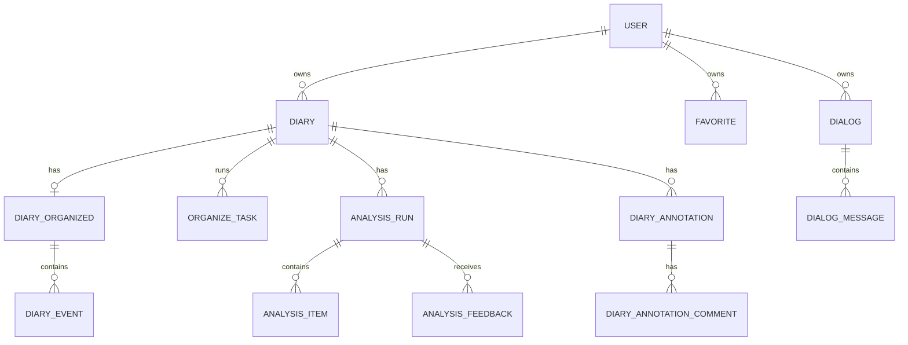
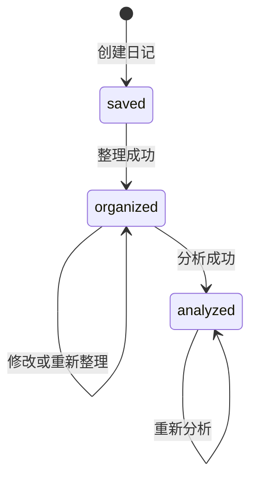

# 日记管理系统设计

> 文档状态：现行  
> 事实基线：2026-07-31 代码  
> 对应需求：[日记管理需求规格](../../需求规格/用户端/日记管理/日记管理需求规格.md)

## 1. 设计范围

本文说明日记主链路的数据组织、服务边界、状态流转和关键一致性设计。AI 分析细节和语音转写分别由独立设计文档说明。

## 2. 代码结构

| 层次 | 主要位置 | 职责 |
|---|---|---|
| 前端页面 | `frontend/pages/index.vue` | 月历、时间线、搜索和收藏 |
| 前端页面 | `frontend/pages/diary/new.vue` | 手工与语音录入入口 |
| 前端页面 | `frontend/pages/diary/[id].vue` | 日记详情、编辑、分析、批注和对话 |
| 前端组件 | `frontend/components/EventCard.vue` | 事件展示、编辑和收藏 |
| 前端组件 | `frontend/components/AnalysisTab.vue` | 分析结果与历史轮次 |
| 后端路由 | `backend/routers/diaries.py` | 日记、整理、分析、反馈、收藏和批注接口 |
| 后端路由 | `backend/routers/dialogs.py` | 对话与消息接口 |
| 后端服务 | `backend/services/pipeline.py` | 日记整理流水线 |
| 后端服务 | `backend/services/analysis_pipeline.py` | 日记分析流水线 |
| 后端服务 | `backend/services/analysis_history.py` | 分析历史、反馈继承和响应组装 |

## 3. 核心数据模型



主要边界：

- `Diary` 保存原文、日期、状态、脏标记和软删除信息。
- `DiaryOrganized` 与日记一对一，保存结构化摘要字段。
- `DiaryEvent` 保存有序事件和事件级标签。
- `OrganizeTask` 同时承载整理与分析异步任务状态。
- `AnalysisRun` 保存每次分析轮次，`status=CURRENT` 表示当前结果。
- `Favorite` 通过约束保证一条记录只指向日记或事件之一。
- `DiaryAnnotation` 使用段落和字符偏移定位正文或分析内容。

## 4. 状态机



- `saved` 和 `organized` 允许编辑原文。
- 已整理原文变更时使用 `is_dirty` 标识整理结果可能过期。
- `analyzed` 禁止编辑原文和重新整理，只允许重新分析。
- 删除通过 `deleted_at` 和 `deleted_by` 软删除，不新增状态枚举值。

## 5. 整理任务

整理接口立即返回任务状态，后台执行 LangGraph 流水线。任务包含类型、运行状态、当前步骤和错误信息。

- 同一用户、同一日记、同一任务类型只复用一个有效运行任务。
- 运行超过 15 分钟的任务会被判定为失败。
- 失败任务复用原任务 ID，使 checkpoint 能够继续执行。
- 保存结果时替换当前结构化内容及事件，并更新日记状态。

整理环节、完整 Prompt 和事实边界见 [AI整理流水线设计](AI整理流水线设计.md)；代码仍是判断当前执行行为的最终事实来源。

## 6. 分析与反馈

分析使用独立的 LangGraph 流水线和分析轮次模型：

- 普通分析基于当前结构化日记生成完整结果。
- 反馈分析基于上一轮结果和用户反馈生成新轮次。
- 当前轮次与历史轮次通过状态区分，不覆盖历史数据。
- 日记级与事件级分析使用同一 `AnalysisItem` 模型，通过 `scope` 区分。

详细机制见 [AI分析流水线设计](AI分析流水线设计.md)。

## 7. 收藏与批注

- 收藏接口幂等；取消不存在的收藏同样返回成功。
- 日记软删除时清理其日记收藏与事件收藏。
- 批注保存目标类型、字段、文本范围及前后文，用于内容变化后的定位和合并。
- 批注及评论采用软删除，保留删除原因和合并关系。

## 8. 对话

对话按来源类型支持日记详情、回顾和 AI 伙伴。当前只有日记详情具备用户界面。

发送消息时先保存用户消息，再加载历史消息和来源上下文，调用用途为“对话”的模型，最后保存 AI 回复。

## 9. 已知设计偏差

| 偏差 | 代码位置 | 影响 |
|---|---|---|
| 搜索只筛选 `organized` 状态 | `backend/routers/diaries.py` 的 `search_diaries` | 已分析日记无法通过全文搜索命中 |
| 对话上下文按日记 ID 查询但未校验用户 | `backend/routers/dialogs.py` 的 `send_message` | 来源数据隔离依赖不完整 |

这些偏差是待修复事实，不是目标设计。

## 10. 相关设计

- [数据库设计](../数据库设计.md)
- [AI整理流水线设计](AI整理流水线设计.md)
- [AI分析流水线设计](AI分析流水线设计.md)
- [语音录入系统设计](语音录入系统设计.md)
- [AI分析日志审计报告](AI分析日志审计报告-20260724.md)


## 11. 技术架构细节


| 层面 | 选型 |
|---|---|
| 应用形态 | Web 应用（响应式 + PWA） |
| 前端 | Nuxt.js（Vue） |
| 后端 | Python + FastAPI |
| 数据库 | PostgreSQL |
| ORM | SQLAlchemy |
| AI 模型 | DeepSeek API |
| 用户认证 | 密码登录（密码加密存储） |
| 部署 | Docker 自部署 |

## 12. UI 与交互设计来源


**页面清单（7 个页面）：**

1. **登录页** — 用户名 + 密码输入 + 记住密码 + 登录按钮
2. **日记浏览页（主页·日记 Tab）** — 顶部导航（月份切换）+ 搜索框 + 日历/时间线切换 + 日历网格（心情颜色 + 整理状态标记）+ 标签筛选 + 右下角浮动 + 按钮 + 底部 Tab 栏
3. **日记录入页** — 顶部日期选择 + 全屏文本输入区 + 保存按钮 + 语音上传
4. **日记详情页（已保存）** — 日期 + 原始文本 + "AI 智能整理"按钮
5. **日记详情页（已整理）** — 标题 + 元数据（地点可编辑）+ 日记级标签汇总 + 结构化日记内容（事件内展示事件级标签，按类型着色）+ 原始文本可展开编辑 + "编辑"按钮 + "AI 分析"按钮 + "重新整理"按钮
6. **日记详情页（已分析）** — 双 Tab 布局：日记 Tab（同已整理结构但原文锁定）+ 分析 Tab（心情 + 日记分析六部分只读展示）+ "重新分析"按钮
7. **我的页面（我的 Tab）** — 用户信息 + 模块入口列表（人物画像/心路历程/认知洞察）+ 设置

**日记状态流转：** 已保存 →（整理）→ 已整理 →（分析）→ 已分析

具体页面规则由以下需求文档承载：

- [日记录入与状态管理需求规格](../../需求规格/用户端/日记管理/日记录入与状态管理需求规格.md)
- [日记浏览检索与收藏需求规格](../../需求规格/用户端/日记管理/日记浏览检索与收藏需求规格.md)
- [日记详情展示需求规格](../../需求规格/用户端/日记管理/日记详情展示需求规格.md)
- [日记批注需求规格](../../需求规格/用户端/日记管理/日记批注需求规格.md)
- [日记对话需求规格](../../需求规格/用户端/日记管理/日记对话需求规格.md)

## 13. 原接口设计与当前校正


**认证接口**

| 方法 | 路径 | 说明 |
|---|---|---|
| POST | /api/auth/login | 登录，返回 token |
| POST | /api/auth/logout | 登出 |
| GET | /api/auth/me | 获取当前用户信息 |

**日记接口**

| 方法 | 路径 | 说明 |
|---|---|---|
| POST | /api/diaries | 创建日记（保存为已保存） |
| POST | /api/diaries/{id}/organize | 触发 AI 整理 |
| GET | /api/diaries | 日记列表（参数：日期范围、标签、视图类型） |
| GET | /api/diaries/{id} | 日记详情（含整理内容和分析内容） |
| PUT | /api/diaries/{id}/organized | 修改整理内容 |
| POST | /api/diaries/{id}/analyze | 触发 AI 分析 |
| GET | /api/diaries/calendar | 日历数据（心情+整理状态） |
| GET | /api/diaries/search | 全文搜索（仅已整理内容） |

**日记详情接口返回格式**

`GET /api/diaries/{id}` 必须返回已经组装好的详情数据。后端负责把事件级分析结果放入对应事件的 `analysis` 字段，前端不做 `event_index`、标题或排序字段匹配。

返回结构示例：

```json
{
  "id": "diary-id",
  "user_id": "user-id",
  "original_text": "原始日记文本",
  "diary_date": "2026-07-07",
  "status": "analyzed",
  "organized": {
    "id": "organized-id",
    "title": "日记标题",
    "summary": "摘要文本",
    "location": "地点",
    "introduction": "引入段",
    "trivia": [
      "琐事一"
    ],
    "plans": [
      "后续计划一"
    ],
    "analysis": {
      "mood": "平静 / 专注",
      "emotion_analyses": [
        "一条日记级情绪分析"
      ],
      "behavior_decision_analyses": [
        "一条日记级行为与决策分析"
      ],
      "self_understanding_analyses": [
        "一条日记级关注点与需求分析"
      ],
      "action_suggestions": [
        "下次可以尝试……"
      ],
      "cognitive_calibration_analyses": [
        "一条日记级认知校准"
      ],
      "question_answers": [
        {
          "question": "问题",
          "answer": "回答"
        }
      ],
      "cognitive_enhancements": [
        "一条日记级认知完善"
      ]
    },
    "events": [
      {
        "id": "event-id",
        "event_title": "事件标题",
        "body": [
          "事件正文段落"
        ],
        "feeling": [
          "感受内容"
        ],
        "reflection": [
          "反思内容"
        ],
        "tags": [
          {
            "id": "tag-id",
            "name": "工作",
            "type": "domain"
          }
        ],
        "analysis": {
          "emotion_analyses": [
            "一条事件级情绪分析"
          ],
          "behavior_decision_analyses": [
            "一条事件级行为与决策分析"
          ],
          "self_understanding_analyses": [
            "一条事件级关注点与需求分析"
          ],
          "action_suggestions": [
            "下次可以尝试……"
          ],
          "cognitive_calibration_analyses": [
            "一条事件级认知校准"
          ],
          "question_answers": [
            {
              "question": "问题",
              "answer": "回答"
            }
          ],
          "cognitive_enhancements": [
            "一条事件级认知完善"
          ]
        },
        "sort_order": 0
      }
    ]
  }
}
```

接口约束：

- `organized.analysis` 是日记级分析，只在已有分析结果时返回；无分析结果时返回 `null`。
- `organized.events[].analysis` 是事件级分析；该事件没有任何事件级分析时返回 `null` 或省略该字段。
- 日记级和事件级分析字段名必须一致，不能使用 `diary_` / `event_` 前缀。
- 所有分析数组字段没有内容时返回空数组，不返回空字符串。
- `question_answers` 的元素只能包含 `question` 和 `answer` 两个字段；无法可靠回答的内容直接写入 `answer`。
- `mood` 只出现在日记级 `organized.analysis` 中；事件级 `analysis` 不包含 `mood`。

**标签接口**

| 方法 | 路径 | 说明 |
|---|---|---|
| GET | /api/tags | 获取所有标签 |
| POST | /api/tags | 新建标签 |
| PUT | /api/diaries/{id}/tags | 更新日记标签 |

**对话接口**

| 方法 | 路径 | 说明 |
|---|---|---|
| POST | /api/dialogs | 创建对话（参数：source_type, source_id） |
| GET | /api/dialogs/{id}/messages | 获取消息列表 |
| POST | /api/dialogs/{id}/messages | 发送消息并获取 AI 回复 |

### 13.1 后续新增接口

当前代码在原接口基础上还提供：

- 日记与事件收藏、取消收藏和收藏列表。
- 分析反馈保存、普通分析、反馈重分析和分析状态。
- 日记批注及批注评论的新增、修改、删除和查询。
- 结构化日记、事件和标签修改。
- 语音批次独立接口，见[语音录入系统设计](语音录入系统设计.md)。

旧的发布接口已经删除；创建日记后直接进入 `saved`。
