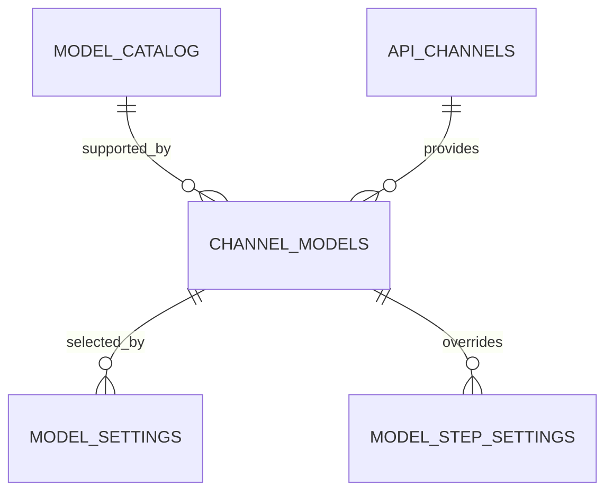

# AI 模型配置系统设计

> 文档状态：现行  
> 事实基线：2026-07-31 代码  
> 对应需求：[AI模型配置需求规格](../../需求规格/管理端/AI模型配置需求规格.md)

## 1. 设计目标

模型能力、调用渠道和业务选择分层存储，使同一模型可由多个渠道提供，并让运行时只接收经过完整校验的最终配置。

## 2. 数据模型



| 表 | 职责 |
|---|---|
| `model_catalog` | 模型类型、厂商、名称、能力、思考模式和启用状态 |
| `api_channels` | API 地址、加密密钥、思考参数模板和启用状态 |
| `channel_models` | 渠道实际支持的模型及启用状态 |
| `model_settings` | 四类业务用途的默认渠道模型和思考状态 |
| `model_step_settings` | 整理与分析具体环节的覆盖配置 |

`channel_models` 不再保存协议或渠道模型别名。调用协议由模型类型映射：语言模型使用 OpenAI Chat 兼容协议，ASR 使用 DashScope 录音文件识别协议。

## 3. 配置键

用途级配置：

| 键 | 类型 |
|---|---|
| `organize` | language |
| `analysis` | language |
| `chat` | language |
| `transcription` | asr |

环节级配置见[流水线环节模型配置设计](流水线环节模型配置设计.md)。

## 4. 密钥安全

- 渠道 API 密钥使用 Fernet 加密后写入 `api_key_encrypted`。
- 查询接口只返回“是否已配置密钥”，不返回密文或明文。
- 更新渠道时没有传入新密钥则保留旧值；清空密钥使用独立操作。
- 只有运行时解析器在调用前解密密钥。

## 5. 运行时解析

`backend/services/model_runtime.py` 的 `resolve_model_setting` 是统一入口：

1. 读取用途级默认配置。
2. 存在环节键时读取环节覆盖。
3. 合并模型和思考状态的继承结果。
4. 校验模型类型、模型状态、渠道状态、渠道模型状态和密钥。
5. 根据模型 `reasoning_mode` 生成合法的思考参数。
6. 返回调用所需的 API 地址、密钥、模型名和协议。

未配置或配置不可用时抛出明确错误，不读取旧 `.env` 模型配置。

## 6. 引用保护

删除模型、渠道或渠道模型前，服务检查 `model_settings` 和 `model_step_settings` 的引用。存在引用时拒绝删除，管理员必须先调整业务配置。

## 7. 管理接口

`backend/routers/admin_models.py` 在 `/api/admin` 下提供：

- 模型查询、新增、修改和删除。
- 渠道查询、新增、修改、清除密钥和删除。
- 渠道支持模型的双向维护。
- 用途级和环节级设置查询、保存与测试。

所有接口复用 `require_admin` 进行服务端超级管理员校验。

## 8. 初始化

应用使用 `backend/data/model_seed.csv` 初始化系统模型清单，并由 `backend/services/model_seed.py` 补齐或修正系统预置模型属性。初始化不应覆盖管理员创建的自定义模型。

## 9. 可观测性

语言模型调用写入 `llm_call_logs`，记录环节、模型、token、耗时、状态和链路标识。日志不得保存 Prompt、响应正文或密钥。

## 10. 原设计保留的字段、初始化与运行时细则

### 10.1 数据模型

#### 10.1.1 `model_catalog`

模型能力清单。初始化数据来自 Excel，后续支持新增自定义模型。

字段：

```text
id
model_type              language / asr
provider_name           模型原始厂商，仅展示和筛选
model_name              模型名称，默认调用名
ability_tier            能力梯队
ability_category        精简能力分类
original_category       Excel 原始能力分类
core_features           核心特点
scenarios               适用场景
score                   数值分
score_label             原始分数字符串
enabled                 是否启用
is_custom               是否自定义模型
created_at
updated_at
```

删除规则：

- 如果模型通过 `channel_models` 被 `model_settings` 使用，禁止删除。
- 否则允许删除，并级联删除相关 `channel_models`。

#### 10.1.2 `api_channels`

调用渠道。渠道只表示账号、API 地址和密钥，不区分语言或语音。

字段：

```text
id
name
api_base_url
api_key_encrypted
enabled
created_at
updated_at
```

规则：

- API Key 使用现有 Fernet 加密能力保存。
- 前端不返回明文，只显示“已配置 / 未配置”。
- 编辑时留空表示不修改已有密钥。
- 提供“清空密钥”按钮。
- 如果渠道下任一 `channel_model` 正被 `model_settings` 使用，禁止清空密钥、禁用渠道、删除渠道。
- 删除渠道时只删除渠道和渠道模型关系，不删除模型清单。

#### 10.1.3 `channel_models`

渠道支持模型关系。只表达“这个渠道可以调用这个模型”。

字段：

```text
id
channel_id
model_id
enabled
created_at
updated_at
```

唯一约束：

```text
channel_id + model_id
```

规则：

- 同一个渠道下，同一个模型只能关联一次。
- 实际请求的模型名直接使用 `model_catalog.model_name`。
- 调用协议由模型类型派生：`language` 使用 `openai_chat`，`asr` 使用 `dashscope_asr`。
- 如果 `channel_model` 正被 `model_settings` 使用，禁止禁用或删除。

#### 10.1.4 `model_settings`

业务用途当前模型设置。该表只保存当前运行选择，不记录历史。

字段：

```text
id
setting_key             organize / analysis / chat / transcription
channel_model_id
updated_by
updated_at
```

唯一约束：

```text
setting_key
```

### 10.2 初始化数据

Excel 数据初始化入库：

- `模型能力排序` 初始化为 `language` 模型。
- `Sheet1` 初始化为 `asr` 模型。
- Excel 原始能力分类保存到 `original_category`。
- 系统按规则映射到精简 `ability_category`。

初始化只负责模型清单，不自动创建渠道和模型设置。

如果管理端未配置渠道、渠道模型和模型设置，则对应功能不可用。

### 10.3 运行时规则

运行时按用途读取 `model_settings`：

```text
organize      → 日记整理流水线
analysis      → 普通分析、反馈重分析
chat          → 日记对话
transcription → 语音转文字
```

读取到 `channel_model` 后：

1. 校验模型、渠道、渠道模型均启用。
2. 校验渠道 API Key 已配置。
3. 根据模型类型选择调用适配器。
4. 使用 `model_catalog.model_name` 作为实际模型名。

未配置或校验失败时，对应功能返回明确错误：

```text
当前用途未配置可用模型，请在管理端模型设置中配置。
```

### 10.4 `.env` 调整

以下模型运行配置不再作为兜底：

```text
LLM_API_KEY
LLM_API_URL
LLM_MODEL
DASHSCOPE_API_KEY
DASHSCOPE_API_BASE_URL
TRANSCRIPTION_MODEL
```

保留非模型运行参数：

```text
DATABASE_URL
SECRET_KEY
ENCRYPTION_KEY
BACKUP_MASTER_KEY
MINIO_*
TRANSCRIPTION_MAX_FILE_SIZE
TRANSCRIPTION_MAX_CONCURRENCY
TRANSCRIPTION_FAILED_RETENTION_DAYS
TRANSCRIPTION_DOWNLOAD_TOKEN_HOURS
```

`TRANSCRIPTION_DOWNLOAD_TOKEN_HOURS` 当前用于 MinIO 预签名读取地址的有效期，不是旧本地下载接口的访问令牌。

## 11. 当前字段修正

在上述原始字段基础上，当前模型已经增加：

- `model_catalog.reasoning_mode`：`unsupported / switchable / always_on`。
- `api_channels.thinkmode`：渠道思考参数模板。
- `model_settings.thinking_enabled`：用途级默认思考状态。
- `model_step_settings`：环节模型和思考状态覆盖，字段为 `step_key`、`channel_model_id`、`thinking_enabled`、`updated_by`、`updated_at`。

模型、渠道或渠道模型的引用保护同时检查用途级和环节级设置。
