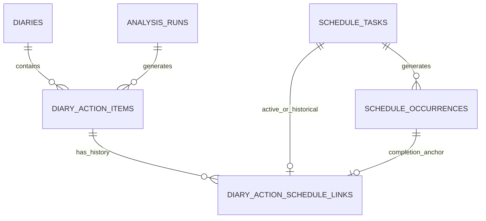

# 日记行动项与日程联动设计

> 文档状态：目标设计，尚未实现  
> 设计基线：2026-08-03  
> 对应需求：[日记行动项需求规格](../../需求规格/用户端/行动管理/日记行动项需求规格.md)

## 1. 设计目标

在不改变现有日记内容和分析结果的前提下，引入独立的日记行动项模型。行动项由 AI 分析流水线生成，在单篇日记详情的“行动”面板中维护，并由用户选择性同步到现有日程管理模块。

设计必须保证：

- 后续计划、可行动建议和行动项分别持久化，互不替代。
- 一个行动项同时最多拥有一个有效日程关联。
- 关联期间名称、时间、循环规则和完成状态双向一致。
- 删除任一业务对象不级联删除另一方。
- AI 重新分析不覆盖已经进入用户执行过程的行动项。

## 2. 现状与改动范围

### 2.1 现状

- `diary_organized.plans` 以 JSON 数组保存后续计划，没有稳定的计划项 ID。
- `analysis_items` 以 `ACTION_SUGGESTION` 保存事件级和日记级可行动建议。
- 分析流水线依次执行 `mood_tag_extract`、`core_analysis` 和 `cognition_analysis`。
- 日程使用 `schedule_tasks` 保存任务定义，使用 `schedule_occurrences` 保存具体实例。
- 日程实例的完成接口只更新 `schedule_occurrences`，当前不存在日记行动项关联。

### 2.2 改动

- 新增分析节点 `action_planning`。
- 新增 `diary_action_items` 和 `diary_action_schedule_links`。
- 新增行动项 API、同步服务和响应结构。
- 扩展日程创建、后续修改、完成和删除服务，使其维护行动关联。
- 已分析日记详情增加“行动”面板；原“日记”“分析”面板不改。

## 3. 领域关系



后续计划和可行动建议通过行动项的 `source_refs` 保留来源证据，不建立会因数组下标变化而失效的强外键。

## 4. 数据模型

### 4.1 `diary_action_items`

| 字段 | 类型 | 约束 | 说明 |
|---|---|---|---|
| `id` | UUID | 主键 | 行动项 ID |
| `user_id` | UUID | 外键，非空 | 用户边界 |
| `diary_id` | UUID | 外键，非空 | 所属日记 |
| `generation_run_id` | UUID | 外键，非空 | 生成该行动项的分析轮次 |
| `source_kind` | String(20) | 非空 | `PLAN`、`SUGGESTION`、`MERGED` |
| `source_refs` | JSONB | 非空 | 后续计划快照和分析项 ID 列表 |
| `title` | String(200) | 非空 | 原子化行动名称 |
| `is_all_day` | Boolean | 非空 | 推荐或同步后的全天属性 |
| `start_date` | Date | 非空 | 推荐或同步后的开始日期 |
| `start_time` | Time | 可空 | 定时行动开始时间 |
| `end_time` | Time | 可空 | 定时行动结束时间 |
| `recurrence_type` | String(32) | 非空 | 复用现有日程循环类型 |
| `interval` | Integer | 非空 | 循环间隔 |
| `weekdays` | JSONB | 非空 | 星期列表 |
| `month_day` | Integer | 可空 | 每月指定日期 |
| `nth_week` | Integer | 可空 | 每月第 N 周 |
| `nth_weekday` | Integer | 可空 | 星期几 |
| `recurrence_until` | Date | 可空 | 循环截止日期 |
| `recurrence_count` | Integer | 可空 | 循环次数 |
| `status` | String(20) | 非空 | `pending`、`completed` |
| `completed_at` | DateTime | 可空 | 行动项完成时间 |
| `user_modified` | Boolean | 非空 | 用户是否修改过行动项 |
| `sort_order` | Integer | 非空 | 面板排序 |
| `deleted_at` | DateTime | 可空 | 软删除时间 |
| `created_at` | DateTime | 非空 | 创建时间 |
| `updated_at` | DateTime | 非空 | 更新时间 |

校验规则复用 `ScheduleTaskCreate`：全天行动不得保存开始和结束时间；定时行动必须同时存在有效开始、结束时间；循环参数必须与循环类型匹配。

`source_refs` 示例：

```json
{
  "plans": [
    {"index": 0, "text": "预约牙医"}
  ],
  "analysis_item_ids": ["4ee2e1a0-16f8-4c25-83ae-31e697a57e4f"]
}
```

后续计划使用文本快照而不是数组下标作为唯一身份。数组下标仅用于解释当次生成来源。

### 4.2 `diary_action_schedule_links`

| 字段 | 类型 | 约束 | 说明 |
|---|---|---|---|
| `id` | UUID | 主键 | 关联记录 ID |
| `user_id` | UUID | 外键，非空 | 用户边界 |
| `action_item_id` | UUID | 外键，非空 | 行动项 |
| `schedule_task_id` | UUID | 外键，可空，删除时置空 | 当前仍存在的日程任务 |
| `schedule_task_snapshot_id` | UUID | 非空 | 原日程任务 ID 的审计快照 |
| `completion_occurrence_id` | UUID | 外键，可空，删除时置空 | 完成锚点 |
| `linked_at` | DateTime | 非空 | 建立关联时间 |
| `unlinked_at` | DateTime | 可空 | 解除时间；为空表示有效关联 |
| `unlink_reason` | String(32) | 可空 | `ACTION_DELETED`、`SCHEDULE_DELETED`、`FOLLOWING_DELETED` |
| `created_at` | DateTime | 非空 | 创建时间 |

数据库增加两个部分唯一索引：

```sql
CREATE UNIQUE INDEX uq_action_active_schedule_link
ON diary_action_schedule_links(action_item_id)
WHERE unlinked_at IS NULL;

CREATE UNIQUE INDEX uq_schedule_active_action_link
ON diary_action_schedule_links(schedule_task_id)
WHERE unlinked_at IS NULL AND schedule_task_id IS NOT NULL;
```

`schedule_task_id` 使用 `ON DELETE SET NULL` 作为兜底。正常删除流程必须先由业务服务填写 `unlinked_at`、`unlink_reason`，再执行日程删除或终止操作。

### 4.3 不在 `schedule_tasks` 增加来源字段

行动与日程的关系需要保存多次“建立—解除—重新建立”的历史。单独在 `schedule_tasks` 增加 `action_item_id` 无法表达历史，也会把日程模型绑定到唯一来源，因此使用独立关联表。

## 5. AI 分析流水线

### 5.1 普通分析

目标拓扑：

```text
START
→ mood_tag_extract
→ core_analysis
→ cognition_analysis
→ action_planning
→ END
```

`action_planning` 完成后，路由再保存分析轮次、行动项并将日记更新为 `analyzed`。分析结果和行动项必须在同一数据库事务中落库；任一方保存失败时均不发布该轮结果。

### 5.2 反馈重分析

反馈重分析在核心分析或可行动建议发生变化后执行 `action_planning`。认知类反馈没有改变后续计划或可行动建议时，可以复用当前行动规划输入，不调用模型。

行动项协调规则：

1. 查询当前日记所有未删除行动项。
2. 将已同步、已完成、`user_modified=true`或 `source_kind` 为 `PLAN`/`MERGED` 的行动项加入保护集合。
3. 仅将未同步、未完成、未修改且 `source_kind=SUGGESTION` 的旧行动项作为可替换集合。
4. 保存新结果后软删除未被新结果匹配的可替换项。
5. 新结果不得更新保护集合中的字段或状态。

### 5.3 Checkpoint

分析任务的 `current_step` 增加 `action_planning`，前端显示“正在生成行动计划”。节点输出写入 LangGraph checkpoint。该节点失败后复用原分析任务，从 `action_planning` 继续，不重复前三个已成功节点。

### 5.4 模型配置

现有流水线环节模型配置增加 `ACTION_PLANNING` 用途和“行动规划”显示名称。`action_planning` 只能通过现有模型运行时解析该环节配置，不读取环境变量中的独立模型参数，也不静默复用其他分析环节的模型。

## 6. 行动规划提示词

### 6.1 输入结构

```json
{
  "diary_date": "2026-08-03",
  "plans": ["整理本周工作并预约牙医"],
  "action_suggestions": [
    {
      "analysis_item_id": "...",
      "scope": "EVENT",
      "event_title": "工作安排",
      "content": "每天预留半小时整理工作记录"
    }
  ]
}
```

### 6.2 核心提示词约束

提示词必须包含以下规则：

```text
你负责把日记中的后续计划与可行动建议整理成原子行动项。

1. 一个行动项只能包含一件可以独立安排、独立完成的事情。
2. 如果一句内容包含两个可以设置不同时间、不同循环规则，或可以分别完成的事项，必须拆成两个行动项。
3. 不拆分同一行动中无法单独完成的必要步骤。
4. 每个行动项只使用一个清晰的主要动作命名，不使用“以及”“并且”等连接两个独立动作。
5. 后续计划与可行动建议表达同一事项时合并，但必须保留全部来源。
6. 不把观点、感受、分析结论、愿望或抽象目标直接输出为行动项。
7. 不增加输入中没有依据的新行动目标。
8. 推荐日程必须符合给定的日程字段与循环规则；依据不足时使用保守、可编辑的建议。
9. 输出前逐项自检：是否可以拆成两个分别完成的事项；如果可以，先拆分再输出。
```

### 6.3 输出结构

```json
{
  "action_items": [
    {
      "title": "预约牙医",
      "source_kind": "PLAN",
      "plan_sources": [{"index": 0, "text": "整理本周工作并预约牙医"}],
      "analysis_item_ids": [],
      "schedule": {
        "is_all_day": true,
        "start_date": "2026-08-04",
        "start_time": null,
        "end_time": null,
        "recurrence_type": "NONE",
        "interval": 1,
        "weekdays": [],
        "month_day": null,
        "nth_week": null,
        "nth_weekday": null,
        "recurrence_until": null,
        "recurrence_count": null
      }
    }
  ]
}
```

后端使用 Pydantic 校验结构、枚举和日程合法性。原子性属于语义约束，由提示词、自检和测试样例保证；后端不得用简单连接词切割文本，否则会错误拆分不可分割的行动。

## 7. 服务设计

### 7.1 `DiaryActionService`

负责：

- 查询和维护行动项。
- 校验用户、日记、行动项归属一致。
- 根据分析结果协调新增、保护和软删除。
- 处理未同步行动项的本地完成状态。

### 7.2 `ActionScheduleLinkService`

负责：

- 建立和解除有效关联。
- 使用数据库唯一约束和幂等键防止重复创建。
- 确定及重选完成锚点。
- 在行动项写入和日程写入之间执行事务内双向同步。
- 处理日程后续修改产生的新 `schedule_task_id`。

日程路由不得自行拼装行动项同步逻辑。现有日程创建、修改、完成和删除行为下沉到服务层，由原日程 API 与行动 API 共同调用。

## 8. API 设计

### 8.1 行动项查询与维护

| 方法 | 路径 | 作用 |
|---|---|---|
| `GET` | `/api/diaries/{diary_id}/actions` | 获取行动面板数据 |
| `PUT` | `/api/diary-actions/{action_id}` | 修改名称和推荐日程；已关联时同步后续日程 |
| `PUT` | `/api/diary-actions/{action_id}/completion` | 完成或取消行动项 |
| `DELETE` | `/api/diary-actions/{action_id}` | 解除关联并软删除行动项 |

日记未达到 `analyzed` 时，行动项查询返回 `409`，前端不会调用该接口。

### 8.2 批量同步

```http
POST /api/diaries/{diary_id}/actions/sync
```

请求：

```json
{
  "items": [
    {
      "action_id": "...",
      "schedule": {
        "title": "预约牙医",
        "is_all_day": true,
        "start_date": "2026-08-04",
        "recurrence_type": "NONE",
        "interval": 1,
        "weekdays": []
      }
    }
  ]
}
```

服务在一个事务中锁定所选行动项。行动项 ID 是同步的幂等业务键：没有有效关联时创建日程任务与实例并建立关联，已经存在有效关联时返回现有关联而不重复创建。批次中任一项目失败时整个批次回滚，避免页面出现部分同步且用户无法判断的结果。

### 8.3 日程 API 扩展

现有响应增加可选字段：

```json
{
  "source_action_id": "..."
}
```

该字段仅用于显示来源和驱动同步，不改变现有日程排序与执行规则。

## 9. 双向同步算法

### 9.1 行动项到日程

1. `SELECT ... FOR UPDATE` 锁定行动项和有效关联。
2. 更新行动项字段，设置 `user_modified=true`。
3. 未关联时结束。
4. 已关联时按日程“后续修改”规则更新任务定义及未来实例。
5. 如果后续修改创建新任务，更新有效关联的 `schedule_task_id` 和快照 ID。
6. 提交同一事务。

### 9.2 日程到行动项

- 单次日程修改：更新关联行动项的同名字段。
- 循环日程 `scope=single`：只更新实例，不写行动项。
- 循环日程 `scope=following`：日程服务返回新的后续任务，关联服务更新行动项和有效关联。
- 完成锚点状态变化：更新行动项 `status` 和 `completed_at`。
- 非完成锚点变化：不更新行动项完成状态。

### 9.3 防止递归同步

服务层只执行一次聚合写入，不通过“调用另一个 HTTP API”实现同步。写入方法接收明确来源 `ACTION` 或 `SCHEDULE`，在同一事务中更新双方，避免 A 更新触发 B、B 又触发 A 的递归事件。

## 10. 删除算法

| 操作 | 关联处理 | 另一方数据 |
|---|---|---|
| 删除行动项 | 有效关联标记 `ACTION_DELETED` | 日程保持 |
| 删除单次日程唯一实例 | 有效关联标记 `SCHEDULE_DELETED` | 行动项保持 |
| 删除循环单次实例 | 关联保持；必要时重选锚点 | 行动项保持 |
| 删除循环当前及后续 | 有效关联标记 `FOLLOWING_DELETED` | 行动项保持 |

行动项查询根据最近一条历史关联判断是否显示“日程已删除”。用户重新同步后创建新的关联行，旧关联不复用。

## 11. 前端设计

### 11.1 日记详情

- `analyzed` 状态的 Tab 类型从 `'diary' | 'analysis'` 扩展为 `'diary' | 'analysis' | 'action'`。
- 原日记与分析组件不修改数据绑定。
- 新增 `DiaryActionPanel`，进入“行动”面板时加载行动项。
- 行动面板右上角“同步”按钮打开 `DiaryActionSyncSheet`。

### 11.2 行动卡片

- Checkbox 点击立即提交完成状态，提交期间禁用重复操作。
- 点击名称或编辑入口打开行动编辑面板。
- 已同步项显示日程关联标识；日程已删除项显示低强调提示和“重新同步”入口。
- 循环行动项 Checkbox 旁显示“首次完成表示已开始落实”，避免把勾选误解为整个循环结束。

### 11.3 同步面板

- 默认不替用户全选，由用户明确选择。
- 每项表单复用现有日程字段和循环规则控件。
- 手机端 `input`、`textarea`、`select` 实际字号不小于 `16px`。
- 确认前展示每项自然语言日程摘要。

## 12. 并发、幂等与权限

- 所有查询同时限定 `user_id`，不能只通过资源 ID 查询。
- 批量同步锁定行动项并检查有效关联，以行动项 ID 和部分唯一索引实现幂等。
- 建立关联时锁定行动项，并由部分唯一索引处理并发兜底。
- 完成操作使用行锁或版本号，避免行动页和日程页同时切换造成丢失更新。
- 双向字段修改采用最后成功提交生效；响应返回最新版本，前端以响应覆盖本地状态。
- 错误响应不得包含日记原文、完整分析内容或模型提示词输入。

## 13. 迁移与兼容

- 通过新增迁移创建两张表、索引和外键，不改写现有后续计划与分析数据。
- 历史已分析日记默认没有行动项。首次进入“行动”面板时不隐式调用模型；用户需要重新分析后生成。
- 现有日程没有行动来源，`source_action_id` 返回 `null`。
- 现有日记和日程 API 的原字段保持兼容。

## 14. 测试切口

### 14.1 AI 节点

- 一个输入包含两个独立事项时输出两条行动项。
- 不可独立完成的组合步骤不被错误拆分。
- 后续计划与建议重复时合并并保留来源。
- 非行动性分析内容不生成行动项。
- 日程字段不合法时节点结果校验失败并可从 checkpoint 重试。

### 14.2 API 集成

- 未分析日记不能读取或同步行动项。
- 用户只能访问自己的行动项和关联日程。
- 批量选择、字段调整、事务回滚和幂等重试。
- 单次及循环日程双向完成。
- `single` 与 `following` 修改的不同回写结果。
- 三种删除路径和删除后的重新同步。
- 数据库唯一约束阻止一个行动项同时关联多个日程。

### 14.3 重新分析

- 已同步、已完成、用户修改和包含后续计划来源的行动项保持不变。
- 未同步、未完成、未修改的纯建议行动项可以被替换。
- checkpoint 从 `action_planning` 恢复时不重复调用前三个节点。
