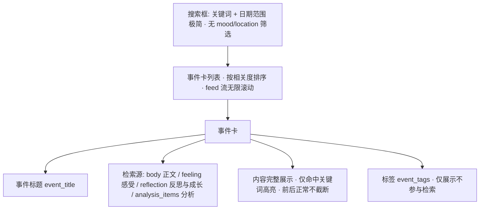
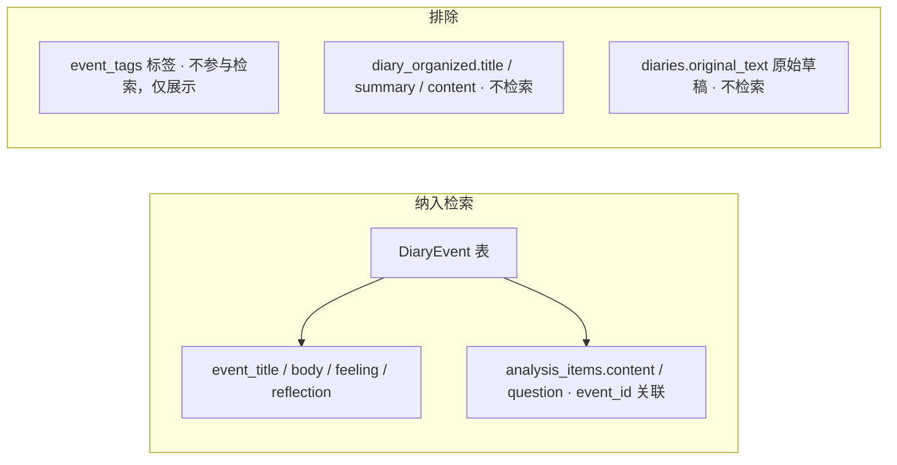

# 统一搜索功能需求规格

> 文档类型：简单 PRD（默认模式，不含竞品/市场分析）  
> 事实基线：2026-08（backend/models、routers、frontend/pages/index.vue、services/analysis_history.py 探查）  
> 关联文档：《日记浏览检索与收藏需求规格》（2026-07-31，记录"只筛 organized"已知偏差）  
> 决策状态：原 5 条待确认问题已于 2026-08 由用户拍板；2026-08 补充决策——① 检索范围收窄为「仅事件」，不搜日记 title/summary/content；② 检索基于事件内容字段（原文/感受/反思与成长/分析），不使用标签做检索；③ 高亮改为「仅命中关键词高亮，事件内容完整展示、前后正常（不截断为前后 10 字短片段）」（替代原"命中位置 + 前后约 10 字"与"每卡 3 条/160 字"）。

## 0. 项目信息

- **Language**：中文
- **前端技术栈**：Nuxt3（Vue3 + TypeScript + TailwindCSS + Pinia）
- **后端技术栈**：FastAPI + SQLAlchemy + PostgreSQL 15
- **Project Name**：`unified_search`
- **原始需求复述**：改造现有统一搜索端点 `GET /diary/api/diaries/search`，将检索范围明确为**仅 `DiaryEvent` 的事件内容字段（`event_title`/`body`/`feeling`/`reflection`）+ 该事件关联的分析内容（`analysis_items`）**；以相关度排序、**仅高亮命中关键词、事件内容完整展示（前后正常，不截断）**；**标签（`event_tags`）仅作展示、不参与检索与排序**；搜索框保持极简（关键词 + 日期范围），不加 `mood`/`location` 筛选；结果以统一事件卡片呈现；分页默认 `limit=20`/`offset`，feed 流（无限滚动）加载。**复用 `frontend/pages/index.vue` 现有顶部搜索入口与 feed 区域，不新建搜索页/入口**。

## 1. 产品目标

**一句话目标**：提供统一的关键词搜索端点，让用户在本人全部事件的【原文 / 感受 / 反思与成长 / 分析】内容中按相关度检索，并仅高亮命中关键词（内容完整展示，前后正常，不截断）。

**背景**：现有 `GET /diary/api/diaries/search` 使用 `ILIKE '%q%'` 模糊匹配，仅检索 `status=organized` 的 `diary_organized` 的 `title`/`summary`/`content`，且**未纳入 `DiaryEvent` 内容与分析**。本 PRD **改造现有统一搜索端点**（不新增端点），将检索范围明确为**仅事件内容（含事件关联分析）**，并补齐相关度排序与「仅高亮命中关键词、内容完整展示」呈现；继续复用页面现有搜索入口，搜索结果落入现有 feed 区域。

- 不检索 `original_text`（原始草稿）——预期排除。
- 不检索 `diary_organized` 的 `title`/`summary`/`content`——2026-08 补充决策：搜索范围收窄为仅事件。
- **不使用标签（`event_tags`）做检索或排序**——2026-08 补充决策：检索应基于事件真实内容字段，标签仅展示。

## 2. 用户故事

- 作为用户，我想在页面顶部搜索框输入关键词后按相关度看到命中的事件内容（原文/感受/反思/分析），以便快速定位。
- 作为用户，我想搜的词若命中事件的原文、感受、反思与成长或任一分析块，都能被找到（不只命中标签）。
- 作为用户，我想在结果中看到**命中关键词在完整内容里被高亮**，前后文字正常展示（不截断成短片段），以便通读上下文。
- 作为用户，我希望来自已分析（`analyzed`）日记的事件也能被搜索命中（事件覆盖 `organized` 与 `analyzed` 日记产生的事件）。
- 作为用户，我希望结果以统一事件卡片呈现，并直接落在页面现有时间线 feed 中。

## 3. 需求池

> 优先级：P0 必须（核心）/ P1 重要 / P2 增强。

### P0（核心，必须实现）

- **P0-1 改造统一搜索端点（复用现有入口）**：**改造现有** `GET /diary/api/diaries/search`（**不新增独立端点**），关键词 + 日期范围筛选 + 分页（`limit`/`offset`）+ 相关度排序 一体化。**继续复用页面现有搜索入口**（`frontend/pages/index.vue` 顶部搜索框，回车调用 `/diaries/search?q=`，配合时间线无限滚动 feed），**不新建搜索页/入口**；搜索结果渲染进现有 feed/列表区域，以统一事件卡片呈现。
- **P0-2 检索范围覆盖（仅事件内容，不含标签）**：
  - **事件内容字段**：检索 `DiaryEvent` 的 `event_title`(标题)、`body`(正文/原文叙述)、`feeling`(感受)、`reflection`(反思与成长)。
  - **事件关联分析**：检索该事件关联的分析内容 `analysis_items.content`（问答类含 `analysis_items.question`），条件 `analysis_items.event_id = diary_events.id`、`analysis_type` ∈ **全部 7 种**（已确认覆盖全部，不缩减）：`EMOTION` 情绪分析 / `BEHAVIOR_DECISION` 行为与决策分析 / `SELF_UNDERSTANDING` 关注点与需求 / `ACTION_SUGGESTION` 可行动建议 / `COGNITIVE_CALIBRATION` 认知校准 / `COGNITION_ENHANCEMENT` 认知完善 / `QUESTION_ANSWER` 问题解答。
  - **不检索** `event_tags`（标签）作为检索/排序依据。
  - **不检索** `diary_organized` 的 `title`/`summary`/`content`，也**不检索** `diaries.original_text`（原始草稿）。
  - 事件需覆盖其所属日记 `status = organized` 与 `status = analyzed` 两种状态（确保 analyzed 日记产生的事件也可命中）；按 `user_id` 隔离，过滤所属日记 `deleted_at` 非空的软删除记录。
- **P0-3 相关度排序 + 命中高亮（内容完整展示、仅关键词高亮）**：结果按相关度排序；事件内容**完整展示**，**仅将命中的关键词在文中高亮**，**前后文字正常显示、不做截断**（不采用"前后约 10 字短片段"方案）。内容过长时由前端按现有卡片样式做展开/收起（沿用页面既有展示习惯），但不对命中上下文做人为截断。
- **P0-4 标签不作为检索/排序依据**：`event_tags`（五维 JSON 快照）与规范化 `Tag`（经 `event_tags` 关联表挂载）**不参与全文检索，也不用于相关度加权**。标签仍可作为事件卡上的**展示元数据**（领域/主题/人物与对象/心理/知识），仅作信息呈现。
- **P0-5 统一事件卡片**：**以事件为单位**，每个结果 = 一个**事件卡**；所有结果均为事件卡（无"日记卡"概念），统一一种视觉样式。

### P1（重要）

- **P1-1 日期范围筛选**：支持 `start_date` / `end_date` 筛选（对齐现有列表接口能力；基于事件日期）。
- **P1-2 分页与加载（复用现有 feed）**：分页参数默认 **`limit=20`、`offset`**；加载方式用 **feed 流（无限滚动）**，沿用前端现有 `IntersectionObserver` 模式（现有 `index.vue` 时间线即此模式），**非翻页按钮**；搜索结果**复用现有 feed/列表区域**渲染，不另开结果页。
- **P1-3 用户隔离与软删除**：所有查询按 `user_id` 隔离，过滤所属日记 `deleted_at` 非空的软删除记录；无"公开/私有"字段。

### P2（增强）

- **P2-1 mood / location 筛选 UI**：【**已确认-不实现**】用户明确不加 `mood`/`location` 筛选，搜索框保持极简（关键词 + 日期范围）。
- **P2-2 空态与加载态规范**：按常规默认（无结果提示文案 + 搜索中 loading）；是否需特别设计待后续确认（见第 5 章、第 4 章 (d) 线框图已含骨架屏/空结果态基础形态）。
- **P2-3 事件卡展示日记级字段**：事件卡优先展示事件自身字段（标题/正文/感受/反思/分析命中/标签）。若需在事件卡展示所属日记的情绪等日记级字段，待架构阶段确认（可能需 join 父日记，属展示增强，非搜索必需）。
- **P2-4 长内容卡片展开/收起策略**：事件内容（body/feeling/reflection/分析）完整展示、仅关键词高亮；内容过长（如超过约 6 行）时前端按现有卡片样式默认收起并提供"展开"按钮（沿用页面既有习惯），但**不得对命中上下文做截断**。

## 4. UI 设计稿

> 严格基于「已确认决策」排版：以事件为单位的统一事件卡片；高亮 = 仅命中关键词高亮、事件内容完整展示（前后正常，不截断）；检索源为事件内容字段（原文/感受/反思与成长/分析）；标签仅展示、不参与检索。**复用 `frontend/pages/index.vue` 现有搜索入口与 feed 区域，不新建搜索页**；以下 (a)(b)(c) 为组件/流程/范围示意，(d) 为页面级线框图。不引入其他布局方案作为"决定"。

### (a) 搜索结果列表布局示意（统一事件卡 + 内容检索 + 仅关键词高亮）



**文字描述**：

- **搜索框**：极简，仅关键词输入 + 日期范围（起始/结束）；不加 `mood`/`location` 筛选、不做标签筛选 UI。
- **检索源**：事件内容字段 `body`/`feeling`/`reflection`/`event_title` + 该事件关联的分析 `analysis_items.content`（及问答类 `question`）。**标签不参与检索**。
- **结果列表**：统一事件卡纵向列表，按相关度从高到低排列；feed 流（无限滚动），沿用现有 `IntersectionObserver` 模式，非翻页按钮。
- **统一事件卡字段**：事件标题、事件日期、标签（`event_tags`，仅展示）、命中的内容块（正文/感受/反思/分析）**完整展示，仅命中关键词高亮**，前后文字正常、不截断。
- **高亮**：命中关键词在事件正文/感受/反思/分析等命中处高亮，但对应内容块整体完整呈现，仅做关键词标色，不做上下文截断。

### (b) 搜索流程图（输入 → 检索 → 排序 → 卡片渲染）

```mermaid
flowchart LR
    A[用户在 index.vue 顶部搜索框输入: 关键词 + 日期范围] --> B[改造现有统一搜索端点检索]
    B --> C1[DiaryEvent: event_title / body / feeling / reflection]
    B --> C2[analysis_items(事件级): content / question · event_id 关联]
    B --> D[相关度排序]
    D --> E[内容完整展示 · 仅关键词高亮]
    E --> F[渲染进 index.vue 现有 feed: 事件卡列表]
```

### (c) 检索范围覆盖图（仅事件内容 + 事件分析，不含标签/日记/原文）



### (d) 页面布局线框图（复用 index.vue 现有入口，结果落在现有 feed）

```mermaid
graph TD
    PAGE[index.vue 页面 · 复用现有搜索入口 · 不新建搜索页]

    PAGE --> TOP[顶部搜索栏: 关键词输入 + 日期范围 + 收起「筛选」chip]
    PAGE --> QUICK[日期快捷筛选: 今天 / 本周 / 本月 沿用现有]
    PAGE --> FEED[结果区 = 事件卡 feed 列表 · 无限滚动 IntersectionObserver]

    FEED --> CARD[事件卡: 标题 · 内容完整展示+仅关键词高亮 · 标签(仅展示)]
    FEED --> MORE[更多卡片 …]
    FEED --> SKELETON[加载骨架屏 · 搜索中]
    FEED --> EMPTY[空结果态: 无匹配提示文案]
```

**文字描述**：

- **整体结构**：本图对应 `frontend/pages/index.vue` 现有页面，**复用顶部搜索框作为唯一搜索入口**（回车调 `/diaries/search?q=`），**不新建搜索页**；搜索态下结果直接渲染进该页已有的时间线 feed 区域，以统一事件卡呈现（**无"日记卡"**）。
- **顶部搜索栏**：关键词输入 + 日期范围 + 收起的「筛选」chip（筛选能力后续按需展开，当前保持极简）。
- **日期快捷筛选**：今天 / 本周 / 本月等快捷项，沿用页面现有实现。
- **结果区**：统一事件卡 feed 列表，无限滚动（`IntersectionObserver`）；每张卡含事件标题、**内容完整展示 + 仅命中关键词高亮**、标签（仅展示）。
- **加载态**：feed 底部展示骨架屏（搜索中）。
- **空结果态**：无匹配时展示提示文案。

## 5. 待确认问题

原 5 条待确认问题已由用户拍板，并随 2026-08 补充决策更新，结论如下；其中部分项保留为后续确认。

1. **mood / location 筛选 UI**：【**已确认**】不加。搜索框保持极简（关键词 + 日期范围），不加 `mood`/`location` 筛选（对应 P0-4 / P2-1）。
2. **统一搜索端点路由策略 + 分页默认大小**：【**已确认**】改造现有 `GET /diary/api/diaries/search`（不新增端点）；分页默认 `limit=20`、`offset`；加载用 feed 流（无限滚动），沿用 `IntersectionObserver` 模式（对应 P0-1 / P1-2）。
3. **高亮片段规则**：【**已确认-更新**】仅高亮命中关键词，事件内容完整展示、前后正常不截断（替代原"命中位置 + 前后约 10 字"与"每卡 3 条/160 字"），对应 P0-3。
4. **结果单位与检索范围**：【**已确认-更新**】以事件为单位，结果全是事件卡，无"日记卡"；检索范围收窄为仅 `DiaryEvent` 内容（不含日记 title/summary/content），且**不使用标签做检索**（对应 P0-2 / P0-5）。
5. **空态与加载态规范**：【**待确认 · 默认常规**】无结果提示文案 + 搜索中 loading（线框图 (d) 已含骨架屏/空结果态基础形态）；是否需特别设计待后续确认（对应 P2-2）。
6. **分析类型数量（"6 块" vs 代码 7 种）**：【**已确认-采用默认**】搜索覆盖**全部 7 种** `analysis_type`（4 核心 + 3 认知），不缩减——用户口述"6 块"为泛指，全部纳入检索更全面、不丢内容，对应 P0-2。
7. **长内容卡片展开/收起策略**：【**已确认-采用默认**】事件内容完整展示、仅关键词高亮；内容过长（如超过约 6 行）时前端默认收起并提供"展开"按钮，沿用页面既有卡片展示习惯，但**不对命中上下文截断**，对应 P2-4。
