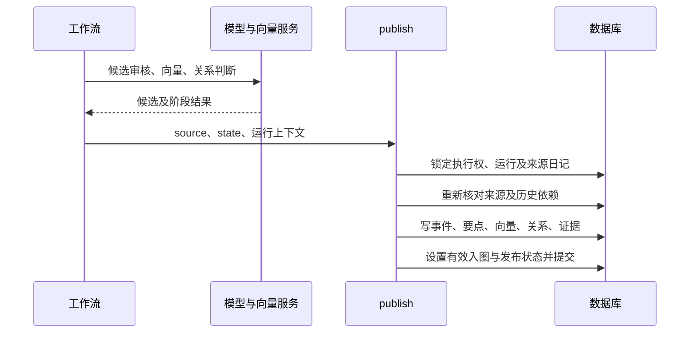

# 09-09 事件要点正式入库适配评估

## 1. 范围

- 目标：`backend/services/graph_publish.py::publish`，向上追踪任务、候选、向量与关系准备，向下核对正式模型及数据库结构。
- 分析等级：L3，聚焦已有 Markdown 要点如何进入正式发布流程。
- 静态证据：当前代码、050 迁移、第一层设计文档。本次另以只读事务补充核实实际数据库，不把静态代码推断当作运行结果。
- 没有创建任务、调用外部模型、生成向量或写入数据库。

## 2. 业务职责与入口定位

`publish` 将某一日图谱的事件、要点、向量、关系和证据在同一事务中正式保存，并设置运行发布状态。ANALYSIS 入口还发布后续分析结果；HISTORY 入口只发布图谱。

当前稿来自 `diary-event-points/2026-09-09/` 下本次独立运行。它是本地来源快照与内容产物，不是数据库 `graph_runs` 运行，也没有自动产生正式要点身份。

## 3. 主流程概述

1. `/api/graph/build` 接收日期范围，创建仅建图任务；允许已整理或已分析日记。
2. 工作流读取日记并冻结完整来源，只对有效重要性为 MEDIUM/HIGH 的事件处理要点。
3. 单事件生成候选、审核及必要修正；通过后分配要点 UUID。
4. 为完整 detail 生成向量，发现历史候选，判断当天及跨日事件关系。
5. 发布阶段重新校验来源、执行权及历史依赖，将正式结果一次提交。

## 4. 逐步逻辑拆解

### 4.1 来源与准入

**已验证：**数据库中目标日记为 organized，is_dirty 为 false，内容修订号与整理来源修订号一致。当前 8 个事件的 ID、标题、正文、感受、反思、重要性及顺序与本地 source.json 一致。第一事件为 LOW，其余 7 个为 MEDIUM；按正式规则可纳入 7 个事件、37 条要点。

### 4.2 本地候选与程序契约

**已验证：**将现有 Markdown 在内存中解析为 `title/points[{no,summary,detail}]` 后，全部 8 个事件通过现有 `validate_points`，未改写文字。准入详情最长 354 字符，没有超过本地配置的 8000 字符向量输入上限。

这只能证明字段与编号契约及本地字符预算满足要求，不能证明外部向量服务可用或语义绝对正确。此前对完整来源的内容审阅未发现阻止入库的实质遗漏或失真，属于本次内容评价，不等于正式模型审核记录。

### 4.3 当前接口不会导入此稿

**已验证：**`HistoryBuildRequest` 仅包含起止日期，额外字段禁止。`/api/graph/build` 设置 graph_only，改变来源准入和后续分析分支，并没有接受现成要点。

工作流在事件尚无 passed 候选时调用 `extract_event`；没有 candidate 时会调用 point_generate。因此，直接触发当前仅建图接口，会重新生成要点，不能据此宣称本地这份稿被正式采用。

`extract_event` 支持恢复 checkpoint 中既有 candidate，但该内部恢复机制不等于已经存在公开的本地稿导入入口。若接入本稿，应明确记录候选来源并进入真实审核流程，不能用手工填 passed 冒充已有核验。

### 4.4 正式保存前的准备

**已验证：**通过审核的 points 具有 UUID、event_id、run_id；向量以 point_id 关联。关系判断使用双方全部要点，A/B 一致或 C 裁决后形成 final_pair_results，设置 graph_checked。

`publish` 检查来源摘要仍匹配、准入事件全部具有 passed 和非空 points、序号连续、向量合法、事件对结果完整及证据序号有效。没有关系也需要完整事件对判断，不要求一定产生关系行。

## 5. 完整调用链

```text
POST /api/graph/build
  -> create_history(graph_only=True)
  -> graph_task_manager / execute_task
  -> snapshot_for_task / source_material
  -> extract_event
  -> embed_points
  -> discover / identify
  -> publish
     -> GraphRunEvent
     -> GraphEventPoint
     -> GraphEventRelation / GraphRelationEvidence
     -> run.status=PUBLISHED、DiaryEvent.is_in_graph=true
     -> commit
```

## 6. 对象与字段流转

| 对象或字段 | 来源 | 去向及转换 | 作用 |
|---|---|---|---|
| event_id | diary_events，已在本地快照保留 | graph_run_events、graph_event_points | 复用来源事件身份 |
| title、no、summary、detail | Markdown，需解析 | candidate，再进入 point_work.points | 保留当前内容与事件归属 |
| run_id、point_id | 正式任务及审核后分配 | 正式要点与关系证据 | 本地文件夹名不能替代这些 UUID |
| source_snapshot、source_sha256 | 正式 snapshot/source_material | graph_runs及发布一致性检查 | Skill 快照与正式快照字段不同，不能直接互换摘要 |
| embedding、embedding_model | 冻结向量配置和实际请求 | graph_event_points | 两者必填，不能仅插入文字 |
| source/target_point_nos | 关系判断 | 发布时解析为 point_id | 证据固定到实际事件与运行版本 |

## 7. 配置与结构影响

实际数据库只读核查结果：

- 七张图谱表均已存在，现有迁移检查器返回 migrated=true、structure_errors=[]；vector 可用。
- graph_event_points 的 id、run_id、event_id、user_id、no、summary、detail、embedding、embedding_model、created_at 均非空；embedding 为 VECTOR(1024)。
- 唯一键 `(run_id,event_id,no)`，要点通过复合外键归属 graph_run_events。关系证据通过 point_id 及运行、事件、用户复合外键归属。
- 本篇日记尚无 graph_runs，正式要点数为 0，事件有效入图数为 0；本次查询时该用户没有活动图谱任务。

早期完整数据库设计仍写着“尚未迁移”，与当前实现及实际结构不一致，本次以代码、迁移和只读核查为准。现有检查器通过不代表对数据库每一项约束表达式进行了独立穷尽审计。

## 8. 异常处理与边界条件

| 场景 | 当前行为 | 依据 |
|---|---|---|
| 没有审核通过的候选 | POINT_REVIEW_FAILED，禁止发布 | publish |
| 详情向量缺失或不合法 | 向量校验失败，禁止正式保存 | validate_vector / publish |
| 来源发生变化 | SOURCE_CHANGED | 发布前重建快照并比较摘要 |
| 历史端点过时或删除 | DEPENDENCY_OBSOLETE | publish |
| 事件对结果不完整 | PAIR_RESULTS_INCOMPLETE | publish |
| 低重要性事件 | 不进入正式事件及要点写入循环 | execute_task / publish |
| 已发布运行再次进入 | 返回已有运行 | publish 的代码分支；本次没有执行重入实验 |

## 9. 图示

主流程与分支：

```text
当前 Markdown -> [尚缺：现成候选接入] -> 正式候选审核
                                          |
                         未通过 -> 停止   | 通过
                                          v
                              分配要点ID -> 向量 -> 关系判断
                                          |
                                来源及完整性检查
                                  /            \
                                失败           通过
                                停止       事务发布正式结果
```

发布时序：



字段及状态：

```text
Markdown标题/序号/文字 -> candidate -> 审核后points+UUID
  -> vectors[point_id] -> graph_event_points -> graph_relation_evidence

运行：QUEUED -> RUNNING -> PUBLISHED
                     -> FAILED -> 恢复后QUEUED
已发布结果重新分析时：PUBLISHED -> OBSOLETE
```

## 10. 已验证结论

1. 本稿的文字和编号能够映射到正式要点内容字段；7 个准入事件共 37 条。
2. 当前数据库结构支持这种存储，目标日记仍与本稿来源一致，尚无正式图谱结果。
3. 当前稿尚不具备正式运行身份、审核记录、要点 UUID、向量和关系处理结果，不能作为完整正式图谱直接发布。
4. 现有公开入口不会采用这份本地稿，而会重新生成要点。

## 11. 推断性结论

以本稿为既有 candidate 接入现有审核及后续流程，能够复用大部分现有能力，预计不需要改变正式表结构。这是基于候选恢复机制、文本字段与发布契约的实现判断，尚未开发或运行验证。

## 12. 待确认项

- 问题：实际服务配置、额度与历史向量模型是否能支持本次运行。
- 当前证据：代码会冻结模型配置并校验历史向量版本；数据库结构检查通过。
- 未确认原因：本次只读核对，没有调用 freeze_config、外部模型或历史召回，没有创建任务。
- 下一步：在正式执行前核对当前模型用途、可用预算和历史向量版本；需要网络服务调用时按实际执行授权处理。
- 影响：这些运行条件可能导致任务失败，但不能因此判定本稿内容不合格。

## 13. 证据索引

| 类型 | 路径及定位 | 支撑内容 |
|---|---|---|
| code | backend/routers/graph.py:60，build_graph_only | 当前仅建图入口 |
| code | backend/schemas/graph.py:10，HistoryBuildRequest | 日期输入，无现成要点参数 |
| code | backend/services/graph_tasks.py:38、42、139 | 正式摘要材料、来源冻结和任务创建 |
| code | backend/services/graph_workflow.py:15 | 单日完整工作流 |
| code | backend/services/graph_points.py:39、106 | 结构契约、生成审核和UUID分配 |
| code | backend/services/graph_relations.py:19、29、102、248 | 向量、召回和关系完整性 |
| code | backend/services/graph_publish.py:13 | 发布检查、正式写入和提交 |
| code | backend/models/graph.py:143、157 | 正式事件、要点字段与外键 |
| sql | backend/migrations/050_event_graph.sql:215 | 正式要点表DDL |
| runtime-readonly | 本次数据库只读事务 | 实际结构、来源一致性、目标日记尚未建图 |

## 14. 建议的下一步核查

若目标是正式使用当前稿，应增加或实现受控的既有候选接入，完成来源比对、结构检查、真实审核、身份分配、向量与关系处理，再复用发布事务。不能仅调用现有日期建图接口，就将新生成的结果当成本稿入库。

本次判断：**内容可以作为正式候选；当前产物尚未满足直接正式入库条件。缺口主要在接入和执行状态，不在继续润色文字。**
